# NauticPinnace

A DIY **NMEA 2000 instrument display** for sailing yachts, running on three
**Waveshare ESP32-S3** touch boards: the 4-inch (480 × 480) and the two
1024 × 600 panels, 7-inch and 5-inch (see [Hardware](#hardware)).
It sits on the bus like a commercial multifunction instrument: wind, speed,
depth, engine, AIS, autopilot, batteries, tanks, weather, anchor watch and
more — 17 instrument screens plus up to 6 user-defined data grids, in
English and German, with dark, light and red-preserving night themes.

**About the name:** a *pinnace* is a ship's tender — the small boat that
belongs to a bigger ship and does the visible work alongside it. This project
is the tender to [**NauticPi**](https://github.com/Ranman86/NauticPi), the
author's Raspberry-Pi boat computer, and carries its mothership right in the
name: Nautic**Pi**nnace. Both run independently; together they make a
bus-powered instrument network without a single chartplotter involved.
(Pronounced "PINN-iss", if you want to sound salty.)

It requires an NMEA 2000 backbone (Raymarine SeaTalk-ng works with an adapter
cable — it is NMEA 2000 with proprietary connectors). There is no NMEA 0183
or classic SeaTalk input.

What changed between releases is in [CHANGELOG.md](CHANGELOG.md). The version
a device is actually running is on its boot screen, under **Update** in the web
interface, and in the device list of any chartplotter on the bus.

<p align="center">
  <picture>
    <source media="(prefers-color-scheme: light)" srcset="docs/img/wind_light.png">
    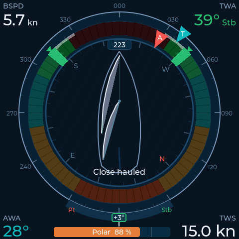
  </picture>
  <br>
  <em>All screenshots in this README come from the PC simulator, which renders
  the same UI code as the device.</em>
</p>

> **⚠️ Please read before connecting this to a boat**
>
> This is a hobby project. It is **not NMEA-certified**, sold, or supported as
> a product — you build it, you are responsible for it. Connecting a
> self-built device to an NMEA 2000 backbone may have warranty implications
> for the certified equipment installed on that network. For exactly this
> case the firmware has a **listen-only mode**: it sends no messages (not
> even an address claim) and opens the CAN controller in hardware listen-only
> mode, so it doesn't even drive ACK bits — electrically passive. Listen-only
> is **off by default**: power the display from USB-C first and enable it in
> the settings before connecting the drop cable, if that's what you want.
> And obviously: this display is an aid, **not a navigation device** — never
> rely on it as your primary source for depth, position or collision
> avoidance.

---

## Screens

| | | |
|:---:|:---:|:---:|
| <picture><source media="(prefers-color-scheme: dark)" srcset="docs/img/wind_dark.png">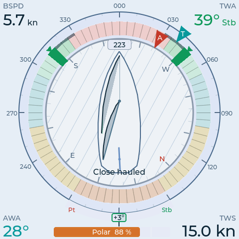</picture> | <picture><source media="(prefers-color-scheme: dark)" srcset="docs/img/speed_dark.png">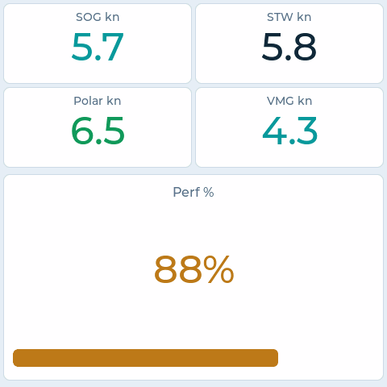</picture> | <picture><source media="(prefers-color-scheme: dark)" srcset="docs/img/vmg_dark.png">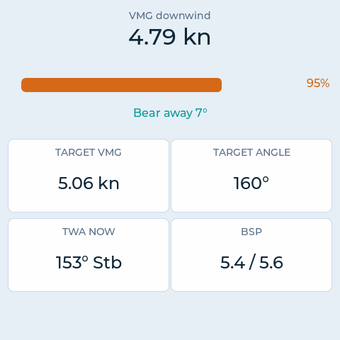</picture> |
| **Wind &amp; Trim**<br>sail zones, hull with trimmed sails, polar target, trim advice | **Speed**<br>SOG and STW against the polar target, performance bar | **VMG**<br>live vs. best achievable, optimal TWA, steer higher/lower |
| <picture><source media="(prefers-color-scheme: dark)" srcset="docs/img/depth_dark.png">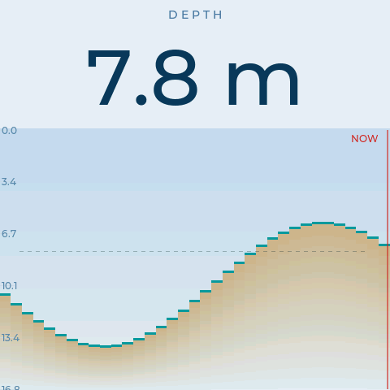</picture> | <picture><source media="(prefers-color-scheme: dark)" srcset="docs/img/windplot_dark.png">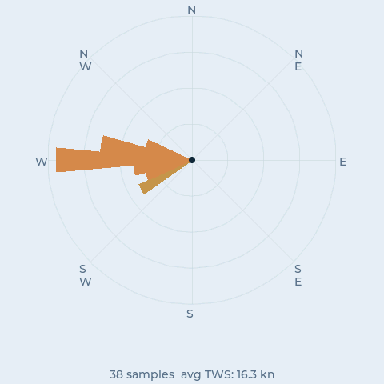</picture> | <picture><source media="(prefers-color-scheme: dark)" srcset="docs/img/route_dark.png">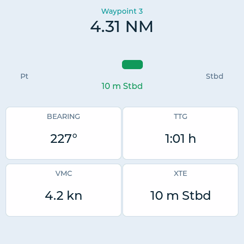</picture> |
| **Depth**<br>96 px digits over a scrolling echo history, shallow alarm | **Wind plot**<br>TWD/TWS history as a polar rose with statistics | **Route**<br>distance and bearing to the waypoint, XTE bar, time to go |
| <picture><source media="(prefers-color-scheme: dark)" srcset="docs/img/ais_dark.png">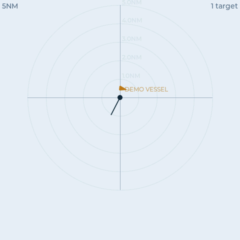</picture> | <picture><source media="(prefers-color-scheme: dark)" srcset="docs/img/anchor_dark.png">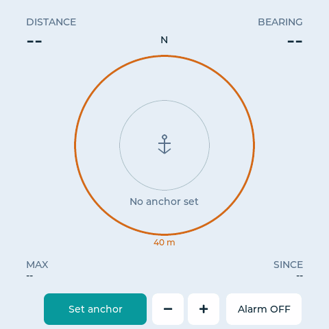</picture> | <picture><source media="(prefers-color-scheme: dark)" srcset="docs/img/attitude_dark.png">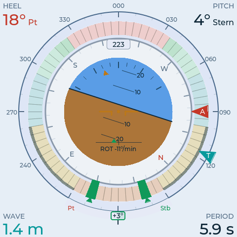</picture> |
| **AIS radar**<br>target plot, tap a target for details, CPA/TCPA colouring | **Anchor watch**<br>swing circle, drift track, radius alarm on any screen | **Attitude**<br>artificial horizon, rate of turn, wave height and period |
| <picture><source media="(prefers-color-scheme: dark)" srcset="docs/img/engine_dark.png">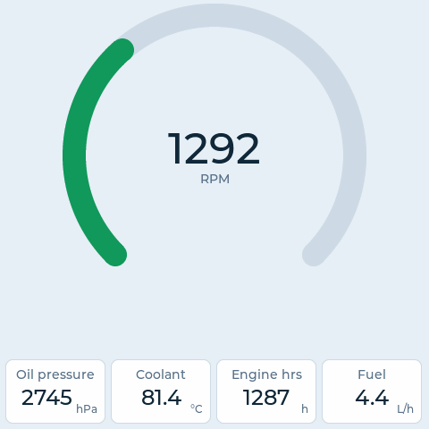</picture> | <picture><source media="(prefers-color-scheme: dark)" srcset="docs/img/tanks_dark.png">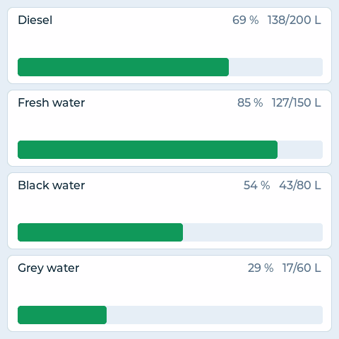</picture> | <picture><source media="(prefers-color-scheme: dark)" srcset="docs/img/battery_dark.png">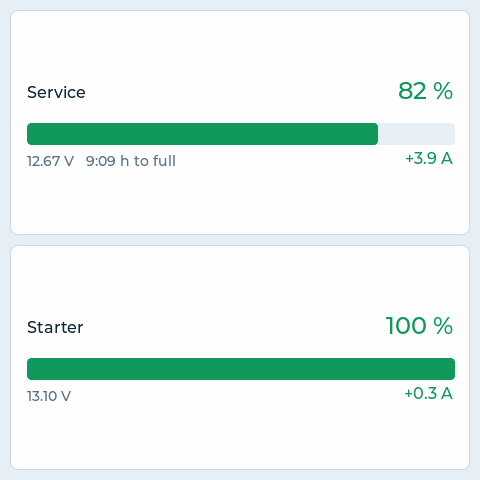</picture> |
| **Engine**<br>RPM arc plus 1-6 freely assignable value cards | **Tanks**<br>one bar per fluid tank on the bus, calibrated per tank | **Batteries**<br>state of charge, voltage, current, time remaining per bank |
| <picture><source media="(prefers-color-scheme: dark)" srcset="docs/img/autopilot_dark.png">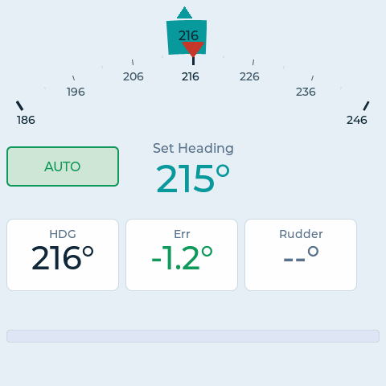</picture> | <picture><source media="(prefers-color-scheme: dark)" srcset="docs/img/rudder_dark.png">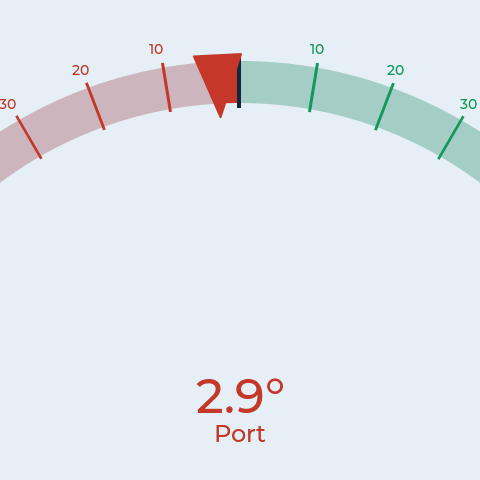</picture> | <picture><source media="(prefers-color-scheme: dark)" srcset="docs/img/weather_dark.png">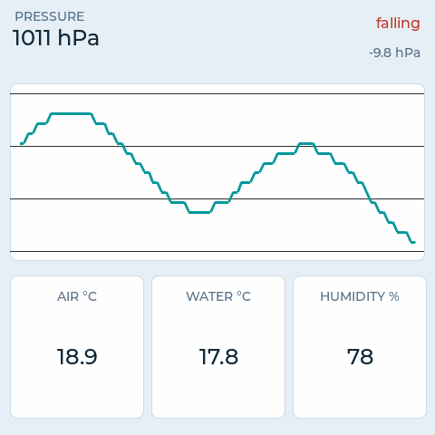</picture> |
| **Autopilot**<br>pilot mode and setpoint from the bus, deviation and rudder | **Rudder**<br>rudder angle band with value and direction | **Weather**<br>barometer with 3 h trend, air and water temperature |
| <picture><source media="(prefers-color-scheme: dark)" srcset="docs/img/clock_dark.png">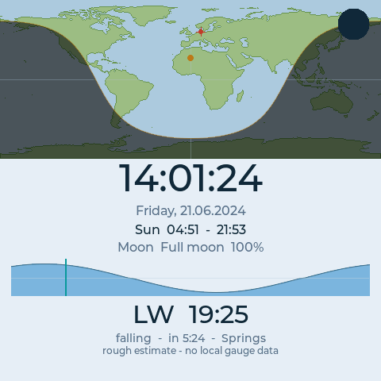</picture> | <picture><source media="(prefers-color-scheme: dark)" srcset="docs/img/media_dark.png">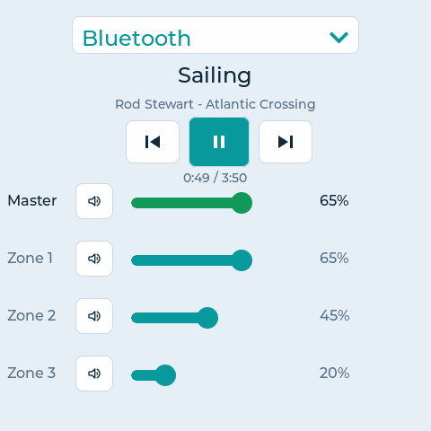</picture> | <picture><source media="(prefers-color-scheme: dark)" srcset="docs/img/grid_dark.png">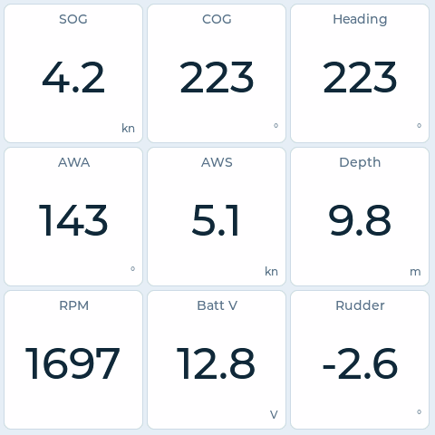</picture> |
| **Clock**<br>world map with day/night terminator, sun, moon, tide curve | **Media**<br>stereo remote (NMEA 2000, manufacturer code 419): source, now playing, transport, master and zone volumes | **Data grid**<br>your own layout, any bus value per cell, up to 6 of them |

That is all 17 fixed screens, plus one **data grid** in the last cell. Every
shot exists in light and dark and follows your GitHub theme, so what you see
above is what the display looks like in your preferred one.

You can add up to **6 data grids** of your own: free layouts up to 3 × 3
cells (plus "hero" layouts with one big value on top), each cell mapped to
any data point on the bus.

Screen **order and visibility are configurable**; navigation is by touch
swipe or on-screen arrows.

### Themes

| Light | Dark | Night |
|:---:|:---:|:---:|
|  | 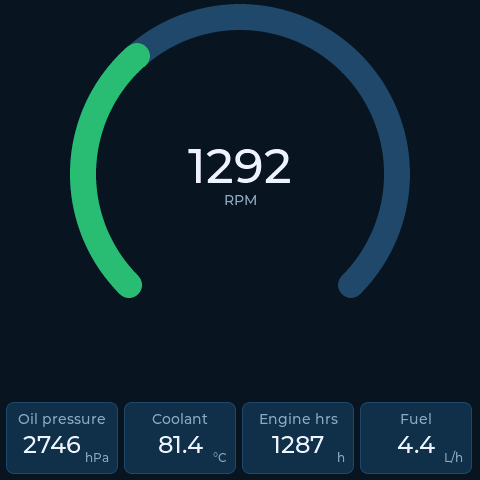 | 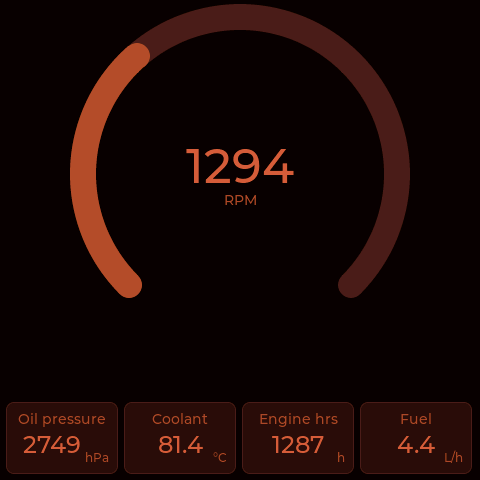 |

Night mode keeps everything on the red channel so it doesn't wreck your dark
adaptation on a night watch:

| | | | | |
|:---:|:---:|:---:|:---:|:---:|
| 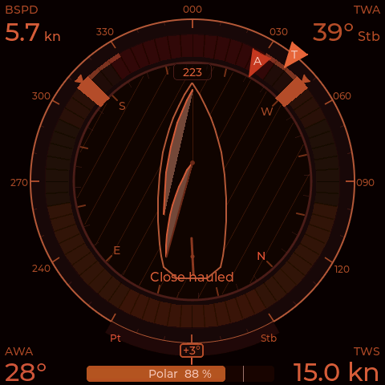 | 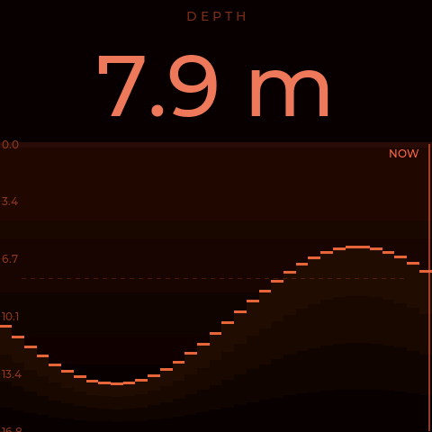 | 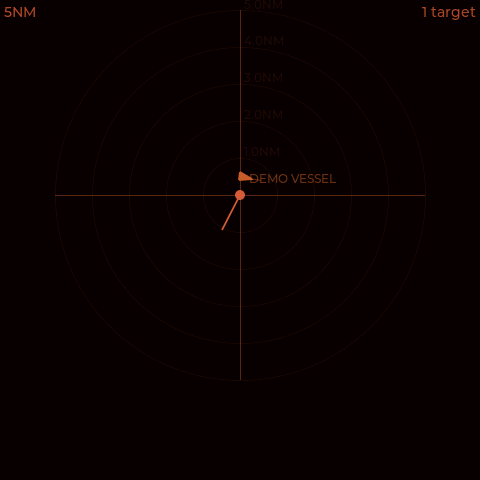 | 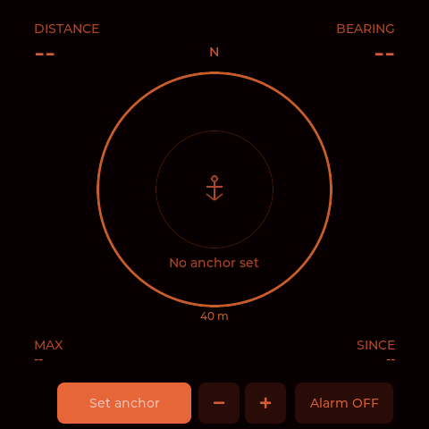 | 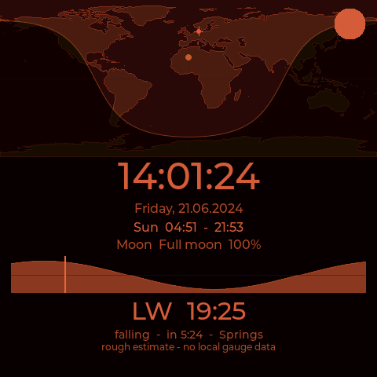 |

Dark (default), light, and night are switchable on the display; an optional
auto mode switches between light (day) and dark (night) by sun position
(needs GPS + time from the bus) — the night theme is selected manually. Every colour, size and font role of the dark and light themes is
editable in the web UI and applies live; the night palette can be customised
via config JSON import.

### On the 1024 × 600 boards

The screenshots above are the 4-inch board's 480 × 480 square. The 7-inch and
5-inch panels are not that picture stretched: the instrument keeps a 600 × 600
square of its own and the extra width becomes permanent furniture — a
navigation rail on the left, and a sidebar of up to eight freely configured
value cells on the right, so the numbers you always want are never a swipe
away.

<p align="center">
  <picture>
    <source media="(prefers-color-scheme: dark)" srcset="docs/img/hires/wind_trim_dark_landscape.png">
    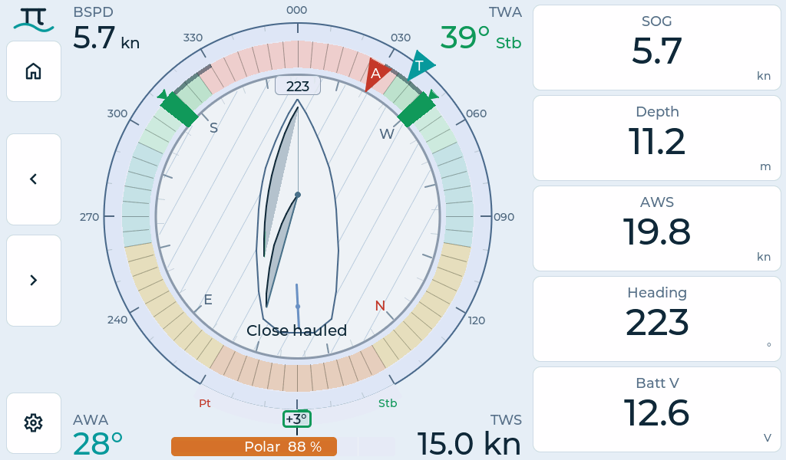
  </picture>
  <br>
  <em><strong>Wind &amp; Trim</strong> on 1024 × 600 — rail, instrument, sidebar.</em>
</p>

The rail's home button opens a launcher showing every active screen as a
labelled tile, so you can jump straight to one instead of swiping through the
carousel.

<p align="center">
  <picture>
    <source media="(prefers-color-scheme: dark)" srcset="docs/img/hires/home_dark_landscape.png">
    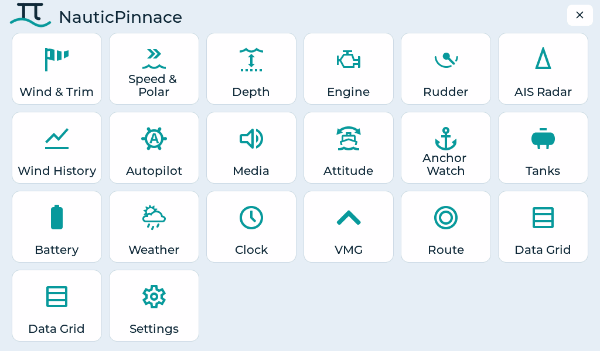
  </picture>
  <br>
  <em><strong>Home launcher</strong> — one tile per active screen, plus settings.</em>
</p>

Mounted upright, the rail moves to the top and the sidebar becomes a band
along the bottom; the instrument keeps its square either way. The full set —
every screen, all three themes, both orientations — is in
[`docs/img/hires/`](docs/img/hires/), and `tools\gen_docs_shots.ps1`
regenerates it.

---

## Hardware

The firmware runs on **three Waveshare ESP32-S3 boards**. All of them carry
16 MB flash and 8 MB PSRAM; what differs is the panel and how the console and
the CAN bus are wired.

| | 4-inch | 7B | 5B |
|---|---|---|---|
| Board | [ESP32-S3-Touch-LCD-4](https://www.waveshare.com/wiki/ESP32-S3-Touch-LCD-4) **Rev 4** | [ESP32-S3-Touch-LCD-7B](https://www.waveshare.com/esp32-s3-touch-lcd-7b.htm) | [ESP32-S3-Touch-LCD-5B](https://www.waveshare.com/esp32-s3-touch-lcd-5.htm) |
| Display | ST7701S, 480 × 480 | ST7262, 1024 × 600, 7", ~170 ppi | ST7262, 1024 × 600, 5", ~240 ppi |
| Touch | GT911 (auto-probes 0x5D and 0x14) | GT911 @ 0x5D | GT911 @ 0x5D |
| CAN | GPIO 6/0 | GPIO 20/19, behind a USB/CAN mux | GPIO 15/16, no mux |
| Console | native USB CDC | CH343 bridge, **UART DIP switch must be on UART1** | native USB CDC |
| Extras | — | — | RTC (PCF85063A, coin cell), SD card, RS485, 2× isolated DI/DO, 7–36 V input |
| PlatformIO env | `waveshare_esp32s3_4` | `waveshare_esp32s3_7b` | `waveshare_esp32s3_5b` |

Both 1024 × 600 boards share the same user interface — a nav rail on the left,
the instrument in a 600 × 600 centre column and a configurable data sidebar on
the right. That layout is selected by the `BOARD_PANEL_1024X600` build flag,
not by the board identity, so the two boards share every line of UI code; only
the pin headers (`src/BoardConfig_*.h`) differ. At 5 inches the same pixels are
about 30 % smaller in millimetres than at 7 inches — the nav rail measures
9.3 mm instead of 13 mm.

**On the 4-inch board, check the revision before buying.** Waveshare has
shipped several hardware revisions under the same product name. This firmware
targets **Rev 4** (GT911 touch controller, CAN on GPIO 6/0). Earlier revisions
use a different touch controller and different CAN pins and will not work
without adaptation — if in doubt, ask the seller which revision they ship.

### Wiring

No extra CAN transceiver is needed — the drop cable lands directly on the
screw terminal. Standard NMEA 2000 cable colours:

| Drop cable | Screw terminal |
|---|---|
| White (CAN-H) | `CANH` |
| Blue (CAN-L) | `CANL` |
| Red (+12 V) | `VIN` |
| Black (GND) | `GND` |

Before powering from the bus, check the accepted input-voltage range for the
`VIN` terminal in the [Waveshare wiki](https://www.waveshare.com/wiki/ESP32-S3-Touch-LCD-4)
against your bus supply, and fuse the drop as usual. Per Waveshare's
documentation the board carries an **onboard 120 Ω termination resistor** —
an NMEA 2000 backbone must have exactly two terminators, so account for it
in your bus layout.

The firmware's CAN pins (TX = GPIO 6, RX = GPIO 0) are routed on the board to
the onboard transceiver — nothing for you to wire; the pin setting in the web
UI exists only for modified or future board revisions.

**Worth knowing:**

- **GPIO 0 is both CAN RX and the ESP32-S3 boot-strapping pin.** A CAN
  transceiver idles recessive (high), so normal boots are fine — but if a
  boot ever fails with the bus attached, detach it briefly. GPIO 0 also can't
  serve as a button anymore: bus traffic on the pin would register as a
  stream of button presses, so navigation is touch-only.

---

## Building and flashing

**Just want it on a board?** You do not need any of this — the
[browser flasher](https://ranman86.github.io/NauticPinnace/flash.html) writes a
prebuilt image over USB, no toolchain involved.

### What you need to build it

| | Why |
|---|---|
| [PlatformIO](https://platformio.org/) | Builds everything. VS Code extension (brings its own Python) or the CLI installer. |
| [Git](https://git-scm.com/downloads) | **Not optional.** Several libraries are pinned to specific commits and fetched with git, and the 7-inch/5-inch platform refuses to load without it. Only the PC simulator builds without git. |
| ~4 GB free (4-inch) / ~8 GB (7B, 5B) | The first build downloads complete toolchains. The 4-inch keeps a second, private copy on purpose — see the note in `platformio.ini`. |

`deploy.bat` checks all of this before it compiles and tells you what is
missing, so you can also just run it and follow what it says.

Two things bite specifically on a **freshly set up Windows**, and neither is
your fault:

- **A space in your Windows user name.** The 7-inch and 5-inch builds recompile
  the Arduino IDF layer, and that step refuses any space in its paths — which
  includes `C:\Users\Hans Meier\.platformio\packages\…`. `deploy.bat` detects
  this and redirects to `C:\pio` for the run. To fix it once and for all,
  create `C:\.platformio` *before* installing PlatformIO: it prefers a
  drive-root directory over your home folder.
- **Windows path length.** The 7-inch and 5-inch pull in an Arduino package
  that carries the whole Matter/connectedhomeip tree; its longest file needs
  232 characters of room, and unpacking it under
  `C:\Users\<you>\.platformio\.cache\…` overruns the 260-character limit.
  It fails as `FileNotFoundError: No such file or directory` naming a file
  PlatformIO was trying to *create* — which looks like anything except a path
  length problem. `deploy.bat` recognises it and redirects to `C:\pio` for the
  run. The permanent fix, once, in an **admin** PowerShell followed by a
  reboot:
  ```powershell
  New-ItemProperty 'HKLM:\SYSTEM\CurrentControlSet\Control\FileSystem' -Name LongPathsEnabled -Value 1 -PropertyType DWORD -Force
  ```
- **The 7-inch needs a driver.** It talks through a CH343 bridge; without the
  [WCH driver](https://www.wch-ic.com/downloads/CH343SER_EXE.html) Windows
  gives it no COM port at all and it simply will not appear in the port list.
  The 4-inch and the 5-inch use the ESP32-S3's own USB and need nothing.

### Building

Connect the board via USB-C — no boot-button dance needed. The default
environment is the 4-inch board; pick another with `-e`, or let `deploy.bat`
ask you.

```bash
pio run -t deploy
```

`deploy` is a custom target that uploads the LittleFS image (web UI, factory
config, polar) and then the firmware — **as two separate steps, in the right
order**. (Don't combine `-t uploadfs -t upload` in one invocation; PlatformIO
resolves both to the filesystem image and silently skips the firmware.)

Day-to-day, firmware only:

```bash
pio run -t upload
```

> **Note:** `uploadfs` rewrites the whole LittleFS partition from `data/`,
> which resets the on-device configuration to factory state — WiFi
> credentials cleared, English, demo mode off, and the first-run flow (below)
> appears again. Export your config first (web UI → Import/Export) if you
> want to restore it afterwards.

On Windows there is also `build_deploy.ps1` (interactive menu or
`-FullDeploy`, `-FsOnly`, `-Build`, `-Simulator`, `-Monitor`, `-Clean`); it
can auto-download SDL2 and copies the simulator's runtime DLLs next to the
exe from an existing MinGW/MSYS2 install.

**7-inch and 5-inch:** these two compile the Arduino IDF layer themselves,
with the settings listed under `custom_sdkconfig` in `platformio.ini` - an
IRAM-safe panel interrupt and code running from PSRAM for a steady picture,
trimmed WiFi buffers, TLS in PSRAM with software AES for the tide download.
The first build, and the first one after that list changes, therefore takes
far longer than the ones after it. A build notices a changed list through a
hash that pioarduino writes into the first line of `sdkconfig.defaults` -
but every PlatformIO core building this project shares that file, so only
the core that builds first after the change rebuilds its libraries; any
other core takes the new hash for its own and keeps the old ones. The
release scripts build the 7-inch and 5-inch in a core of their own
(`tools/gen_web_flasher.py`): before they build, they compare that core's
libraries with the list and stop with the remedy when they differ, and
`tools/release_checks.py` refuses a 7-inch or 5-inch firmware that still
has hardware AES.

**First boot:** the display starts in English, asks for your language, shows
the licence screen, and generates its WiFi hotspot password.

### Flashing without PlatformIO

You don't need a toolchain just to try the firmware:

- **Browser (easiest):** open the
  [web flasher](https://ranman86.github.io/NauticPinnace/flash.html) in
  Chrome or Edge, plug the display in via USB-C, click the button for your
  board. All three are offered. Uses WebSerial via
  [ESP Web Tools](https://esphome.github.io/esp-web-tools/) 10.5.2, which the
  page loads from the unpkg.com CDN.
  **Pick the right board:** all three are ESP32-S3 and indistinguishable over
  USB, so the browser cannot choose for you, and the wrong firmware leaves the
  screen dark until you flash the right one.
- **Release package (all three boards):** grab the ZIP from the
  [Releases](https://github.com/Ranman86/NauticPinnace/releases) page. It
  holds one folder per board — `4/`, `7b/`, `5b/` — and flash scripts that
  ask which board is connected; as in the browser, the wrong choice leaves
  the screen dark. On Windows, double-click `flash.bat`: it uses Espressif's
  standalone `esptool.exe` 4.8.1, which you download once from
  [Espressif's release](https://github.com/espressif/esptool/releases/tag/v4.8.1)
  (`esptool-v4.8.1-win64.zip`) and put next to it — the script checks its
  SHA-256 before using it; on Linux/macOS,
  `pip install "esptool>=4.8,<6"` and run `sh flash.sh`. Both also take the board and
  the port as arguments: `.\flash.bat 7b COM5`, `sh flash.sh 7b /dev/ttyACM0`.
  Details — including the 7-inch's USB driver and a fallback for the
  5-inch — in the included `FLASHING.md`.

The script paths **erase the entire 16 MB flash first**, then write bootloader,
firmware and web UI — so the device really starts from a factory state rather
than new firmware layered on old leftovers (the erase also clears the NVS area
the ESP-IDF uses for WiFi calibration and cached credentials). The whole run
takes about a minute. The browser flasher offers the erase as a prompt on
first install instead of always doing it.

To update while keeping your configuration, use the web interface's
**Update** tab (firmware, and the web interface as `index.html.gz`), an
[update over NMEA 2000](#updates-over-nmea-2000), or the firmware-only USB
command in the release package's `FLASHING.md` — it writes the partition
table and `boot_app0.bin` along with the firmware, because a board updated
over WiFi may be running from its second app slot and would otherwise keep
starting the old firmware.

A board still running 1.1.0 or 1.2.0 needs one extra round, once: install
the firmware there - its page says "Update failed" about a minute later
although it worked, because these versions restart before their answer
leaves, so leave the power on. Once "Checking update" has gone from the
display (about three minutes), reload the page and check that the **Update**
tab says v1.3.0; only then install `index.html.gz` in the old **Install
filesystem** field (on 1.1.0 or 1.2.0 that field would overwrite the whole
file system). Ignore the old page's hints that the filesystem goes first and
that the settings get overwritten: settings, polar table and boot logo stay.
`FLASHING.md` in the release package has the steps; v1.0.0 has no update
over WiFi at all.

From 1.3.0 on, if the phone or laptop drops out of WiFi in the middle of an
upload, simply start it again: once the broken upload has sent nothing for
10 s, the new one takes over; until then the Update tab says how many seconds
to wait, without sending the file.

A firmware installed over WiFi or NMEA 2000 has to prove itself after its
first restart: if it does not start cleanly, hangs, stops drawing or stops
reading the bus, it is not confirmed and the display returns to the previous
firmware by itself within about three minutes (five, if the whole chip
freezes) - and, if that one is 1.3.0 or later, says so on screen. Three
crashes in a row within its first 30 minutes of use do the same. From 1.3.0
on, a firmware for a different board is refused before it is ever started;
a board still running 1.1.0 or 1.2.0 does not check, and neither does USB.

<details>
<summary>Maintainer notes</summary>

A release is two separate runs, after `FW_VERSION` in `src/Version.h` has
been set to the release version:

1. `python tools/make_release.py --version vX.Y.Z` builds **all three
   boards**, one after the other, and assembles
   `release/NauticPinnace-vX.Y.Z/` and its ZIP: a folder per board (`4/`,
   `7b/`, `5b/`, each with the five images, the merged
   `nauticpinnace-full.bin`, a `manifest.json` and `index.html.gz`) and,
   once at the top,
   `flash.bat` (which runs the user's own download of Espressif's
   `esptool.exe` and checks its SHA-256 first — the package does not bundle
   it), `flash.sh`, `FLASHING.md` and the licences. It also fetches the source
   archives of the LGPL libraries into
   `release/NauticPinnace-vX.Y.Z-sources/`. It does **not** touch
   `docs/flash/`.
2. `python tools/gen_web_flasher.py --skip-build` regenerates the web
   flasher payload in `docs/flash/` (images, one manifest per board, and the
   licence copies that travel with them) from the same build output — both
   scripts build every board into the same directories, so building twice
   gains nothing. Commit it with `git add -A docs/flash`, so removed files are
   recorded too.

Both release scripts run `tools/release_checks.py` over their inputs before
they write anything — the build machine's account name or home path inside an
image, an image older than the sources, a firmware without the expected
version, a LittleFS image that differs from `data/`, files or WiFi credentials
in `data/` that do not belong there — and stop if any of them fails, leaving
the previous output untouched. `--skip-build` is accepted only when the
existing build output passes. `python tools/release_checks.py <file or
directory>` runs the same checks report-only.

To try the package's `flash.bat` or `flash.sh` without touching a board, set
`NP_FLASH_DRYRUN=1`: they then print the esptool commands instead of running
them (and `flash.bat` does not pause). `flash.bat` checks its `esptool.exe`
before anything else, so even a dry run needs Espressif's genuine file next to
it.

Release assets on GitHub (the scripts upload nothing; `make_release.py` ends
with this list): `NauticPinnace-vX.Y.Z.zip` (all three boards) plus the seven
LGPL source archives `src-framework-arduinoespressif32-3.20017.241212.zip`
(packed from the installed PlatformIO package, which is the 2.0.17 tag plus
PlatformIO's backports), `src-arduino-esp32-2.0.17.zip` (that tag, for
reference), `src-AsyncTCP-ef448a8.zip`,
`src-ESPAsyncWebServer-ad3741d.zip` (linked by the 4-inch),
`src-arduino-esp32-3.3.11.zip`, `src-AsyncTCP-3.5.0.zip` and
`src-ESPAsyncWebServer-3.12.0.zip` (linked by the 7-inch and 5-inch).

The web flasher needs GitHub Pages enabled: *Settings → Pages → Source:
deploy from branch `main`, folder `/docs`*. Until then the link above 404s.

Flash layout (from `partitions_16MB.csv`): bootloader `0x0`, partition table
`0x8000`, boot_app0 `0xe000`, firmware `0x10000`, LittleFS `0xA10000`.
</details>

**No boat? Try it anyway.** The factory config ships with **demo mode off**,
so out of the box the display shows live bus data — and on a bare board, empty
values and, after 10 seconds, the "no data from the bus" strip (see
[No data from the bus](#no-data-from-the-bus)). Switch it on in the web UI under **Display → Demo mode** (see
[Connecting to the web UI](#connecting-to-the-web-ui)): all screens then run on
animated synthetic data, marked by a demo banner, until you turn it off again —
so a bare board on a desk shows the full instrument set. Or skip the hardware
entirely and use the PC simulator.

### PC simulator

The full UI runs on a PC — same screens, same config code, demo data:

```bash
pio run -e simulator
.pio/build/simulator/program.exe
```

On Windows it needs SDL2 (`C:/SDL2` by default; paths adjustable in
`platformio.ini`) plus `SDL2.dll` and three MinGW runtime DLLs next to the
exe (`build_deploy.ps1 -Simulator` sets all of this up). On Linux, install
`libsdl2-dev` and adjust the paths — the simulator is developed and tested on
Windows. Useful flags: `--screen N`, `--light/--dark/--night`, `--de/--en`,
`--firstrun` (first-boot flow), `--nodemo` (empty data model, so the "no
data from the bus" strip comes up after 10 s), `--demo-stop S` (demo data for
S seconds, then none: the values go blank one by one and the strip comes
up, as on a bus that goes quiet), `--selftest`
(automated first-run regression test), `--cfg <path>`, `--n2kupdate-demo`
(plays an update over NMEA 2000 on screen: dialog - hold "Install" with the
mouse -, progress banner, restart countdown and the notices; with
`--shots DIR` it saves each of them as `upd_*.bmp` instead),
`--n2kupdate-selftest` (checks the dialog's press-and-hold rules with
injected touches; exit code 0 = pass), `--ap-frames` (checks every
decoding rule on single frames first, then plays synthetic autopilot
example frames, built from the protocol description and not a bus
recording - address claim, every mode, reports that must show ACTIVE,
frames that must be ignored, a second pilot computer, a display restart,
staleness - through the real decoder onto the Autopilot screen;
exit code = failed steps; with `--shots DIR` it saves each step as
`ap_*.bmp`).

---

## Configuration

There are two ways in, and they are not equivalent.

**On the display** — tap the gear button: WiFi on/off, network credentials,
hotspot mode with QR codes for joining the hotspot and opening the web UI,
theme, NMEA 2000 listen-only switch, licences. That
is deliberately just enough to get the device onto a network and to change the
look. Anything longer means typing it on the on-screen keyboard.

**In a browser — the recommended way to configure the display.** Everything
about the screens lives here and nowhere else: which screens exist and in what
order, the data-grid editor, screen orientation, brightness, every colour and
font size, sensor calibration, the polar table, and config backup/restore. A
1024 × 600 panel is fine for flipping a single switch with a finger; for
setting the thing up you want a real keyboard, a colour picker and the whole
configuration on one page.

### Connecting to the web UI

WiFi is **off by default** — on a boat without shore WiFi it would only cost
boot time — so the first step is always to switch it on: gear button on the
display, WiFi toggle. From there you have two options.

**Option A — the display's own hotspot.** Works anywhere, including well
offshore, and needs nothing else on board. The display opens a WPA2 access
point:

- SSID is `NauticPinnace` followed by six hex digits of its MAC, e.g.
  `NauticPinnace1A2B3C`
- The password is **random per device** and shown only on the display — on the
  settings screen, and as a QR code you can scan with a phone to join without
  typing it
- Once your phone or laptop has joined, open **`http://192.168.4.1`** — or
  scan the second QR code (7B/5B: next to or below the first; 4": tap the QR
  code to switch it to the address)
- If the phone warns that the hotspot has no internet, tell it to stay
  connected: the display runs no captive portal, so no login page pops up by
  itself

**Option B — join an existing WiFi network.** Convenient at the dock, or with a
router on board: the display stays reachable while your phone keeps its normal
internet connection.

- Either enter SSID and password on the display, or — less fiddly — join the
  hotspot first and set it in the web UI under **WiFi**: mode *Client*, SSID,
  password, *Save & restart*
- After the restart the display's settings screen shows the address it was
  given, as text (e.g. `Connected: http://192.168.x.y`) and as a QR code.
  Open that in a browser on the same network
- There is no `.local` name — the firmware runs no mDNS responder, so use the
  IP. If you want it to stay the same, give the display a fixed lease in your
  router

The two modes are exclusive: in client mode the hotspot is off, and vice versa.
Which one you use is mostly a question of where you are — the web UI is
identical either way. One thing does tip the balance: the HTTP API has no
authentication, so on a shared network anyone who can reach the display can
read and change its whole configuration. That is why the web UI labels
*Access Point* as the recommended mode, and why joining an existing network is
worth doing only on one you trust. See [Security](#security) below.

**You cannot lock yourself out.** If the configured network is not in range or
the password is wrong, the firmware retries three times (about 18 seconds) and
then falls back to its own hotspot. A typo costs you one boot, not a serial
cable.

**WiFi country.** *Default* leaves each display exactly as it was. Pick your
country under **WiFi** and the display scans that country's channels
actively — 1–13 in Europe, so a hidden network on channel 12 or 13 is found
too — and its hotspot announces that country. Change it when you sail to
another country. A rollback to an older firmware resets it to *Default*.

The web UI has these tabs:

- **Live** — 16 key bus values at a glance (polled once per second), with
  the same "no data from the bus" warning as the panel; when the display
  stops answering, the values go to `--` and the badge says offline instead
  of the last values staying up
- **WiFi** — client/hotspot mode, credentials, country (which WiFi channels
  the display scans actively, and which country its hotspot announces)
- **Display** — brightness, screen orientation (0° / 90° / 180° / 270°, so the
  panel can be mounted on its side or upside down — the device restarts to
  apply it), screen order & visibility, per-screen settings, data-grid editor,
  demo mode
- **Appearance** — dark/light theme colours, font sizes and dimensions, applies
  live
- **NMEA 2000** — listen-only mode, CAN pins (for modified boards)
- **Devices** — sensor calibration (depth transducer offset, wind-vane
  rotation, AWS/STW factors, compass offset, roll/pitch/rudder zero points
  with rudder direction invert, water-temp and pressure offsets — applied
  once at reception, so every screen shows calibrated values), the four
  wind damping settings (apparent and true wind, each speed and direction,
  see [Wind](#wind-apparent-in-true-wind-computed)), and N2K
  source selection: when several bus devices send the same data (two GPS,
  two compasses …), pin the authoritative sender per category from the
  list of seen source addresses
- **Polar** — polar table editor with CSV import/export (target speeds drive
  the performance bar, VMG optimisation and trim advice). The firmware ships
  with a generic example polar — get one for your actual boat, e.g. from ORC
  speed guides or from your boat's manufacturer, and import it here
- **Boot logo** — title line (defaults to "NauticPinnace"), optional boat name
  underneath, and an upload slot for your own logo. The upload takes a
  pre-converted raw RGB565 `.bin`, not a PNG — `tools/logo_convert.py` does the
  conversion. Without one, a built-in vector mark is drawn.
- **Import/Export** — full config backup/restore as JSON, restart (a tank or
  battery bank listed twice in a file edited by hand is merged into one
  entry: the first wins, the other fills in what it left empty)

Every instrument screen works without WiFi — but two things use it: without
a GPS time on the bus, the clock can only set itself from the internet (NTP;
no RTC battery on this board), and the official high and low water times come
from the BSH online forecast. With the radio off, the clock waits for a time
from the bus, and the tide page uses a tide station on the bus or its own
astronomical estimate.

### Security

- The hotspot password is **random per device** (12 characters, ~68 bit),
  generated on first boot from the hardware RNG mixed with an entropy pool
  fed by your touches during initial setup. It is shown only on the display
  (settings + QR code) and never printed to the serial log. It is *not*
  derived from the MAC address — a scheme like that would be computable by
  anyone in radio range, since the AP beacon broadcasts the MAC.
- The HTTP API has **no authentication**, and the config endpoints
  (`/api/config`, `/api/export`) return the stored WiFi credentials —
  including the hotspot password. **Anyone who can reach the display's IP can
  read and change everything.** The WPA2 hotspot password is the security
  boundary. If you join the display to an existing network instead, make
  sure it is one you trust.
- The same goes for the **Update** tab: whoever is in that network can
  install firmware without touching the display. A firmware for another
  board is refused, and one that does not run properly rolls itself back.
  An update over NMEA 2000, by contrast, always has to be confirmed on the
  display's touchscreen.
- **What the display sends to the internet** (only when it is joined to a
  network with internet access; its own hotspot never is):
  - *Clock*: NTP requests to the time server the router names in its DHCP
    lease, or to `pool.ntp.org` / `de.pool.ntp.org` when it names none or
    that server has not answered with a set clock within 10 minutes - at
    start-up, then about every 3 hours; while no server answers, every 15
    seconds to a few minutes. They carry nothing about the boat.
  - *Tide forecast*, while "Fetch the forecast over the internet (BSH)" is
    on (the default; web UI, Devices tab): an HTTPS request to `gdi.bsh.de`
    after start-up and then about every 3 hours (after a failed download
    again after 2 and after another 10 minutes, at most twice per outage)
    for the gauges around the
    boat's position rounded to 0.1° (about 11 km north-south, 6.5 km
    east-west), or around Cuxhaven while no position is known. Its
    User-Agent names the firmware
    (`NauticPinnace/<version> (+https://github.com/Ranman86/NauticPinnace)`).
    The server certificate is not checked - the data is public.
  - Like any internet request, both show the server your connection's
    public IP address; the BSH's privacy policy is at
    <https://gdi.bsh.de/datenschutzerklaerung.html>. Nothing else leaves the
    display - no telemetry, no update check; the names are looked up through
    the router's DNS.

---

## NMEA 2000

Built on Timo Lappalainen's [NMEA2000](https://github.com/ttlappalainen/NMEA2000)
library. The CAN driver in `lib/NMEA2000_esp32` is a re-write on the
ESP-IDF TWAI API (the upstream ESP32 driver predates the S3); its public
interface deliberately mirrors the upstream `NMEA2000_esp32` library (MIT,
Timo Lappalainen, Kave Oy) for drop-in compatibility, and a few lines follow
it - see [THIRD-PARTY-NOTICES.md](THIRD-PARTY-NOTICES.md).

By default the device joins the bus as a normal node (address claim,
heartbeat, source address preference 42). In **listen-only mode** it sends
nothing — no address claim, no heartbeat — and the CAN controller itself is
opened in hardware listen-only mode, so it doesn't even acknowledge frames:
electrically passive. Use it on charter boats, other people's boats, or
wherever you don't want a non-certified transmitter on the backbone. Toggle
it in the on-screen settings or the web UI (reboots to apply). The
functional losses: the stereo remote becomes read-only, and the display
cannot be updated over NMEA 2000.

### No data from the bus

A value is only shown while its sender keeps delivering it. Every value goes
blank (`--`) once no valid reading of it has arrived for **10 seconds** -
**30 seconds** for the slow ones: air and water temperature, humidity, air
pressure, the distance log, tanks, batteries and the stereo - instead of
staying frozen on the last reading. A sender that keeps talking but marks a
value "not available", such as a GPS that has lost its fix, counts as not
delivering it. AIS targets keep their own rule: they go after 5 minutes
without a position report, on whichever screen is showing.

When **no data value at all** has arrived for 10 seconds, an amber strip at
the top of the instrument says **"KEINE DATEN VOM NMEA-2000-BUS"** ("NO DATA
FROM NMEA 2000 BUS") with the time since the last value, and every bus value
is blanked at once, also in the 7B/5B sidebar, the data grid and the web UI's
Live tab. Messages that carry no measurement do not count: address claims,
heartbeats, the anchor sync of other displays and NauticPi, updates over
NMEA 2000, the system time and the stereo keep a bus busy while every
instrument is switched off - exactly the case worth reporting. Neither do
the magnetic variation and a tide station: they change rarely, are shown
nowhere prominent, and a bus carrying only them still leaves every
instrument on `--`. The serial log names the value that ended a silence
(`[bus] data again (depth), 42 s without`). The strip
leaves by itself with the next value. It does not blink, cannot be tapped
(touches go through), and is not an alarm: it neither sounds nor stops an
update over NMEA 2000. After a start the display waits 10 seconds before it
reports a bus that has said nothing yet.

With the **anchor watch armed** and no current position - the bus silent, or
just the GPS gone - the strip turns red: **"ANKERWACHE OHNE POSITION"**
("ANCHOR WATCH: NO FIX"). The drag alarm needs a position to work; until now
it simply went quiet when the position was lost. A drag alarm that is
already sounding stays up when the position goes, with the distance shown as
`-- m`, until a fix inside the circle comes back or the watch is switched
off.

Not blanked: the clock (it keeps running from the last time it was given),
the internet tide forecast, and the histories - echogram, wind rose,
pressure trend - which stop where the data stopped. `/api/data` reports the
state as `bus` (`starting`, `ok`, `silent`, `never`, or `demo` while demo
data runs) and `busQuietS` (seconds without data while silent).

### Wind: apparent in, true wind computed

A boat measures one wind: the **apparent** wind at the masthead (PGN 130306,
reference 2). The display computes **true** wind itself from it rather than
showing whatever another device on the bus calculated:

- **TWS and TWA** are water referenced: the apparent wind minus the boat's
  own motion at speed through water (128259) along the bow. Without a log —
  no STW in the last 5 s — speed over ground (129026) stands in. With
  neither, TWS/TWA/TWD show `--` while AWS/AWA still show. Leeway, current
  and heel are not modelled. The AWA offset and AWS factor from the Devices
  tab apply to the measured apparent wind, so true wind carries them too.
- **TWD** is the true heading plus TWA. The heading is 127250 as received
  when it says *true*; a *magnetic* heading gets the deviation 127250 sends
  with it and the variation (from 127250 itself or 127258) added, each when
  known — without a variation it is off by the local variation, as on
  every other screen. The direction comes from the first of these that is
  there:
  1. **the heading** (127250 in the last 5 s) — a compass always wins;
  2. **another device's north-referenced true wind** (reference 0, in the
     last 5 s) — its direction only, TWS and TWA stay the display's own;
  3. **the COG, only if switched on** — Devices tab, true-wind group, *TWD
     fallback from COG* (config `cal.twd_cog`, **off by default**): the
     course over ground from 129026 stands in for the heading while COG and
     SOG are both from the last 5 s and the boat is moving — on from 1 kn
     SOG (as the bus sends it: 0.51 m/s, which arrives as 0.99 kn, counts),
     off only below 0.8 kn (likewise as the bus sends it: 0.41 m/s, which
     arrives as 0.797 kn and shows as 0.8, still counts; 0.40 m/s is below).
     Between the two it keeps its state, so a boat doing about 1 kn does not
     make TWD flicker between a value and `--`. It is dropped at once, and
     then needs 1 kn again, when the option is switched off, when the GPS
     marks the COG *not available*, when COG or SOG have not arrived for
     5 s, or when no wind sample has arrived for 5 s. Behind a compass or a
     reference-0 TWD it keeps following the SOG: when that source goes
     quiet, the COG takes over without a gap if the boat reached 1 kn and
     has not been below 0.8 kn since. COG is true already, so nothing is
     added to it (a COG the GPS marks magnetic gets the variation).

  With none of them, TWD shows `--`, which also leaves the wind history
  empty. The COG is a compromise, hence the switch: it is the boat's
  track, not where the bow points, so current, leeway and drift turn TWD
  by the angle between the two — a few degrees, more in a strong
  cross-current; at a crawl the GPS course is mostly noise, hence the
  speed limits. TWS and TWA never use a heading, so the option does not
  touch them.
- **True wind from another device** (references 4, 3 and 0) is otherwise
  only a fallback for a bus without apparent wind: it is used while no
  apparent wind sample has arrived for 5 s, and of the references still
  talking the best one wins — 4 (water), then 3 (ground), then 0 (north) —
  instead of the last frame.
- **Damping** — four settings on the Devices tab, in two groups, each a
  time constant in seconds, default 2 s, 0–30 s, **0 = off**:

  | Group | Setting | Acts on | Config key (`cal.`) |
  |---|---|---|---|
  | Apparent wind | speed | AWS | `wind_damp_app_spd` |
  | Apparent wind | direction | AWA | `wind_damp_app_dir` |
  | True wind | speed | TWS | `wind_damp_true_spd` |
  | True wind | direction | TWA and TWD | `wind_damp_true_dir` |

  Apparent wind is what you trim by, so it should react quickly — keep its
  damping low. The true wind *direction* is for tactics: it is the shifts
  that matter, not every gust, and it takes much more damping. True wind
  *speed* lies in between: gusts should stay visible.
  True wind is computed from the raw, undamped apparent wind and damped
  afterwards, so each setting acts on its own values only — the apparent
  wind's damping never reaches the true wind, and the other way round.
  After the time constant a sudden change in speed is 63 % through, and so
  is a small change in direction; the filter accounts for the actual
  spacing of the samples, so the feel does not depend on how fast the
  sensor sends. Directions are averaged as directions: 359° → 1° passes
  through north, and a following wind wandering between +179° and −179°
  never swings round through the bow. A side effect: a large swing in
  direction comes through faster than a small one (a 90° jump is 66 %
  through after the time constant, a 170° one 92 %).
  Changes apply on save, without a restart. The web interface takes the
  limits and the default from the firmware (`/api/info`, `limits`).
  *Migration:* development builds before this one had two settings,
  `cal.wind_damp_spd` (AWS and TWS) and `cal.wind_damp_dir` (AWA, TWA,
  TWD). A configuration — or an export — that still carries only those is
  taken over unchanged: the speed value goes to both speed settings, the
  direction value to both direction settings, so the display damps exactly
  as before. Where a new key is present it wins. From the next save on only
  the four new keys are written.
- **Stale values go blank.** When no wind has arrived for 10 s, every wind
  value shows `--` instead of freezing on the last number; the next sample
  starts the display afresh, without a ramp from zero. Every other bus value
  now does the same (see [No data from the bus](#no-data-from-the-bus)).
- **Wind history** (the wind-history page) takes one TWD/TWS sample per
  second, so its 360 samples are six minutes of valid true wind on every
  boat, whatever the sensor's rate. Seconds without TWD or TWS (no heading,
  no boat speed) are skipped, so after such a gap the page reaches further
  back than six minutes.

Demo mode feeds the same path: it hands over only the apparent wind its
scenario produces, and the display works out the rest.

The exact rules — true wind, damping and the sail picture of Wind & Trim,
with test vectors for a port — are in [docs/WIND-AND-SAILS.md](docs/WIND-AND-SAILS.md).

### Autopilot: the mode read from the bus

The Autopilot screen shows what the pilot computer itself reports: its mode -
STANDBY, AUTO (heading hold), WIND, NAV, NO DRIFT or ACTIVE (engaged, mode
not known) - and its setpoint: the held heading, or the held wind angle with
its side.

- **What is read.** Three proprietary single-frame PGNs of manufacturer
  code 1857 (industry group Marine; the payload must start with exactly
  `41 9F`): 65305 (report 10 = mode, report 2 = manual/automatic), 65340
  (standby or engaged, and heading/wind/nav - decoded the way it was
  measured on a real installation, which differs from public PGN tables)
  and 65341 (the setpoint). 65305 decides; 65340 only when 65305 has been
  silent for 10 s; 65341 supplies the setpoint and nothing else. A new
  mode is shown only after two identical reports in a row from the same
  source address. PGN 127237 still supplies heading-to-steer and the
  commanded rudder but never the mode - pilots have been seen reporting
  steering mode 7 there while engaged.
- **ACTIVE instead of a guess.** Of 65305's mode word only the five
  documented bits are read: standby, heading, nav, no drift and wind.
  Standby wins whatever else is set; exactly one of the other four gives
  that mode. Anything else - two of them at once, or any other bit - shows
  ACTIVE (engaged, mode not known), never AUTO or another guessed mode; so
  does a 65340 "engaged" without a known sub-mode.
- **Only the pilot computer counts.** A frame is used only if its sender's
  ISO NAME - learnt from the address claims on the bus (PGN 60928) - says
  device class 40 (steering), function 150 and manufacturer code 1857.
  Frames with another manufacturer's header, or from a device of another
  class, are ignored. With two pilot computers on the bus, the one whose
  mode is shown keeps the screen until it has been silent for 10 s, and
  its status and setpoint come with it; to choose one, pin it in the web
  interface (Devices tab, data sources, "Autopilot (pilot computer)";
  config key `sources.ap`). Only pilot computers are listed there.
- **The setpoint that belongs to the mode.** The big number is the held
  heading in AUTO, NAV and NO DRIFT, the held wind angle with its side in
  WIND (`---` under "Set Wind Angle" while 65341 has none), and in ACTIVE
  whichever of the two came last. 65341 sends the two separately; one does
  not replace or blank the other. In STANDBY and without a setpoint from
  65341 the screen shows heading-to-steer from 127237, as before.
- **`--` instead of a guess.** With no status for more than 10 s the badge
  shows `--`, not STANDBY, and the 65341 setpoint goes blank the same way.
- **After a restart of the display.** The NAME is learnt from address
  claims, and a display that restarts on its own hears none - the pilot
  claimed long ago. So the display remembers the pilot computer whose
  frames decided the mode (NAME and address, in NVS) and accepts it again
  at once after a restart. A claim on the bus overrides that: the pilot
  claiming another address moves it, another device claiming that address
  or a "cannot claim" forgets it.
- **Limitation.** The display never asks the bus for address claims. A
  pilot computer it has not seen deciding the mode yet - a new one, or one
  that changed its address while the display was off or in demo mode
  (the bus is not read then) - stays unknown, and the mode `--`, until it
  claims again: when it is switched on, when it has to change its
  address, or when another device asks every node to claim (chartplotters
  typically do when they build their device list). The serial log says so
  once per address
  (`[ap] PGN 65305 from SA 3 ignored: no address claim seen from it yet`).
- **Nothing is sent.** No command, no request, no acknowledgement: reading
  the pilot adds no transmission at all. Controlling it is not
  implemented.
- **Not yet confirmed on a real frame:** the 65305 and 65341 rules follow
  the public description only (65340 and 127237 are the measured part).
  Open in particular is how a held wind angle is encoded (taken as
  unsigned 0-360 degrees like the apparent wind angle of 130306, clockwise
  from the bow, so 0-180 = starboard). That is two constants in
  `src/nmea/ApDecode.h` (`WIND_SETPOINT_SIGNED`,
  `WIND_SETPOINT_STBD_LOW`); the comment there says how to settle it from
  one port and one starboard frame.
- `/api/data` reports `apMode` (`unknown`, `standby`, `auto`, `wind`,
  `nav`, `no_drift`, `active`), `apModeSrc` (`65305`, `65340`, `demo`),
  `apSa`, `apStatus`, `apSetpoint` and `apSetpointKind` (`heading`,
  `wind`; the setpoint that belongs to the mode, as on the screen);
  `apEngaged` and `apTarget` keep their meaning, and `apEngaged` is false
  while the mode is unknown.

Demo mode shows the pilot engaged in AUTO on 215 degrees. The PC
simulator's `--ap-frames` plays synthetic example frames - built from the
protocol description above, not recorded on a bus - through the same
decoder.

<details>
<summary><strong>PGNs received</strong> (39)</summary>

| PGN | Data |
|---|---|
| 60928 | ISO address claim - the NAME of each device, read to recognise the pilot computer |
| 126992 | System time |
| 127237 | Heading/track control (autopilot): heading-to-steer, commanded rudder |
| 127245 | Rudder angle |
| 127250 | Vessel heading |
| 127251 | Rate of turn |
| 127252 | Heave |
| 127257 | Attitude (roll/pitch/yaw) |
| 127258 | Magnetic variation |
| 127488 | Engine parameters, rapid (RPM) |
| 127489 | Engine parameters, dynamic (oil pressure, coolant temp, fuel rate, hours) |
| 127505 | Fluid level (tanks) |
| 127506 | DC detailed status (SoC, time remaining) |
| 127508 | Battery status |
| 128259 | Speed through water |
| 128267 | Water depth |
| 128275 | Distance log |
| 129025 | Position, rapid update |
| 129026 | COG & SOG, rapid update |
| 129029 | GNSS position data |
| 129033 | Local time offset |
| 129038 / 129039 | AIS class A / B position reports |
| 129283 | Cross-track error |
| 129284 | Navigation data (waypoint) |
| 129794 | AIS class A static & voyage data |
| 129809 / 129810 | AIS class B static data, parts A (name) and B (callsign, ship type) |
| 130306 | Wind — apparent; true wind is computed on the device (see [Wind](#wind-apparent-in-true-wind-computed)) |
| 130310 / 130311 / 130314 | Environment (temps, humidity, pressure) |
| 130312 | Temperature, extended |
| 130320 | Tide station data (hand-decoded) |
| 65305 / 65340 / 65341 | Autopilot mode, state and setpoint (proprietary, manufacturer 1857 - see [Autopilot](#autopilot-the-mode-read-from-the-bus)) |
| 130820 | Stereo status (proprietary, manufacturer 419) |
| 131035 | Anchor state shared with NauticPi (proprietary, manufacturer 2046) |
| 126720 | Update over NMEA 2000 (proprietary, addressed, manufacturer 2046 - see [below](#updates-over-nmea-2000)) |

</details>

**Transmitted:** application code sends two proprietary PGNs, and only
when listen-only is off: 126720 (commands to the stereo, manufacturer
419: source, volume, transport; and the display's answers in an
[update over NMEA 2000](#updates-over-nmea-2000), manufacturer 2046, only
when an updater asks) and 131035 (the anchor state shared with
NauticPi - on every change plus a 10 s heartbeat). In node mode the library additionally handles the
usual protocol traffic (address claim, heartbeat). Each display claims its
address with a NAME of its own, derived from its MAC address, so two
displays on one bus can no longer end up on the same address; a CAN
controller that went bus-off (a short between CAN-H and CAN-L, for one)
recovers by itself instead of staying silent until the next restart.

### Updates over NMEA 2000

A display running this firmware can be updated over the backbone - no WiFi,
no USB cable, no laptop in the boat's network. The protocol is specified in
[docs/N2K-UPDATE.md](docs/N2K-UPDATE.md).

**What you need**

- A **CANable** USB-CAN adapter (slcan firmware, 250 kbit/s) on the
  backbone; recommended: the **Makerbase CANable V2.0 Pro** (found by its USB
  id 16D0:117E). Updates over NMEA 2000 are not supported through an
  Actisense NGT-1: the protocol needs an adapter that can send long
  fast-packet bursts, and with an NGT-1 that could not be achieved in testing.
- A sender: the Windows updater from `tools/N2kUpdate/` or NauticPi.
- On the display: this firmware or later - the very first time it has to go
  over WiFi or USB, because 1.2.0 has no receiver - with **"Accept updates
  over NMEA 2000"** switched on (the default; on-screen settings and web
  interface, NMEA 2000 tab), listen-only off, and not started in demo mode.
- The release folder of the board (`4/`, `7b/` or `5b/`): `firmware.bin`
  and `index.html.gz`.

**How it looks**

| | |
|---|---|
| <picture><source media="(prefers-color-scheme: dark)" srcset="docs/img/n2kupdate_confirm_dark.png">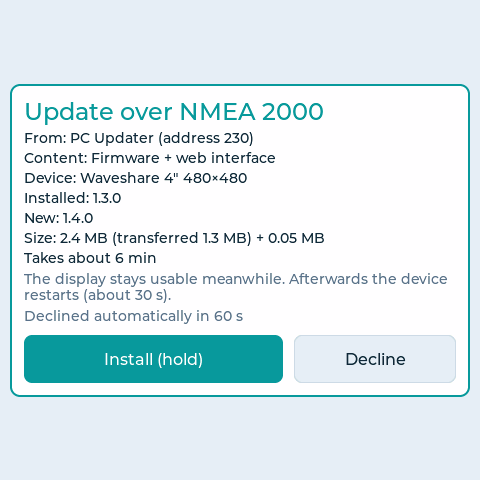</picture> | <picture><source media="(prefers-color-scheme: dark)" srcset="docs/img/n2kupdate_banner_dark.png">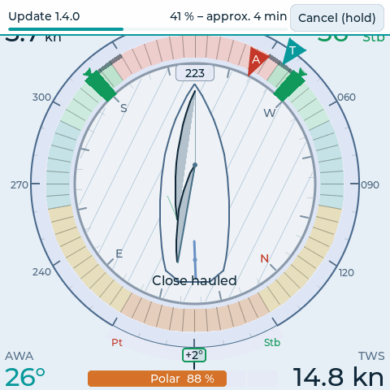</picture> |

1. The updater lists the displays on the bus with board, version and label;
   **Identify** makes the chosen one show a full-screen "This display" (a tap
   closes it; the display then ignores Identify for a minute).
2. Every offer opens a dialog on the display: sender, content, installed and
   new version, size, duration. **Install** acts only after the button has
   been held for 1.5 s (spray on the glass cannot install anything),
   **Decline** or 60 s without an answer refuse it - and for the next 10 s
   that sender's offers get the same answer without a new dialog. Nothing on
   the bus and nothing in the web interface can confirm - only the
   touchscreen.
3. During the transfer a banner across the top of the instrument shows the
   progress and the remaining time; the instruments keep working. Holding
   **Cancel** stops it. A firmware takes about 6 minutes at the default bus
   share (compressed on the way), the web interface about 15 seconds.
4. The display checks what it received (the stream's CRC-32, the SHA-256
   read back from flash, the board), activates it and restarts after a 10 s
   countdown - **Restart now** or **Later**, then at the next power-up.
5. The new firmware checks itself for one to three minutes ("Checking update
   1.3.0 – 45 s") and is confirmed only if it runs properly and has heard the
   updater again after the restart. Otherwise the display returns to the
   previous firmware by itself and shows why. So keep the updater connected
   until it reports success.
6. If the release brings a new web interface, the updater sends it right
   after - approved in the same dialog, so without a second confirmation.

**Limits**

- One display at a time, one transfer per bus. The updater keeps its share
  of the bus at 30 % by default (adjustable, 10-60 %), so the autopilot and
  the instruments keep working; frames that get lost are simply sent again.
- No offer is accepted while an alarm (anchor drag) is active, and the
  restart countdown waits for the alarm to end - as a strip under the alarm
  banner, so the anchor screen stays in view. During the restart - about
  30 s - the display gives no anchor alarm; the dialog says so when the
  anchor watch is armed. The alarm banner stays visible above the menus too.
- Not in listen-only mode, and not on a display that was started in demo
  mode; the settings say so. Demo mode switched on during an update takes
  effect afterwards, and so does a restart asked for in the settings.
- Images without the firmware descriptor (1.2.0 and older) are refused over
  NMEA 2000; they still install over WiFi or USB.
- There are no signatures. What protects the boat is the confirmation on the
  display, the SHA-256 check, the board check, the switch - and the
  rollback above.

---

## Watchdog

A display whose main loop hangs restarts by itself instead of staying
frozen until the power is cut (`src/LoopWatchdog.h`). There is nothing to
set.

- **What it watches:** the main loop, which also draws the screen. If one
  pass does not come back within **30 s**, the chip resets - measured on all
  three boards as an RTC watchdog reset (rst 0x10), which also boots a chip
  whose core 0 is stalled; a second stage 2 s later is only a fallback.
  Setup gets 120 s. The loop is also not fed while the NMEA 2000 task has
  stood still for 30 s.
- **On the 4"** the IDF's own task watchdog still watches the web server's
  task and can end some hangs first - measured after about 5 s or 15 s. The
  boot log then names it a task-watchdog reset, not this watchdog's.
- **Crashes** need no watchdog: a crash prints its backtrace to the serial
  log and restarts by itself. On the 7B and 5B a crash while the watchdog
  is already counting - during a slow start or in the first minutes after
  an update - no longer loses its backtrace and core dump to the
  watchdog's own reset.
- **USB:** on the 4" and the 5B the watchdog is **off while a computer is
  attached** to the USB port - flashing from the browser could not finish
  otherwise - and comes back 10 s after it is unplugged. The 7B does not
  need this.
- **After an update** the new firmware is first checked by its own rollback
  guard ([Updates over NMEA 2000](#updates-over-nmea-2000)); the watchdog
  takes over once it is confirmed. A watchdog reset in the first 30 minutes
  counts as a crash: three in a row bring the previous firmware back.
- **What it leaves behind:** the boot log line `[wdt] last reset: ...` says
  what happened - for example `loop watchdog (rst 0x10) - loop stuck in
  'tick' on screen 4, 812 s after start; the core-0 stamp ran on for 30 s
  (core 0 alive) - the loop itself stopped: busy, blocked, or held off
  core 1, 1 in a row`; a stalled NMEA 2000 task, setup and the update
  backstop have lines of their own - and GET `/api/info` carries `reset`
  and `loopWatchdog` (armed, mode, the longest loop pass
  since boot, how often it fired, the last time). The heartbeat line's
  `wdt=` field is the longest loop pass of the last 5 s, in ms.

---

## Status

Honest state of affairs:

- The **stereo control opcodes** (PGN 126720, manufacturer 419) come from community reverse
  engineering (canboat/Signal K) and are **not yet fully validated against
  real hardware** — status decoding works, control commands may need
  adjustment.
- The AIS radar is north up or course up (web UI → AIS screen editor, "Orientation").
  Course up turns the view to the own course over ground, below 1 kn to the heading,
  and an "N" marks north. Without a compass it holds the last course below 1 kn. With
  no course known it stays north up, and says so.
- The AIS table holds 50 targets. With more on the bus it keeps the 50 nearest
  to own ship, a vessel on a closing course counting by how close it will come.
  The count above the radar reads "11/50 targets" when only 11 of them are within
  its range. Name, callsign and ship type of up to 64 more vessels are kept, so
  a vessel that gets a place in the table shows its name at once if it was heard
  before. A vessel heard for the first time keeps its name among those 64 until
  its first position report (up to 5 minutes), as long as fewer than half of the
  64 are waiting like this. In a simulation (30 to 480 nm) that was 98 to 100 %
  of the vessels getting a place in the table with up to 1,000 vessels reporting
  their position every 10 s or 640 every 30 s, and 95 to 98 % with 2,000 every
  10 s - but not in every case: where many vessels report rarely, the waiting
  places run out - about three quarters with 1,000 vessels every 30 s, about half
  with 2,000 every 30 s, a third to a half with 640 or more that all report only
  every 3 minutes. Of those 64 names, the one of a vessel whose position has not
  been heard for 5 minutes is among the first to make room for another.
- AIS targets are colour-coded by the **CPA/TCPA alarm thresholds from the
  config** (web UI → AIS screen editor, "Alarm CPA/TCPA"): red below the
  configured pair, yellow below twice those values. Defaults 0.5 nm / 10 min.
- The HTTP config API is unauthenticated (see Security).

## How this was built

Full disclosure: this project was **vibe-coded** — large parts of the
firmware were designed, written and debugged in pair with an AI assistant
(Anthropic's Claude), with a human sailor at the helm making the decisions,
holding the crimping tool and testing against the real bus. The code has
been reviewed and it runs on the author's boat, but it has not had a classic
line-by-line human audit. Read it with the same healthy scepticism you'd
apply to any hobby firmware — and see the warning at the top before wiring
it to your backbone.

## Issues & contributions

Bug reports and pull requests are welcome — this is spare-time work, so no
guaranteed response times. Especially valuable: **PGN 130820/126720 captures
from a real stereo of manufacturer 419**, reports from other board batches/revisions, and
real-boat field reports. For firmware issues please attach the serial log
(115200 baud) and, for bus problems, a PGN dump if you can get one.

---

## Repository layout

```
src/            firmware (LVGL 8.4 UI, N2K handlers, config, web server)
src/n2kupdate/  update over NMEA 2000: protocol core (platform-free),
                device glue, firmware/web UI writers, rollback (OtaGuard)
sim/            SDL2 PC simulator shims
data/           LittleFS image: web UI, factory config.json, polar.json
lib/NMEA2000_esp32/  TWAI-based CAN driver (ESP32-S3 compatible)
boards/         PlatformIO board definition for the Waveshare panel
tools/          generators: LVGL fonts (Montserrat subsets), hull outline
                from an image, world map mask, boot-logo converter;
                release tooling (ZIP, web flasher, pre-release checks)
docs/img/       simulator screenshots used in this README
docs/N2K-UPDATE.md  specification of the update over NMEA 2000
docs/WIND-AND-SAILS.md  implementation reference for a port: true wind,
                damping, sail picture with the downwind sail, test vectors
                (from wind_vectors.cpp), the sail's clearance checker
                downwind_check.cpp and its vectors downwind_vectors.txt
download/fonts/ unmodified Montserrat TTFs + OFL.txt (source of the fonts)
```

`extra_script.py` (ccache + the `deploy` target) and `partitions_16MB.csv`
are used by PlatformIO automatically; `deploy.bat` is a thin wrapper around
`build_deploy.ps1`.

---

## Licence

The project's own code is **MIT** (see [LICENSE](LICENSE)).

Bundled third-party components keep their own licences — the complete list
with obligations lives in
[THIRD-PARTY-NOTICES.md](THIRD-PARTY-NOTICES.md), full texts in
[`LICENSES/`](LICENSES/). Highlights: LVGL, ArduinoJson, NMEA2000 and, on
the 4-inch only, LovyanGFX (MIT/BSD); Montserrat and the bitmap fonts generated from it, and the
Font Awesome glyphs in LVGL's built-in fonts (SIL OFL 1.1);
the OpenBridge Icon Pack icons, the default icon set (CC BY 4.0, partly based on
Google Material Icons, Apache-2.0; attribution in THIRD-PARTY-NOTICES.md section 4 and `ICONS-TRIAL.md`);
Arduino-ESP32 core, AsyncTCP and ESPAsyncWebServer (LGPL, linked statically;
the 4-inch and the 1024 × 600 boards link different versions of them). Every
GitHub Release from v1.2.0 on carries the source of these libraries as
`src-*.zip` assets next to the ZIP - from v1.3.0 on, for the 4-inch's Arduino
core, the PlatformIO package it links rather than only the upstream tag it is
based on - and the application source needed to relink is this repository at
the release tag.
**If you distribute a built `firmware.bin` yourself, the LGPL obligations —
library source and relinkability — pass to you**; see the notices file.

Data: world map from Natural Earth (public domain); tide forecast at runtime
from the BSH (`gdi.bsh.de`, CC BY 4.0, credited on screen; what the request
sends: see [Security](#security)); NMEA 2000 field layouts as facts
from the [canboat](https://github.com/canboat/canboat) and
[Signal K](https://github.com/SignalK) projects, complemented by observing the
bus traffic of real installations. The shipped polar table holds generic
example values — import your own boat's polar via the web UI. The hull
silhouette is hand-drawn.

Trademarks: NMEA 2000 is a registered trademark of the National Marine
Electronics Association. Other
product and company names mentioned here belong to their respective owners.
NauticPinnace is an independent project, not affiliated with or endorsed by any
of them - the names appear only to say which equipment it works with.

Fair winds! ⛵
