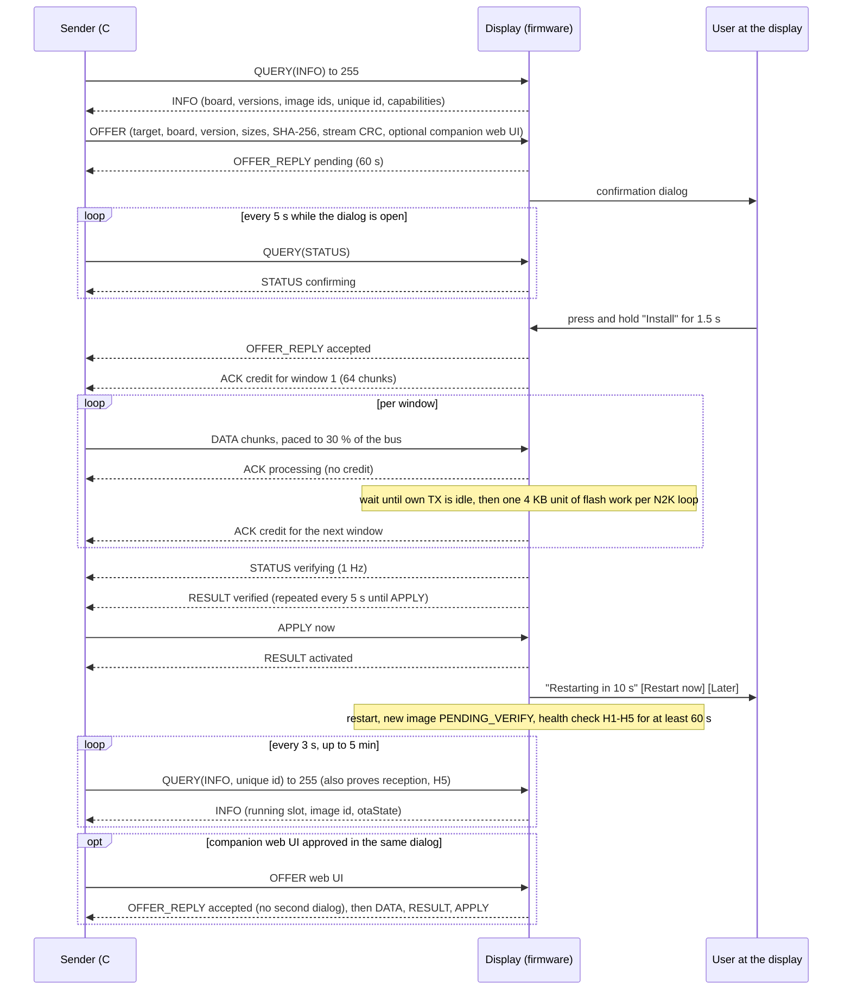
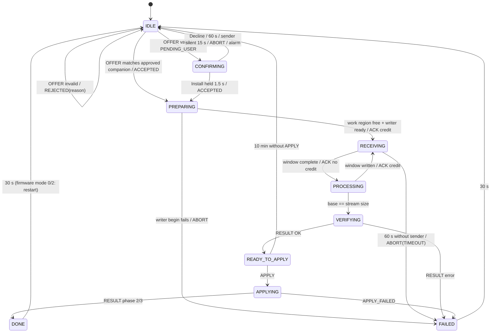

# NauticPinnace: updates over NMEA 2000

Protocol specification, **protocol version 1, revision 2**. Status: ACCEPTED for implementation, 2026-10-12 (owner decisions in 15.2).

Revision 2 resolves the review of revision 1. Appendix C lists all 27 review points and what happened to each one, including the parts that were not adopted. In revision 2 the layouts of INFO, OFFER and IDENTIFY changed. Nothing has shipped, so v1 is still open. Once the first firmware with a receiver is released, only the extension rules in 3.0 and 13 apply.

This document is written for two teams that do not talk to each other:

- the **device team**, who build the receiver in the NauticPinnace firmware (C++, ESP32-S3, boards 4-inch, 7B and 5B);
- the **sender team**, who build one shared C# library that both NauticPi and a standalone Windows updater use.

Sections 2 to 10, 11.2, 11.5, 12.2 to 12.6 and Appendix A are normative. MUST, MUST NOT, SHOULD and MAY have their usual meaning. Where an owner decision is still open (15.2), this spec states the recommended default, and both teams build that default.

---

## 0. Requirements already decided by the owner

| # | Decision |
|---|---|
| R1 | Two targets: the **firmware** (app image into the inactive OTA slot) and the **web UI** as one file, `/index.html.gz` in LittleFS. `config.json`, `polar.json`, the plain `/index.html` and every other file stay untouched. |
| R2 | Two senders: **NauticPi** (C#/.NET 10 on a Raspberry Pi, built later) and a **standalone Windows updater**. Both use **one shared C# library**. |
| R3 | Minimum hardware for an update: a **CANable USB-CAN adapter** with slcan firmware at 250 kbit/s; recommended: the **Makerbase CANable V2.0 Pro**. Updates over NMEA 2000 are not supported through an Actisense NGT-1: the protocol needs an adapter that can send long fast-packet bursts, and with an NGT-1 that could not be achieved in testing. (The one unit tested passed multi-frame messages from the bus only at a very low rate. That is an observation on one unit in one setup, not a statement about the product in general.) |
| R4 | **No signatures.** Safety comes from four things: a mandatory confirmation on the display's touchscreen before anything is written (sender, target, version and size are shown; a timeout rejects); the SHA-256 of the complete image, checked before switching; a board identity check; and the setting "accept updates over NMEA 2000" (default ON). |
| R5 | **Rollback must work.** A new firmware that boots but is broken falls back to the previous one by itself. |
| R6 | Images are streamed into flash in small pieces and never buffered whole. Only 10-21 KB of internal RAM are free while the display runs. |
| R7 | The sender limits its bus load (default 30 % of 250 kbit/s, configurable), so the autopilot and the instruments keep working. |

---

## 1. Overview



Bus transfer times at the default 30 % bus share, modelled on the current builds (Appendix B):

| Image | Size | Raw | Deflate (ratio) |
|---|---|---|---|
| 4-inch firmware | 2,370,304 B | 10.8 min | 5.4 min (51.2 %) |
| 7B firmware (5B similar) | 2,441,792 B | 11.1 min | 5.8 min (53.8 %) |
| Web UI `index.html.gz` | 48,751 B | about 13 s | not used |

On top of that come about 0.5-1 min of flash work and verification, the 10 s countdown, about 15 s of boot, and at least 60 s of health check. **From "Install" to "Update successful", a firmware update with deflate takes about 8 minutes**; without deflate it takes about 13.

---

## 2. Transport

### 2.1 Choice

The carrier is the **addressed proprietary fast-packet PGN 126720**, with manufacturer code **2046**. The protocol's own windowed flow control runs on top.

- The unmodified ttlappalainen NMEA2000 library 4.24.1 is used by all three boards. It treats 126720 as fast packet on receive and on send without any registration. With `HandleOnlyKnownMessages` off, the message reaches the handler. The firmware already sends 126720 (media module, manufacturer 419), and it sends and receives a proprietary fast packet (anchor sync, 131035, manufacturer 2046). **No library patch is needed.**
- **The ISO transport protocol (TP) is not used.** The library caps TP at 222 bytes and a CTS window of 5. A larger TP would need a custom frame-level implementation on both ends and gains almost nothing (6.5-6.9 against 6.75 payload bytes per frame). The J1939 timers (T1 750 ms, T2/T3 1250 ms) would also break during flash erases on the 4-inch.
- **Broadcast proprietary PGNs (130816-131071) are not used.** With those, every node reassembles the data, including the other displays.
- **`SetFastPacketMessages()` MUST NOT be called** on the device (see the comment in `N2kHandler.cpp`). Nothing needs registering.

### 2.2 Identifiers

| Item | Value |
|---|---|
| PGN | 126720 (0x1EF00), PDU1, so the destination address is in the CAN ID |
| CAN ID | `(prio << 26) \| (1 << 24) \| (0xEF << 16) \| (dest << 8) \| src` |
| Priority | 6 for every control message, 7 for DATA |
| Manufacturer header | bytes 0-1 = `FE 9F` = `(4 << 13) \| (3 << 11) \| 2046`, little endian (industry group 4 marine, reserved bits 11b, code 2046) |
| Destination | the display's current source address; `255` only for a broadcast QUERY |
| Sender address | claimed by the sender (12.3); the display answers to the source address of the request |

Examples: DATA from 0xE6 to 0x2A = `0x1DEF2AE6`; ACK from 0x2A to 0xE6 = `0x19EFE62A`; broadcast QUERY from 0xE6 = `0x19EFFFE6`.

**The manufacturer header is not a signature.** 2046 is the NMEA2000 library's default manufacturer code (`NMEA2000.h`, `SetDeviceInformation()`); the library's examples say it was chosen as a free code from the NMEA registration list, so it is not a code assigned by the NMEA. Many DIY projects use it. A message belongs to this protocol only if *all* of these hold: PGN 126720, header `FE 9F`, a known message type (0xA0-0xAA), the protocol version byte where there is one, the exact minimum length, and, for session messages, the session binding. None of these checks may be dropped as redundant.

### 2.3 Fast-packet framing (both directions, normative)

1. **Every message of this protocol is fast-packet framed, including messages of 8 bytes or less.** The receiving library treats every 126720 frame as fast packet. A message of 1-6 bytes is a single frame `[seq<<5 | 0][len][payload…][0xFF padding]`. (No v1 message is shorter than 6 bytes. The library's frame 0 copies 6 payload bytes without padding, so a shorter message would carry garbage on the device side.)
   *Trap:* a fast-packet encoder that sends payloads of 8 bytes or less **unframed** (as the author's earlier, unpublished slcan sender did) is right for some PGNs but wrong here, so such an encoder must not be reused as is.
2. Frame 0: byte 0 = `seq<<5 | 0`, byte 1 = total payload length, bytes 2-7 = payload[0..5]. Frame k (k ≥ 1): byte 0 = `seq<<5 | k`, bytes 1-7 = the next 7 payload bytes. Unused bytes in the last frame are `0xFF`. DLC is always 8.
3. The maximum payload is 223 bytes (32 frames).
4. `seq` is a 3-bit counter per (source address, PGN 126720). It goes up once per message and stays constant within a message.
5. All frames of one message MUST be sent in order. **No frame of another 126720 message from the same source may come between them.** Frames of other PGNs may. The reason: the receiving library matches continuation frames by (PGN, source) only, takes the first slot it finds, and checks `LastFrame + 1`.
6. A missing or out-of-order frame makes the receiving library drop the **whole message silently**. There is no partial delivery. The chunk bitmap (5.4) recovers lost messages.
7. **On the display, every NMEA2000 send happens in the N2K task** (11.2). The library's send ring and its per-PGN sequence counters are not thread-safe. Today the media module sends 126720 directly from the LVGL task, and that could interleave with the update node's 126720 messages from the same source and break rule 5. Revision 2 routes the media sends through a mailbox.

### 2.4 Facts about the receiving side that the sender relies on

- The display reassembles fast packets in **5 slots**, which it shares with every other fast packet on the bus (AIS, GNSS). When all 5 are busy, a slot is reused only once it is older than 100 ms. The sender therefore sends each DATA message as one contiguous burst (section 6).
- The library does not filter by destination: **every display reassembles every 126720 message**. The firmware handler does the filtering (5.1).
- **RX buffering.** The TWAI driver queues up to 65 received frames (`NMEA2000_esp32.cpp:52`). The N2K task drains them about every millisecond, at most 20 frames per `ParseMessages()` call. While the N2K task does a unit of flash work, nothing drains the queue. A typical unit is one 4 KB erase plus 16 page writes, about 50-70 ms; at 300 frames/s of other traffic it needs about 20 slots. A worst-case erase (about 0.4 s) at 550 frames/s needs about 220 slots, so the excess other traffic is lost. That costs at most a stale instrument value or a dropped AIS message for a fraction of a second. The sender's own DATA is never affected, because flash work only runs while the sender holds no credit (5.4).
- **4-inch board.** The TWAI interrupt is not in IRAM, and IDF 4.4 switches off the cache for every flash erase and write. During those operations the ISR cannot run:
  - On RX, only the 64-byte hardware FIFO buffers, which is about 4 frames.
  - On TX, frames waiting in the driver queue only leave between flash operations.
  - The controller still ACKs frames on the bus, so **a CAN-level ACK does not prove delivery**; only the protocol's ACK does.
  - For these reasons the display starts flash work only once its own transmit queue is empty (9.1), and senders tolerate gaps of up to 2 s between the frames of one message (12.2).
- **7B and 5B.** The cache stays on during flash operations (XIP from PSRAM), so ISRs keep running and only the N2K task blocks.

### 2.5 Message types

| Type | Name | Direction | Prio | Length v1 | Frames |
|---|---|---|---|---|---|
| 0xA0 | QUERY | sender → display (or 255) | 6 | 12 | 2 |
| 0xA1 | INFO | display → sender | 6 | 129 | 19 |
| 0xA2 | OFFER | sender → display | 6 | 131 | 19 |
| 0xA3 | OFFER_REPLY | display → sender | 6 | 10 | 2 |
| 0xA4 | DATA | sender → display | 7 | 223 (final chunk: 7 + n) | ≤ 32 |
| 0xA5 | ACK | display → sender | 6 | 28 | 5 |
| 0xA6 | RESULT | display → sender | 6 | 40 | 6 |
| 0xA7 | APPLY | sender → display | 6 | 6 | 1 |
| 0xA8 | ABORT | both | 6 | 6 | 1 |
| 0xA9 | STATUS | display → sender | 6 | 25 | 4 |
| 0xAA | IDENTIFY | sender → display | 6 | 12 | 2 |

A receiver ignores a type that travels in the wrong direction, an unknown type, and any message shorter than its v1 length.

---

## 3. Message layouts

### 3.0 Conventions

- All integers are **little endian**. `u8/u16/u24/u32/u64` are unsigned. A `u24` is 3 bytes, LSB first.
- `str[16]` version fields hold **1-15 printable ASCII characters (0x20-0x7E), NUL-terminated and NUL-padded**. That is the same limit as the descriptor's `fw_version` (8.1).
- Labels and sender names are UTF-8, at most 16 bytes, NUL-padded, cut at a character boundary, and not necessarily NUL-terminated when full. The display can only draw the glyphs in its fonts: ASCII 0x20-0x7E, `°`, `•`, `±`, `Ä`, `Ö`, `×`, `Ü`, `ß`, `ä`, `ö`, `ü`, `–`, `“`, `”`, `„`. **Before text reaches LVGL, the display code replaces every other character with `?`**, because LVGL would draw an empty box.
- NA values: `0xFF` (u8), `0xFFFF` (u16), `0xFFFFFFFF` (u32). Reserved bits are sent as 0 and ignored on receipt.
- An **image id** is the first 8 bytes of `esp_app_desc_t.app_elf_sha256` of a firmware image, at image file offset `0xB0` (8.3). A **web UI id** is the first 8 bytes of the SHA-256 of `index.html.gz`. All zero means none.
- **Extensibility:** once v1 has shipped, a later minor revision may only **append** fields. Receivers MUST accept messages longer than the v1 length and ignore the extra bytes. Fields defined here are never reinterpreted. (This is the same rule as anchor sync.)
- Control-message header `H` (all types except DATA):

| Off | Size | Field | Value |
|---|---|---|---|
| 0 | 2 | manufacturer header | `FE 9F` |
| 2 | 1 | type | 0xA0..0xAA |
| 3 | 1 | protocol version | 0x01 |
| 4 | 1 | session id | 1..254 for a session; 0 = none; 255 reserved. An OFFER with 0 or 255 is BAD_REQUEST. |

### 3.1 QUERY (0xA0), sender → display, 12 bytes

| Off | Size | Field | Notes |
|---|---|---|---|
| 0 | 5 | H | session id = the sender's session, or 0 |
| 5 | 1 | what | table 4.12: 1 = INFO, 2 = STATUS, 3 = ACK, 4 = RESULT |
| 6 | 6 | unique id filter | `FF×6` = any display; otherwise only the display with this unique id answers |

The display answers with exactly one message, unicast to the requester, even when the QUERY was broadcast:

| what | Answer |
|---|---|
| 1 INFO | INFO, always (with or without a session) |
| 2 STATUS | STATUS of the current state; its session id is the active session, or 0 |
| 3 ACK | the current ACK in RECEIVING and PROCESSING; STATUS in every other state of that session |
| 4 RESULT | the stored RESULT of that session (phase 1 once verified, phase 2 or 3 once applied); STATUS while there is none |

For `what` 2, 3 or 4 with a non-zero session id that the display does not hold, it answers `ABORT(SESSION_UNKNOWN)` with that session id, at most once per second.

### 3.2 INFO (0xA1), display → sender, 129 bytes

| Off | Size | Field | Notes |
|---|---|---|---|
| 0 | 5 | H | session id = the active session, or 0 |
| 5 | 1 | protoMin | lowest protocol version supported (1) |
| 6 | 1 | protoMax | highest protocol version supported (1) |
| 7 | 1 | board id | table 4.1 |
| 8 | 1 | capabilities | table 4.4; 0 if the receiver self-tests failed or the update regions could not be reserved |
| 9 | 6 | unique id | the ESP32 base MAC (eFuse); transmission order = display order |
| 15 | 1 | session state | table 4.7 |
| 16 | 1 | otaState | state of the running image, table 4.6 |
| 17 | 2 | verify seconds left | u16, seconds until OtaGuard must decide (180 s cap); `0xFFFF` = not verifying |
| 19 | 1 | running slot | 0 = app0, 1 = app1, `0xFF` = unknown |
| 20 | 1 | status flags | table 4.5 |
| 21 | 4 | max firmware size | u32 = inactive slot size − 4096 (today 0x4EF000) |
| 25 | 4 | max web UI size | u32 = size of one update region (9.1); v1: 0x20000 |
| 29 | 1 | max chunk size | 216 |
| 30 | 1 | max window chunks | 64 |
| 31 | 16 | running version | str[16], `FW_VERSION` |
| 47 | 16 | last invalid version | str[16], version of the rolled-back image (10.5); empty if none |
| 63 | 16 | label | UTF-8, the configured boat name (`bootName`), cut to 16 bytes |
| 79 | 8 | running image id | from the running image's `esp_app_desc_t` |
| 87 | 8 | last invalid image id | of the rolled-back image; zero if none |
| 95 | 1 | rollback cause | table 4.11; 0 if none |
| 96 | 1 | rollback detail | cause 1: the health criterion that failed (1-5); otherwise 0 |
| 97 | 16 | web UI version | str[16] of the stored `/index.html.gz`; empty if unknown (9.4.7) |
| 113 | 8 | web UI id | of the stored `/index.html.gz`, computed at boot and after every replacement; zero if the file is missing |
| 121 | 4 | web UI size | u32, bytes |
| 125 | 4 | uptime | u32, seconds since boot; lets the sender see that the display restarted |

### 3.3 OFFER (0xA2), sender → display, 131 bytes

| Off | Size | Field | Notes |
|---|---|---|---|
| 0 | 5 | H | session id chosen by the sender: 1..254, random, never its previous one |
| 5 | 1 | target | 1 = firmware, 2 = web UI |
| 6 | 1 | board id | firmware: from the image descriptor (8.1); web UI: 0 = any board |
| 7 | 1 | encoding | 0 = raw, 1 = deflate (9.3); web UI: MUST be 0 |
| 8 | 1 | flags | table 4.10 |
| 9 | 1 | chunk size | MUST be 216 in v1; any other value is BAD_REQUEST |
| 10 | 4 | image size | u32, bytes after decoding = bytes written on the display |
| 14 | 4 | stream size | u32, bytes carried by DATA; encoding 0: equal to the image size; encoding 1: at most `image size + image size / 1000 + 1024`; always ≤ 0xFFFFFF |
| 18 | 32 | SHA-256 | of the decoded image (all `image size` bytes) |
| 50 | 6 | target unique id | from INFO; guards against an address taken over by another display |
| 56 | 16 | version | str[16]; firmware: MUST equal the descriptor's `fw_version`; web UI: the firmware version this UI belongs to |
| 72 | 16 | sender name | UTF-8, for example `NauticPi` or `PC Updater` |
| 88 | 1 | sender kind | 0 = other, 1 = NauticPi, 2 = standalone updater |
| 89 | 2 | estimated seconds | u16, the sender's estimate of the transfer time at its configured rate; `0xFFFF` = unknown |
| 91 | 4 | stream CRC-32 | CRC-32 (8.5) over the whole stream; for encoding 0 that is the CRC of the image |
| 95 | 32 | companion web UI SHA-256 | firmware only: the web UI to be approved together with this firmware (5.3.6); all zero = none |
| 127 | 4 | companion web UI size | u32; 0 = none; MUST be 0 for target 2 |

### 3.4 OFFER_REPLY (0xA3), display → sender, 10 bytes

| Off | Size | Field | Notes |
|---|---|---|---|
| 0 | 5 | H | session id = the OFFER's |
| 5 | 1 | decision | 0 = PENDING_USER (dialog shown), 1 = ACCEPTED, 2 = REJECTED |
| 6 | 1 | reason | table 4.8; 0 unless REJECTED |
| 7 | 2 | seconds | u16; PENDING_USER: seconds left in the dialog; otherwise 0 |
| 9 | 1 | window chunks | ACCEPTED: the window size the display will grant (informative); otherwise 0 |

### 3.5 DATA (0xA4), sender → display, 7 + n bytes

| Off | Size | Field | Notes |
|---|---|---|---|
| 0 | 2 | manufacturer header | `FE 9F` |
| 2 | 1 | type | 0xA4 |
| 3 | 1 | session id | |
| 4 | 3 | offset | u24, byte offset in the **stream**, a multiple of 216 |
| 7 | n | data | n = 216, except in the final chunk: n = stream size − offset |

DATA carries no protocol-version byte, because the session implies it. A full DATA message is exactly 223 bytes, or 32 frames.

### 3.6 ACK (0xA5), display → sender, 28 bytes

| Off | Size | Field | Notes |
|---|---|---|---|
| 0 | 5 | H | |
| 5 | 1 | state | 3 = RECEIVING (credit granted) or 4 = PROCESSING (no credit) |
| 6 | 4 | base | u32: every stream byte below `base` has been received and accepted |
| 10 | 4 | window end | u32: the sender may send chunks with `offset < end`; `end == base` means no credit |
| 14 | 8 | received bitmap | u64: bit i (bit 0 = LSB of byte 14) set means the chunk at `base + i × 216` has arrived |
| 22 | 4 | stream CRC-32 | CRC-32 (8.5) over stream bytes `[0, base)`; 0 when `base = 0` |
| 26 | 2 | hold ms | u16: with no credit, the longest expected time until the next ACK; `0xFFFF` = unknown; 0 with credit |

Invariants:
- `base` is a multiple of 216, or equals the stream size.
- `end − base ≤ maxWindowChunks × 216`, and `end ≤ stream size`.
- Bits for chunks at or beyond `end` are 0.
- **`base` never decreases within a session.** A sender ignores an ACK whose `base` is lower than the highest `base` it has seen, as stale.

### 3.7 RESULT (0xA6), display → sender, 40 bytes

| Off | Size | Field | Notes |
|---|---|---|---|
| 0 | 5 | H | |
| 5 | 1 | code | 0 = OK, otherwise a reason (table 4.8) |
| 6 | 1 | phase | 1 = VERIFIED, 2 = APPLIED (web UI replaced), 3 = ACTIVATED (firmware boot slot set) |
| 7 | 1 | detail | phase 2: 0 = the new web UI is served now, 1 = it is served from the next restart (cache reload failed); phase 3: 0 = restart countdown started, 1 = becomes active at the next restart; otherwise 0 |
| 8 | 32 | SHA-256 | computed by the display over the **written** data, read back from flash or the file; all zero if not computed |

The display stores the last RESULT of the session. It repeats it on QUERY(RESULT), on a duplicate APPLY (5.6) and on a matching RESUME (5.3.4), and every 5 s in READY_TO_APPLY and DONE as long as the sender has been heard within the last 60 s.

### 3.8 APPLY (0xA7), sender → display, 6 bytes

| Off | Size | Field | Notes |
|---|---|---|---|
| 0 | 5 | H | |
| 5 | 1 | mode | 0 = now: activate, restart after the on-screen countdown, and the sender will poll INFO until the image is validated; 1 = activate, but do not restart (active from the next restart); 2 = like 0, but the sender will **not** poll. The web UI treats 1 and 2 as 0. |

The mode tells the display which reception proof to expect after the restart (health criterion H5, 10.2).

### 3.9 ABORT (0xA8), either direction, 6 bytes

| Off | Size | Field |
|---|---|---|
| 0 | 5 | H (the session being aborted) |
| 5 | 1 | reason (table 4.8) |

ABORT is never acknowledged. The display ignores an ABORT for a session it does not hold.

### 3.10 STATUS (0xA9), display → sender, 25 bytes

| Off | Size | Field | Notes |
|---|---|---|---|
| 0 | 5 | H | |
| 5 | 1 | state | table 4.7 |
| 6 | 1 | reason | the last error, or 0 |
| 7 | 4 | stream accepted | u32 (= ACK base) |
| 11 | 4 | stream size | u32 |
| 15 | 4 | image written | u32, decoded bytes written to flash or file |
| 19 | 4 | image size | u32 |
| 23 | 2 | seconds | u16, seconds left in the current phase (dialog countdown, verify, region grace, apply wait); `0xFFFF` = NA |

### 3.11 IDENTIFY (0xAA), sender → display, 12 bytes

| Off | Size | Field |
|---|---|---|
| 0 | 5 | H (session id 0) |
| 5 | 1 | seconds, 1..30 (larger values count as 30) |
| 6 | 6 | target unique id; only the display with this unique id reacts |

The display shows its identify screen (7.7) for that long. There is no reply. IDENTIFY works without a session, and even when the setting "accept updates" is off. It is ignored while a confirmation dialog or the restart countdown is open and while an alarm is active, and it is accepted at most once per 10 s.

---

## 4. Code tables

### 4.1 Board id
| Id | Board | `FW_BOARD_NAME` | Panel (`panel_w` × `panel_h`) |
|---|---|---|---|
| 0 | any (web UI only) / unknown | | |
| 1 | 4-inch | `waveshare-4inch-480x480` | 480 × 480 |
| 2 | 7B | `waveshare-7b-1024x600` | 1024 × 600 |
| 3 | 5B | `waveshare-5b-1024x600` | 1024 × 600 |

Board ids are only ever added, never renumbered. Simulator builds carry no descriptor.

### 4.2 Target
1 = firmware, 2 = web UI. Other values are rejected with UNSUPPORTED_TARGET.

### 4.3 Encoding
- 0 = raw.
- 1 = a raw DEFLATE stream (RFC 1951, no zlib or gzip wrapper, window up to 32 KB), as produced by .NET `DeflateStream`.

The web UI is already gzip-compressed, so the sender MUST use encoding 0 for it, and the display MUST reject encoding 1 for it with UNSUPPORTED_ENCODING.

### 4.4 Capabilities (INFO byte 8)
| Bit | Meaning |
|---|---|
| 0 | firmware target supported |
| 1 | web UI target supported |
| 2 | encoding 1 (deflate) supported |
| 3 | RESUME supported (5.3.4) |
| 4 | IDENTIFY supported |
| 5 | companion web UI approval supported (5.3.6) |
| 6-7 | reserved |

### 4.5 Status flags (INFO byte 20)
| Bit | Meaning |
|---|---|
| 0 | the setting "accept updates over NMEA 2000" is ON |
| 1 | an alarm is active (offers are rejected with ALARM_ACTIVE) |
| 2 | restart pending: a new firmware is activated but not running yet |
| 3 | the last update was rolled back (bytes 47, 87, 95 and 96 are valid) |
| 4 | ready: setup has finished, the self-tests passed, and offers can be handled |
| 5 | an approved companion web UI is waiting (5.3.6); the sender may send it without a new confirmation |
| 6 | a WiFi OTA is in progress (offers get BUSY) |
| 7 | reserved |

### 4.6 otaState (INFO byte 16)
- 0 = not available.
- 1 = VALID. This includes images installed over USB, whose otadata entry is UNDEFINED.
- 2 = PENDING_VERIFY (OtaGuard is still deciding).

### 4.7 Session state
| Code | State | Meaning |
|---|---|---|
| 0 | IDLE | no session |
| 1 | CONFIRMING | dialog open |
| 2 | PREPARING | user accepted; waiting for the work region (9.1), setting up the writer |
| 3 | RECEIVING | credit granted, waiting for DATA |
| 4 | PROCESSING | window complete, writing flash, no credit |
| 5 | VERIFYING | all data received, final checks |
| 6 | READY_TO_APPLY | verified, waiting for APPLY |
| 7 | APPLYING | activating, or renaming and reloading |
| 8 | DONE | finished (web UI replaced, or firmware activated) |
| 9 | FAILED | aborted or failed |

DONE and FAILED are reported for 30 s and then become IDLE. For OFFER handling they already count as IDLE.

### 4.8 Reason and result codes
Columns: R = sent in OFFER_REPLY REJECTED, Ad = sent in ABORT by the display, As = sent in ABORT by the sender, Rs = sent in RESULT.

| Code | Name | R | Ad | As | Rs | DE text | EN text |
|---|---|---|---|---|---|---|---|
| 0x00 | OK | | | | ✓ | | |
| 0x01 | DECLINED_BY_USER | ✓ | | | | Am Display abgelehnt | Declined on the display |
| 0x02 | CONFIRM_TIMEOUT | ✓ | | | | Am Display nicht bestätigt | Not confirmed on the display |
| 0x03 | DISABLED | ✓ | ✓ | | | Updates über NMEA 2000 sind ausgeschaltet | Updates over NMEA 2000 are switched off |
| 0x04 | BUSY | ✓ | | | | Ein anderes Update läuft | Another update is in progress |
| 0x05 | WRONG_BOARD | ✓ | ✓ | | ✓ | Firmware für ein anderes Gerät | Firmware for a different device |
| 0x06 | TOO_LARGE | ✓ | | | | Datei zu groß | File too large |
| 0x07 | UNSUPPORTED_TARGET | ✓ | | | | Nicht unterstützt | Not supported |
| 0x08 | UNSUPPORTED_ENCODING | ✓ | | | | Nicht unterstützt | Not supported |
| 0x09 | UNSUPPORTED_PROTOCOL | ✓ | | | | Nicht unterstützt | Not supported |
| 0x0A | BAD_REQUEST | ✓ | ✓ | | | Ungültige Anfrage | Invalid request |
| 0x0B | PENDING_VERIFY | ✓ | | | | Das letzte Update wird noch geprüft | The previous update is still being checked |
| 0x0C | ALARM_ACTIVE | ✓ | | | | Alarm aktiv | Alarm active |
| 0x0D | WRONG_DEVICE | ✓ | | | | (not shown) | (not shown) |
| 0x0E | VERSION_MISMATCH | ✓ | | | | Weboberfläche passt nicht zur Firmware | Web interface does not match the firmware |
| 0x0F | NO_SPACE | ✓ | ✓ | | | Zu wenig Platz im Dateisystem | Not enough space in the file system |
| 0x10 | OUT_OF_MEMORY | ✓ | | | | Zu wenig Arbeitsspeicher | Out of memory |
| 0x11 | DESCRIPTOR_INVALID | | ✓ | | ✓ | Firmware ohne gültige Kennung | Firmware without a valid identification |
| 0x12 | SHA_MISMATCH | | | ✓ | ✓ | Prüfsumme falsch – Daten beschädigt | Checksum mismatch – data corrupted |
| 0x13 | IMAGE_INVALID | | ✓ | | ✓ | Firmware-Abbild ungültig | Firmware image invalid |
| 0x14 | SIZE_MISMATCH | | ✓ | | ✓ | Größe stimmt nicht | Size mismatch |
| 0x15 | FLASH_ERROR | | ✓ | | ✓ | Fehler beim Schreiben | Write error |
| 0x16 | TIMEOUT | | ✓ | ✓ | | Verbindung zum Absender verloren | Connection to the sender lost |
| 0x17 | USER_CANCELLED | | ✓ | | | Am Display abgebrochen | Cancelled on the display |
| 0x18 | SENDER_CANCELLED | | | ✓ | | Vom Absender abgebrochen | Cancelled by the sender |
| 0x19 | SESSION_UNKNOWN | | ✓ | | | (not shown) | (not shown) |
| 0x1A | STREAM_CRC_MISMATCH | | | ✓ | ✓ | Übertragungsfehler | Transmission error |
| 0x1B | LINK_UNRELIABLE | | | ✓ | | Bus zu unzuverlässig | Bus too unreliable |
| 0x1C | APPLY_FAILED | | | | ✓ | Aktivieren fehlgeschlagen | Activation failed |
| 0x1D | RESTART_PENDING | ✓ | | | | Neustart ausstehend | Restart pending |
| 0x1E | NOT_READY | ✓ | | | | Gerät startet noch | Device is still starting |
| 0x1F | LOW_VOLTAGE | | | | | reserved, not sent in v1 (9.6) | |
| 0xFE | INTERNAL_ERROR | ✓ | ✓ | ✓ | ✓ | Interner Fehler | Internal error |

The display shows an unknown code as "Fehler 0xNN" / "Error 0xNN". The sender shows an unknown code by its number.

### 4.9 Sender kind
0 = other, 1 = NauticPi, 2 = standalone updater.

### 4.10 OFFER flags
| Bit | Name | Meaning |
|---|---|---|
| 0 | RESUME | continue a session the display still holds (5.3.4) |
| 1 | ALLOW_VERSION_MISMATCH | web UI only: accept a version that differs from the running firmware |
| 2-7 | reserved | |

There is deliberately **no flag that skips the confirmation**. A companion web UI (5.3.6) is no exception to that rule, because it is shown in the firmware's dialog and is confirmed there.

### 4.11 Rollback cause (INFO byte 95)
| Code | Meaning | Determined by (10.5) |
|---|---|---|
| 0 | none or unknown | |
| 1 | the health check failed; byte 96 = the criterion (1-5) | NVS record written by OtaGuard before it rolled back |
| 2 | crash or watchdog during the check | reset reason PANIC, INT_WDT, TASK_WDT or WDT |
| 3 | power lost or brown-out during the check | reset reason POWERON or BROWNOUT |
| 4 | another restart during the check | any other reset reason |
| 5 | repeated crashes after validation (crash-loop guard) | NVS record written by the guard (10.6) |

### 4.12 QUERY what
1 = INFO, 2 = STATUS, 3 = ACK, 4 = RESULT. The answers are given in 3.1.

---

## 5. Protocol behaviour

### 5.1 Acceptance rules on the display

1. Only PGN 126720 with header `FE 9F` and a type from 2.5 is considered. Header `A3 99` (manufacturer 419) and every other header are not this protocol.
2. `Destination` MUST equal the display's own current source address (`NMEA2000.GetN2kSource()`). The only exception is QUERY, which is also accepted with destination 255.
3. In control messages the protocol version must lie in `[protoMin, protoMax]`. The exception is QUERY(INFO), which is always answered with the v1 INFO, so a newer sender can read `protoMax`.
4. An active session is bound to (sender source address, session id). Messages with another address or session id are ignored. There are three exceptions: an OFFER with RESUME (5.3.4), a pre-empting OFFER (5.3.5), and a single `ABORT(SESSION_UNKNOWN)` per second in reply to stale DATA, APPLY or QUERY.
5. In listen-only mode the display cannot answer, so it is invisible to the protocol. When it was booted in demo mode, no N2K task exists. Both are documented limitations (15.2).
6. When demo mode is switched on at runtime, the N2K task stops parsing. That switch therefore **takes effect only after** a running session or verify window has ended (11.2). The display shows "Demo-Modus erst nach dem Update" / "Demo mode after the update".

### 5.2 Discovery

The sender sends QUERY(INFO) to 255, waits 1 s, and repeats twice. Every display with this protocol answers with INFO. Displays are identified by **unique id**, never by address, because the address can change at every boot.

To list displays that cannot take updates yet, the sender MAY also request PGN 126996 (ISO request 59904 to 255). Every `ModelID = "NauticPinnace"` source that did not answer QUERY is then shown as "NauticPinnace, firmware x.y.z: no update over NMEA 2000 yet; update it once over WiFi or USB".

### 5.3 Offer and confirmation

#### 5.3.1 Checks

The display checks an OFFER in this order and answers `OFFER_REPLY(REJECTED, reason)` at the first failure:

1. Length ≥ 131 and a supported protocol version; else UNSUPPORTED_PROTOCOL.
2. Target unique id = own; else WRONG_DEVICE.
3. Setup has finished; else NOT_READY. Receiver self-tests passed (8.1); else INTERNAL_ERROR. Update regions reserved (9.1); else OUT_OF_MEMORY.
4. The setting is ON; else DISABLED.
5. Duplicate (5.3.3), RESUME (5.3.4) and pre-emption (5.3.5) handling. If another session or dialog is active, or a WiFi OTA is running: BUSY.
6. Running image PENDING_VERIFY: PENDING_VERIFY. Restart pending: RESTART_PENDING.
7. Target supported; else UNSUPPORTED_TARGET. Encoding supported, and 0 for the web UI; else UNSUPPORTED_ENCODING.
8. Otherwise BAD_REQUEST if any of these fail: session id 1..254; chunk size = 216; image size > 0; stream size > 0 and within the bounds of 3.3; version 1-15 printable characters; companion fields all zero for the web UI; companion size 0 or at most the region size, with SHA and size either both set or both zero.
9. Image size within the limit: firmware ≤ INFO byte 21; web UI ≤ INFO byte 25, else TOO_LARGE, and ≤ free LittleFS space − 64 KB, else NO_SPACE. The same limits apply to the companion size.
10. Firmware: board id = own. Web UI: board id 0 or own. Else WRONG_BOARD.
11. Web UI: version = own `FW_VERSION`, unless ALLOW_VERSION_MISMATCH is set; else VERSION_MISMATCH.
12. No alarm is active; else ALARM_ACTIVE.

If all pass and no approved companion matches (5.3.6), the display answers `OFFER_REPLY(PENDING_USER, seconds = 60)`, enters CONFIRMING and opens the dialog (7.2).

#### 5.3.2 In CONFIRMING

- **Keepalive:** the sender sends QUERY(STATUS) every 5 s. If the display hears nothing from the sender for 15 s, it closes the dialog silently and returns to IDLE.
- **User holds Install for 1.5 s:** `OFFER_REPLY(ACCEPTED)` → PREPARING (9.1) → first `ACK(RECEIVING, base 0, end = min(window, stream size))`.
- **User taps Decline:** `REJECTED(DECLINED_BY_USER)`. **60 s without an answer:** `REJECTED(CONFIRM_TIMEOUT)`.
- **An alarm fires while the dialog is open:** the dialog closes, `REJECTED(ALARM_ACTIVE)`.
- **ABORT from the sender:** the dialog closes; nothing else is sent.

#### 5.3.3 Duplicate OFFER

An OFFER is a duplicate when it comes from the session's sender address with the session's id and is **byte-identical to the original apart from the RESUME bit**. The display re-sends its current reply:
- in CONFIRMING: PENDING_USER with the remaining seconds;
- later: ACCEPTED, followed by the current ACK, STATUS or stored RESULT, exactly as for RESUME (5.3.4).

#### 5.3.4 RESUME

An OFFER with RESUME (flag bit 0) **matches** the held session when target, encoding, chunk size, image size, stream size, SHA-256, stream CRC-32 and both companion fields are identical. A match is possible in every state from CONFIRMING to DONE.

On a match, the display rebinds the session to the OFFER's sender address and session id **without asking the user again**, because the user has already approved exactly this image. It answers:

| Held state | Answer |
|---|---|
| CONFIRMING | PENDING_USER with the remaining seconds |
| PREPARING | ACCEPTED, then STATUS (credit follows) |
| RECEIVING, PROCESSING | ACCEPTED, then the current ACK |
| VERIFYING | ACCEPTED, then STATUS (RESULT follows) |
| READY_TO_APPLY, APPLYING, DONE | ACCEPTED, then the stored RESULT |

Without a match, the OFFER is handled as a new one. That usually means BUSY at step 5, unless 5.3.5 applies.

The stream CRC-32 is part of the match because a deflate stream is only reproducible with the same compressor. A sender that cannot reproduce its stream byte for byte must not claim RESUME; it offers again, and 5.3.5 lets it replace its own stale session.

#### 5.3.5 Pre-emption of a sender's own stale session

A new OFFER that does not match **replaces** the held session when all of these hold:
- it comes from the **same source address** as the held session;
- the display has heard nothing from that session's sender for **more than 5 s**;
- the held session is in CONFIRMING, PREPARING, RECEIVING, PROCESSING, VERIFYING or READY_TO_APPLY (never APPLYING).

The display cleans up the old session (`esp_ota_abort()` or file deletion), sends no ABORT, and handles the OFFER as new, with a new dialog. An OFFER from a different address still gets BUSY until the old session times out (60 s).

#### 5.3.6 Companion web UI (one confirmation per release)

A firmware OFFER MAY name the web UI that belongs to the same release (companion SHA-256 and size, 3.3). The dialog then shows both (7.2), and confirming it approves both.

1. **At firmware APPLY** the display stores the approval in NVS `n2kupd/preweb` = {companion SHA-256, companion size, the new firmware's image id, the OFFER's version}.
2. **After the new firmware has been marked valid** (10.2), and only if its running image id equals the stored image id, the approval becomes usable. It stays usable for 30 minutes of uptime in that boot, and INFO status flag bit 5 is set.
3. **A web UI OFFER that matches the approval** (SHA-256, size and version, everything else valid by 5.3.1) is answered `OFFER_REPLY(ACCEPTED)` at once, **without a dialog**. The progress banner (7.3) is shown as usual.
4. The approval is deleted once that web UI has been applied, when it expires, at the next boot, and on any rollback.

### 5.4 Transfer: chunks, windows, ACK

The stream is cut into **chunks** of 216 bytes, and each chunk is one DATA message. The display grants **windows** of at most 64 chunks (13,824 bytes) through ACK credit. `base` only moves forward, and only when a window is complete.

**The display sends an ACK:**

| # | When | Content |
|---|---|---|
| A1 | the window has just become complete | `state 4 PROCESSING`, `base = end` (new), no credit, CRC over the new base, `hold ms` estimate; then it processes the window (9.1) |
| A2 | processing has finished | `state 3 RECEIVING`, the next window as credit (or VERIFYING follows when `base = stream size`) |
| A3 | the chunk at the highest offset of the current window arrived while holes remain | bitmap of the window |
| A4 | no DATA for 1000 ms while the window is incomplete | bitmap; repeated every 1000 ms, at most 5 times in a row |
| A5 | QUERY(ACK) | the current ACK (in other states: STATUS, 3.1) |
| A6 | DATA outside `[base, end)` (offset ≥ end, or offset < base three times since the last ACK) | the current ACK, at most one per 250 ms |

In overlap mode (9.5, optional on 7B and 5B, not in v1) A1 and A2 merge into one `state 3` ACK that already carries the next credit.

**The display checks each DATA:** session and sender match; `offset % 216 == 0`; `len == 216`, or for the final chunk `len == stream size − offset`; `base ≤ offset < end`. A duplicate chunk inside the window (bit already set) is ignored. After 20 malformed DATA in one session it sends `ABORT(BAD_REQUEST)`.

**The sender:**

1. On every ACK it first drops stale ACKs (3.6). It then compares `stream CRC-32` with its own CRC over `[0, base)`. On a mismatch it sends `ABORT(STREAM_CRC_MISMATCH)`, and the session fails.
2. With credit (`end > base`), its send queue becomes every chunk in `[base, end)` whose bitmap bit is 0, in ascending order. The new queue replaces the old one. A chunk that was in flight may be sent once more; the display ignores the duplicate.
3. It sends the queue paced by the bus-load limiter (section 6), one complete DATA message per burst.
4. When the queue is empty and no new ACK arrives within 300 ms, it sends QUERY(ACK). It repeats that every 1000 ms, at most 5 times, and then runs recovery (5.8).
5. Without credit (state 4) it waits `hold ms + 3000 ms`. Every ACK or STATUS from the display restarts this timer, and the display sends STATUS every 1000 ms while it processes. After the wait it sends QUERY(ACK) as in step 4.
6. If one chunk has been sent 10 times, it sends `ABORT(LINK_UNRELIABLE)`.

### 5.5 Completion and verification

When `base == stream size`, the display enters VERIFYING and sends STATUS every 1000 ms. It checks, in this order:

1. The whole-stream CRC-32 equals the OFFER's; else STREAM_CRC_MISMATCH.
2. The decoder has finished (deflate: `TINFL_STATUS_DONE`) with exactly `image size` bytes and no stream bytes left over; else SIZE_MISMATCH.
3. The write-time SHA-256 (8.4) equals the OFFER's; else SHA_MISMATCH. This is a quick failure path that needs no read-back.
4. Firmware: `esp_ota_end()` succeeds (it checks the image structure and the appended hash); else IMAGE_INVALID.
5. The written data is read back through the bounce buffer (9.1), and its SHA-256 equals the OFFER's; else SHA_MISMATCH. **Only this read-back value counts.**
6. Firmware: the descriptor is read back from flash at offset 0x120 and checked again, including `panel_w` and `panel_h` (8.2); else WRONG_BOARD or DESCRIPTOR_INVALID. Web UI: the first three bytes are `1F 8B 08`; else IMAGE_INVALID.
7. `RESULT(code, phase 1, read-back SHA-256)`. On OK the state becomes READY_TO_APPLY. Otherwise it becomes FAILED, followed by `esp_ota_abort()` or deletion of the temporary file, and a message on the display.

The sender waits up to 120 s for RESULT. Every STATUS restarts that timer. After 5 s without any message it sends QUERY(RESULT). If the display's SHA-256 differs from the sender's, the sender sends `ABORT(SHA_MISMATCH)` and reports SHA_MISMATCH, even when `code = 0`, which can only happen through a display bug.

### 5.6 Apply

- **Firmware, mode 0 or 2:** `esp_ota_set_boot_partition(slot)`, then write the H5 marker (10.2), then `RESULT(OK, phase 3, detail 0)`, then the countdown dialog (7.4), then `esp_restart()` after 10 s, or at once on "Restart now".
  - "Later" cancels the restart. The new firmware becomes active at the next restart or power cycle, INFO status flag bit 2 is set, and the H5 marker switches to "any N2K frame".
  - While an alarm is active, the countdown pauses. It starts again at 10 s once every alarm has cleared.
- **Firmware, mode 1:** as above, but with `detail 1` and no countdown. The display shows a short note: "becomes active at the next restart".
- **Web UI:** rename and cache reload (9.4), then `RESULT(OK, phase 2, detail)`, then a toast.
- **On failure:** `RESULT(APPLY_FAILED, phase 2 or 3)`.
- **APPLY is idempotent.** In APPLYING it is ignored, because the RESULT follows. In DONE it is answered with the stored RESULT and nothing else happens. APPLY for a session the display does not hold is answered with `ABORT(SESSION_UNKNOWN)`.
- **Sender side:** after a firmware APPLY, any of these means "go to WAIT_REBOOT": `RESULT(phase 3)`, `ABORT(SESSION_UNKNOWN)`, or no answer to three attempts. The display may already be restarting.
- **No APPLY within 10 min of RESULT:** the display discards the result. The firmware stays unactivated, the web UI temporary file is deleted, and the state goes to IDLE without a message on screen.

### 5.7 After the restart

Before APPLY the sender records:
- `S_old` = INFO running slot;
- `ID_new` = the image id of the offered file (8.3);
- `T_apply` = the time of `RESULT(phase 3)`.

It then polls `QUERY(INFO, unique id filter)` to 255 every 3 s for up to 5 min. It does not use the old address, because the address may change at boot. The polls also give the new firmware its reception proof (H5, mode 0). **The outcome is decided by slot and image id, never by version strings.** This keeps reinstalling the same version unambiguous.

| What INFO shows | Outcome |
|---|---|
| running slot ≠ `S_old`, running image id = `ID_new`, otaState VALID | **Success** |
| running slot ≠ `S_old`, running image id = `ID_new`, otaState PENDING_VERIFY | keep polling (`verify seconds left`) |
| running slot = `S_old`, status flag 3, last invalid image id = `ID_new` | **Rolled back**, with cause and detail (bytes 95-96) |
| running slot = `S_old`, status flag 2 (restart pending) | **Installed, restart postponed on the display** |
| uptime shows a restart since `T_apply`, but none of the rows above | **Unknown**, with the INFO attached to the report |
| no INFO for 5 min | **Unknown** (the display is probably off, or a 4-inch is in download mode, 10.3) |

Afterwards, if the release has a web UI:
- if INFO status flag 5 is set, the sender sends the companion web UI at once (5.3.6);
- otherwise, if INFO's web UI id differs from the release's, it offers the web UI with a normal dialog.

The web UI succeeds when INFO's web UI id equals the new file's.

### 5.8 Recovery, cancellation and failure cases

| Situation | Behaviour |
|---|---|
| Single frames lost on the bus or in a full 4-inch FIFO | The library drops that DATA message; the bitmap (A3/A4) requests it again. |
| ACK, QUERY, OFFER_REPLY or RESULT lost | Timers in 5.3-5.6; QUERY (STATUS, ACK, RESULT) gets the state back; RESULT also repeats every 5 s. |
| CAN errors or bus-off on the display | Bus-off is recovered by the firmware (11.2); for the protocol it looks like loss, and the timeouts apply. |
| CANable unplugged, USB error, adapter BELL | The library reopens the adapter for up to 30 s and then continues with OFFER RESUME, all well within the display's 60 s idle limit. BELLs count as lost frames (6.4). |
| **Sender restarts** (crash, new run) | The display keeps the session for 60 s after the sender's last message. The new run sends the same image with RESUME and continues where it stopped (5.3.4), without a new confirmation. If the new run cannot reproduce its deflate stream, it sends a plain OFFER, which replaces its own stale session after 5 s of silence (5.3.5); the user confirms once more. |
| **Display restarts mid-transfer** (power loss, crash) | The session is gone, and resuming would also need the decoder state. The partial slot is harmless, because otadata was never changed. The sender sees the restart through INFO uptime and session state IDLE, reports "display restarted", and may send a new OFFER **with a new confirmation**. |
| Display address changes mid-session | The sender's QUERY(ACK) attempts fail. It rediscovers by unique id and sends OFFER RESUME to the new address. |
| Sender address changes (lost address claim) | After reclaiming, the sender sends OFFER RESUME from its new address. Messages from the old address are ignored. |
| **Two senders** | The display serves one session. A second OFFER gets BUSY, also during the dialog. A sender MUST NOT start a transfer while it has seen another source's DATA (frame 0 bytes 2-4 = `FE 9F A4`) in the last 10 s, and MUST pause while that continues (6.5). |
| **WiFi OTA and N2K at the same time** | One owner at a time (`UpdateGate`, 11.1). An OFFER during a WiFi OTA gets BUSY; `/api/ota` during an N2K session, the verify window or a pending restart answers HTTP 409. |
| **Update arrives while the user is in a menu** | The dialog opens on top of everything (7.1). The menu stays open underneath and can be used again after the dialog closes. |
| Alarm active (for example the anchor drag alarm) | An OFFER gets ALARM_ACTIVE; an open dialog closes with ALARM_ACTIVE; the restart countdown pauses. During a transfer, the transfer continues, and the alarm banner is drawn above the progress banner. |
| Setting switched OFF during a session | `ABORT(DISABLED)`, cleanup. |
| User holds Cancel on the progress banner | `ABORT(USER_CANCELLED)`, then `esp_ota_abort()` or file deletion, and a message on screen. |
| Sender cancels | `ABORT(SENDER_CANCELLED)`; the display cleans up and shows a message. |
| Demo mode switched on during a session or the verify window | Takes effect only afterwards (5.1 rule 6); `tick()` keeps running either way. |
| Restart requested on the display or over the WebUI during a session or the verify window | Postponed until the session has ended or the image has been marked valid (7.8). While a restart is pending, `/api/restart` is allowed: it activates the update. |

### 5.9 Display state machine



Additional rules:
- A matching RESUME or duplicate OFFER (5.3.3, 5.3.4) leaves the state unchanged and only rebinds and replies.
- A pre-empting OFFER (5.3.5) leads to cleanup and then CONFIRMING.
- From every state except IDLE, APPLYING and DONE, these lead to FAILED with cleanup: ABORT from the sender, Cancel on the display, or the setting going OFF.

### 5.10 Sender state machine

| State | Entry | Exit to |
|---|---|---|
| DISCOVER | QUERY(INFO) ×3, 1 s each | SELECT (list) |
| OFFERING | OFFER, wait 2 s, 3 attempts | CONFIRMING (PENDING_USER), WAIT_CREDIT (ACCEPTED), DONE (rejected) |
| CONFIRMING | QUERY(STATUS) every 5 s; limit = dialog seconds + 15 s | WAIT_CREDIT on ACCEPTED **or on any ACK or STATUS of the session with state ≥ PREPARING**; DONE (rejected or timed out) |
| WAIT_CREDIT | wait for an ACK with credit: 10 s after ACCEPTED, extended by STATUS (PREPARING may wait up to 120 s for the work region, 9.1), or the hold rule 5.4.5 | SENDING |
| SENDING | queue paced (6) | WAIT_ACK (queue empty) |
| WAIT_ACK | 300 ms, then QUERY(ACK) ×5 at 1 s | SENDING (credit), WAIT_CREDIT (state 4), WAIT_RESULT (`base = stream size` or STATUS VERIFYING), RECOVER |
| WAIT_RESULT | up to 120 s, extended by STATUS; QUERY(RESULT) after 5 s of silence | APPLYING (OK and SHA equal), DONE (failed; ABORT(SHA_MISMATCH) on its own mismatch) |
| APPLYING | APPLY, wait for RESULT 10 s, 3 attempts | firmware: WAIT_REBOOT (on phase 3, SESSION_UNKNOWN or no answer); web UI: WAIT_WEBUI (phase 2) |
| WAIT_REBOOT | QUERY(INFO, uid) every 3 s, 5 min (mode 0); mode 1 and 2 skip this | DONE (outcome 5.7), then OFFERING for a companion or pending web UI |
| WAIT_WEBUI | QUERY(INFO, uid) once | DONE (web UI id equal: Success) |
| RECOVER | reopen the adapter (≤ 30 s), rediscover by uid, OFFER RESUME (up to 3 rounds), all within 55 s of the last message from the display | the state that fits the reply, or DONE (failed) |

Cancellation by the caller at any time leads to `ABORT(SENDER_CANCELLED)` and DONE. In WAIT_REBOOT with mode 0 there is nothing left to abort; the caller is warned that **stopping the polls makes the display roll back** (H5).

### 5.11 Timers (normative values for v1)

| Name | Side | Value |
|---|---|---|
| dialog timeout | display | 60 s |
| button guard after the dialog opens | display | 1.5 s (a hold must start after it) |
| press-and-hold for Install and Cancel | display | 1.5 s |
| sender silent in CONFIRMING | display | 15 s |
| DATA gap → bitmap ACK (A4) | display | 1000 ms, at most 5 repeats |
| session idle (RECEIVING, PROCESSING, nothing from the sender) | display | 60 s |
| silence before a pre-emption is allowed | display | 5 s |
| STATUS keepalive in PREPARING, PROCESSING, VERIFYING, APPLYING | display | 1000 ms |
| RESULT repeat in READY_TO_APPLY and DONE (sender heard within 60 s) | display | 5 s |
| waiting for TX idle before a flash unit | display | at most 250 ms |
| wait for APPLY | display | 10 min |
| restart countdown | display | 10 s (paused during an alarm) |
| DONE/FAILED shown, then IDLE | display | 30 s |
| grace before a retired web UI region is reused | display | 120 s |
| companion approval usable after mark-valid | display | 30 min |
| IDENTIFY rate limit | display | 10 s |
| verify window: earliest valid / stall / cap | display | 60 s / 15 s / 180 s after `setupDone()` |
| hang backstop (RTC watchdog) | display | 300 s, then +2 s RTC reset |
| discovery round | sender | 1 s × 3 |
| OFFER reply | sender | 2 s × 3 |
| CONFIRMING keepalive | sender | 5 s |
| first credit after ACCEPTED | sender | 10 s (extended by STATUS) |
| ACK after the queue is empty | sender | 300 ms, then QUERY(ACK) 5 × 1 s |
| no credit (state 4) | sender | hold ms + 3 s (extended by ACK/STATUS) |
| RESULT | sender | 120 s (extended by STATUS), QUERY(RESULT) after 5 s of silence |
| after the restart | sender | INFO every 3 s, 5 min |
| max sends per chunk | sender | 10 |
| foreign-transfer quiet time | sender | 10 s |
| adapter reopen | sender | at most 30 s |
| gap tolerance between frames of one message | sender | 2 s |

---

## 6. Bus-load limiting (sender)

### 6.1 Rate math

At 250 kbit/s a 29-bit frame with 8 data bytes takes **131 bits plus 0-29 stuff bits**: 118 stuffable bits (SOF, 11-bit ID A, SRR, IDE, 18-bit ID B, RTR, r1, r0, DLC, 64 data bits, 15-bit CRC), plus a 13-bit tail (CRC delimiter, ACK slot and delimiter, 7 EOF bits, 3 intermission bits). The worst case is 160 bits.

| Share s | Bit budget | Frames/s (exact, about 135-138 bits) | Frames/s (conservative, 160 bits) | DATA messages/s | Payload rate |
|---|---|---|---|---|---|
| 30 % | 75,000 bit/s | ≈ 545-555 | 468.75 | ≈ 17.0 / 14.6 | ≈ 3.7 / 3.2 KB/s |
| 50 % | 125,000 bit/s | ≈ 905-925 | 781.25 | ≈ 28.5 / 24.4 | ≈ 6.1 / 5.3 KB/s |

Payload efficiency: 216 of 223 bytes per 32 frames, or 6.75 bytes per frame.

### 6.2 Token bucket (normative)

- Rate `r = s × 250,000 bit/s`. The allowed share `s` is **0.10-0.60, default 0.30**.
- Bucket capacity: 5,120 bits (one 32-frame message at 160 bits). It starts full.
- Each frame costs its **exact on-wire length**: the stuffing count over SOF..CRC with the real CRC-15 (polynomial 0x4599), plus 13. The reference algorithm is `frame_bits()` in `vectors.py`, and the test values are in Appendix A. If `ConservativeFrameBits` is set, every frame costs 160 bits.
- Before a DATA message the sender waits until the bucket holds the cost of all its frames, subtracts it, and hands **all frames to the adapter in one write**: one burst of about 17.7 ms at wire speed. At 30 % the gap to the next burst is then about 41 ms.
- Control messages are charged the same way, but are never delayed by more than 50 ms (the bucket may go negative).
- Re-sent chunks are charged like new ones.

**Arbitration.** Our DATA ID (for example `0x1DEF2AE6`: priority 7, PF 0xEF) loses arbitration to every frame of priority 0-6, and to priority-7 PDU1 frames with a lower PF or address. Those frames wait at most one frame time, about 0.6 ms. It **wins against every priority-7 PDU2 frame** (PF ≥ 0xF0, a higher ID). Those frames wait for the whole burst: up to about 18 ms per 32-frame burst, and somewhat longer if foreign traffic stretches the burst. That is harmless, because priority 7 is by definition the least time-critical class. The average share is what protects the bus.

### 6.3 Adaptive back-off (default ON)

The CANable receives every frame on the bus. Each second the sender computes the **total** load: the exact bits of every received frame plus its own, divided by 250,000.

- If the total is above 70 % in two consecutive seconds: `s_eff = max(0.10, s_eff / 2)`.
- If the total is below 60 % for 5 s: `s_eff = min(s, s_eff + 0.05)`.
- The current `s_eff` and the total load are reported to the UI.

### 6.4 Adapter rules

**slcan (CANable).**
- Open the adapter as the existing simulator does: `C`, `S5` (250 k), `O`. Frames are `T<id8><dlc><data>\r`, 27 ASCII bytes each.
- Write all frames of one DATA message in one `Write()` call (32 × 27 = 864 bytes).
- Facts from canable2-fw (`inc/can.h`, `src/can.c`):
  - The transmit ring holds 63 frames, plus a 3-deep FDCAN FIFO.
  - The `\r` reply means "queued", not "sent".
  - BELL (0x07) means "ring full, frame dropped".
  - One 32-frame burst fits; two bursts back to back do not.
- **Bound on frames outstanding in the adapter.** The sender keeps a drain estimate: `backlog = frames written − frames drained`, where frames drain at `250,000 × (1 − foreign load) / mean frame bits` per second, with the foreign load from 6.3 capped at 0.9. A burst of n frames is written only when `backlog + n ≤ 48`, which leaves 15 slots for control messages. At the normal shares the token bucket already spaces bursts far enough apart, so this rule only bites under heavy foreign load.
- **Small-buffer adapters.** If the adapter answers BELL to any frame of the OFFER (19 frames, written in one call while the adapter is idle), its buffer is smaller than one message, as with older firmware without the circular buffer. The sender then switches to **stop-and-wait** for the rest of the session: one frame per write; wait for its reply (at most 20 ms); on BELL, wait 2 ms and send the same frame again, at most 50 times, and after that treat it as a link error. Frames stay in order, so messages stay contiguous.
- BELLs during DATA in normal mode: that message counts as lost, and the bitmap requests it again. If BELLs exceed 1 % of frames over 10 s, `s_eff` is halved.

**SocketCAN (NauticPi on Linux, if used).** `txqueuelen` MUST be at least 64 (`ip link set can0 txqueuelen 128`). `ENOBUFS` from `write()` is handled like BELL in stop-and-wait: wait 2 ms and resend.

### 6.5 One transfer per bus

A sender MUST NOT start the DATA phase while it has seen another source's DATA (frame 0 of PGN 126720 with bytes 2-4 = `FE 9F A4`) within the last 10 s. If such traffic appears during its own transfer, it MUST pause for up to 60 s, without letting its session time out. Several displays are updated one after another, never in parallel.

### 6.6 Host timing

- Pacing uses a monotonic clock (`Stopwatch.GetTimestamp()`).
- On Windows, waits use a high-resolution waitable timer (`CreateWaitableTimerExW` with `CREATE_WAITABLE_TIMER_HIGH_RESOLUTION`, Windows 10 1803 or later). As a fallback, `timeBeginPeriod(1)` is set for the duration of a session. `Thread.Sleep` and `Task.Delay` MUST NOT be used for pacing: their default granularity of 15.6 ms makes the transfer up to about 20 % slower than configured.
- During a session the standalone updater calls `SetThreadExecutionState(ES_CONTINUOUS | ES_SYSTEM_REQUIRED)` so the laptop does not sleep, and resets it afterwards.
- On Linux (NauticPi) the default timer resolution (about 1 ms) is sufficient.

---

## 7. On-screen UI (firmware)

### 7.1 Principles

- Every piece of update UI is created on `lv_layer_top()` in the display task (core 1). The N2K task (core 0) never touches LVGL. The two talk through a small mailbox guarded by a spinlock, in the same pattern as `AnchorSyncNode`'s pending state:
  - the N2K task posts: an offer to show, progress, a result;
  - the UI posts back: accepted, declined, cancelled, restart now, later.
- Rotation (0/90/180/270), theme (day and night) and both languages are honoured. Layouts fit 480×480 and 1024×600 in both orientations.
- **The confirmation dialog is modal.** A full-screen backdrop absorbs touches.
- **Press and hold.** "Install" and, on the progress banner, "Cancel" act only after the button has been held for **1.5 s**. A bar inside the button fills while it is held, and releasing early resets it. A hold must begin after the 1.5 s guard that starts when the dialog opens. Spray on a capacitive panel produces short phantom touches, and none of them can install or cancel anything. "Decline", "Restart now", "Later" and "OK" are single taps: none of them can do harm.
- **Only the touchscreen can confirm.** No WebUI page, no `/api/*` path and no N2K message can confirm an offer, because the WebUI has no authentication. There is no "always accept" option anywhere.
- A dimmed or switched-off backlight is woken for the dialog, the restart countdown and failure messages.
- The anchor alarm and every other alarm banner stay **above** the progress banner and above the countdown.
- All new strings go into a new fragment `strings_update.inc`, registered in `I18N_STRINGS`. Following the house rule, they contain **no printf specifiers**; numbers are appended in code. They use only glyphs the fonts cover (3.0): umlauts, ß and the en dash are fine, but there is no `→`, no `…` and no `·`.

### 7.2 Confirmation dialog

| Line | DE | EN | Value appended in code |
|---|---|---|---|
| title | Update über NMEA 2000 | Update over NMEA 2000 | |
| from | Von | From | `<sender name> (Adresse/address N)` |
| content | Inhalt | Content | "Firmware", "Weboberfläche" / "Web interface", or with a companion: "Firmware + Weboberfläche" / "Firmware + web interface" |
| device | Gerät | Device | board name from the OFFER's board id |
| installed | Installiert | Installed | running version |
| new | Neu | New | the offered version, with "(älter)" / "(older)" or "(gleiche Version)" / "(same version)" appended where it applies |
| size | Größe | Size | image size in MB; with deflate also "(übertragen X MB)" / "(transferred X MB)"; with a companion also "+ 0.05 MB"; decimal point in both languages |
| duration | Dauer ca. | Takes about | `estimated seconds` in minutes, or "?" |
| note (firmware) | Die Anzeige bleibt währenddessen nutzbar. Danach startet das Gerät neu (ca. 30 s). | The display stays usable meanwhile. Afterwards the device restarts (about 30 s). | |
| note (web UI) | Die Anzeige bleibt nutzbar, kein Neustart. | The display stays usable; no restart. | |
| anchor (firmware, only while the anchor watch is armed) | Ankerwache aktiv: Während des Neustarts gibt dieses Gerät keinen Ankeralarm. | Anchor watch armed: this display gives no anchor alarm while it restarts. | |
| countdown | Automatische Ablehnung in | Declined automatically in | ` 58 s` |
| button 1 | Installieren (halten) | Install (hold) | fill bar while held |
| button 2 | Ablehnen | Decline | |

### 7.3 Progress banner (non-modal)

A strip about 44 px high at the top of the screen. The instruments stay visible and keep updating underneath.

- Text, in two parts on one line: on the left "Update `1.3.0`" (for the web UI "Weboberfläche" / "Web interface"), cut with "…" if space runs out; on the right, never cut, "`42` % – ca. `3` min" / "`42` % – approx. `3` min". The numbers used to share one label with the words, and in the 600-px column of the 1024x600 boards a long version such as `1.3.0-dev.2` pushed the remaining time off the end (bench test, 2026-10-13). The percentage counts decoded bytes written. The remaining time comes from the measured stream rate.
- During VERIFYING: "Update wird geprüft" / "Checking update".
- Button "Abbrechen (halten)" / "Cancel (hold)": after a 1.5 s hold it sends ABORT(USER_CANCELLED) through the mailbox. There is no second question, because cancelling is the safe direction.

### 7.4 Restart countdown (firmware, APPLY mode 0 or 2)

A modal dialog: "Update bereit. Neustart in `10` s" / "Update ready. Restarting in `10` s", with the buttons "Jetzt neu starten" / "Restart now" and "Später" / "Later".
- After "Later": a toast "Update wird beim nächsten Neustart aktiv." / "The update becomes active at the next restart."
- While an alarm is active the countdown shows "Neustart nach dem Alarm" / "Restart after the alarm" and does not run.

### 7.5 After the restart

- During the OtaGuard window (10.2): a small banner "Update wird geprüft `1.3.0` – `45` s" / "Checking update `1.3.0` – `45` s". It updates **every second**, which also guarantees an LVGL flush for health criterion H3.
- After VALID: a toast for 5 s, "Update erfolgreich: `1.3.0`" / "Update successful: `1.3.0`".
- After a rollback, shown once on the old firmware: a box with OK. Line 1 depends on the rollback cause (4.11); line 2 is "Wieder aktiv: `1.2.0`" / "Running again: `1.2.0`".

| Cause | DE line 1 | EN line 1 |
|---|---|---|
| 1 (detail 5) | Update fehlgeschlagen: `1.3.0` – kein Empfang über NMEA 2000 | Update failed: `1.3.0` – no NMEA 2000 reception |
| 1 (other) | Update fehlgeschlagen: `1.3.0` – Selbsttest nicht bestanden | Update failed: `1.3.0` – self-test failed |
| 2 | Update fehlgeschlagen: `1.3.0` – Absturz beim Start | Update failed: `1.3.0` – crashed while starting |
| 3 | Update nicht bestätigt: `1.3.0` – Strom während der Prüfung unterbrochen. Bitte erneut installieren. | Update not confirmed: `1.3.0` – power was lost during the check. Please install it again. |
| 4 | Update nicht bestätigt: `1.3.0` – Neustart während der Prüfung | Update not confirmed: `1.3.0` – restarted during the check |
| 5 | Update zurückgenommen: `1.3.0` – wiederholte Abstürze | Update reverted: `1.3.0` – repeated crashes |

### 7.6 Failure during a session

A box that closes itself after 30 s or on OK: "Update abgebrochen:" / "Update aborted:", followed by the reason text from 4.8. Codes 0x0D and 0x19 are not shown. After the web UI has been replaced: a toast "Weboberfläche aktualisiert." / "Web interface updated."

### 7.7 Identify screen

Full screen for N seconds: "Dieses Display" / "This display", the board name, the last three bytes of the unique id (for example `12:34:56`), and the label. A tap closes it.

### 7.8 Postponed restart and demo mode

A settings change that asks for a restart during a session or the OtaGuard window shows "Neustart erst nach dem Update" / "Restart after the update", followed by ` (45 s)`. The restart is queued until the session has ended or the image has been marked valid. Switching demo mode on in the same period shows "Demo-Modus erst nach dem Update" / "Demo mode after the update" (5.1 rule 6).

### 7.9 Setting

`nmea2000.accept_updates` (11.3). In the on-screen settings, NMEA 2000 section: "Updates über NMEA 2000 annehmen" / "Accept updates over NMEA 2000". It is also in the WebUI settings and takes effect at once, without a restart. The listen-only switch carries the hint "Im Nur-Hören-Modus keine Updates über NMEA 2000" / "No updates over NMEA 2000 in listen-only mode".

---

## 8. Image identity and integrity

### 8.1 Firmware descriptor `np_fw_desc_t`

Every N2K-capable build carries a 64-byte descriptor at **image file offset 0x120**, directly after `esp_app_desc_t` (24-byte image header + 8-byte segment header + 256 bytes). It sits in the section `.rodata_custom_desc`, which the linker scripts of both cores place there (4-inch `qio_opi/sections.ld:528-529`, 7B/5B `esp32s3/ld/sections.ld:745-747`).

`esp_app_desc_t` cannot identify the board: since 1.3.0 every board's build writes the same project name, `NauticPinnace`, and `FW_VERSION` into it after the link (`tools/app_desc.py`); before that it held the framework libraries' strings - `arduino-lib-builder` on the 4-inch, `Waveshare` on both 7B and 5B.

| Off | Size | Field | Value |
|---|---|---|---|
| 0x00 | 8 | magic | ASCII `NPFWDESC` |
| 0x08 | 1 | desc_version | 1 |
| 0x09 | 1 | board_id | table 4.1 |
| 0x0A | 2 | desc_size | 64 |
| 0x0C | 2 | panel_w | `LCD_WIDTH` |
| 0x0E | 2 | panel_h | `LCD_HEIGHT` |
| 0x10 | 1 | n2k_update_proto | the highest protocol version this image's receiver speaks (1) |
| 0x11 | 1 | flags | bit 0 = OTAGUARD: the image confirms itself through OtaGuard (10.2); bits 1-7 reserved |
| 0x12 | 2 | reserved | 0 |
| 0x14 | 16 | fw_version | `FW_VERSION`, 1-15 characters, NUL-padded |
| 0x24 | 28 | board_name | `FW_BOARD_NAME`, NUL-padded |

The definition MUST be in a `.c` file: a namespace-scope `const` in C++ has internal linkage and would vanish.

```c
/* src/update/FwDesc.h */
#pragma once
#include <stdint.h>
#ifdef __cplusplus
extern "C" {
#endif
#define NP_FWDESC_F_OTAGUARD 0x01
typedef struct __attribute__((packed)) {
    char     magic[8];          /* "NPFWDESC" */
    uint8_t  desc_version;      /* 1 */
    uint8_t  board_id;          /* 1 = 4-inch, 2 = 7B, 3 = 5B */
    uint16_t desc_size;         /* 64 */
    uint16_t panel_w, panel_h;
    uint8_t  n2k_update_proto;  /* 1 */
    uint8_t  flags;             /* NP_FWDESC_F_OTAGUARD */
    uint8_t  reserved[2];
    char     fw_version[16];
    char     board_name[28];
} np_fw_desc_t;
_Static_assert(sizeof(np_fw_desc_t) == 64, "np_fw_desc_t must be 64 bytes");
extern const np_fw_desc_t np_fw_desc;
#ifdef __cplusplus
}
#endif

/* src/update/FwDesc.c */
#include "FwDesc.h"
#include "../Version.h"
#include "../BoardConfig.h"
const np_fw_desc_t np_fw_desc __attribute__((section(".rodata_custom_desc"), used)) = {
    .magic = {'N','P','F','W','D','E','S','C'},
    .desc_version = 1, .board_id = NP_BOARD_ID, .desc_size = sizeof(np_fw_desc_t),
    .panel_w = LCD_WIDTH, .panel_h = LCD_HEIGHT,
    .n2k_update_proto = 1, .flags = NP_FWDESC_F_OTAGUARD,
    .fw_version = FW_VERSION, .board_name = FW_BOARD_NAME,
};
```

**Board macros.** Today `Version.h` and `BoardConfig.h` fall back to the 4-inch for every env without a 7B or 5B flag. A build that forgets its flag would therefore silently become a "4-inch" image. Revision 2 makes the choice explicit:

- The 4-inch env gets `-DBOARD_WAVESHARE_4`, and so does every other firmware env (`bringup_*` included). Each env sets exactly one board flag.
- `Version.h` derives `NP_BOARD_ID` and `FW_BOARD_NAME` from exactly one flag, and stops the build otherwise:

```c
#if !defined(SIMULATOR) && \
    (defined(BOARD_WAVESHARE_4) + defined(BOARD_WAVESHARE_7B) + defined(BOARD_WAVESHARE_5B)) != 1
#error "exactly one of BOARD_WAVESHARE_4 / _7B / _5B must be defined"
#endif
```

- `BoardConfig.h` uses the same three-way choice; its `#else` branch is kept only for `SIMULATOR`.
- If `BoardConfig.h` cannot be included from C, `panel_w` and `panel_h` come from build flags instead.
- `-Wl,-u,np_fw_desc` goes into the `build_flags` of all firmware envs, so that `--gc-sections` keeps the symbol.

**Build check (mandatory).** A post-build step or `tools/release_checks.py` opens `firmware.bin` and verifies:
- byte 0 = `0xE9`;
- `0xABCD5432` at 0x20;
- `NPFWDESC` at 0x120;
- board id, `panel_w`/`panel_h` and version match the env and `Version.h`.

A build that fails the check is not released. The script also prints the image id (8.3).

**Boot self-tests** (all must pass, or capabilities stay 0, OFFERs get INTERNAL_ERROR, and H5 fails for an N2K-installed image):
1. `(uintptr_t)&np_fw_desc − (uintptr_t)app_desc() == 0x100`, where `app_desc()` is `esp_ota_get_app_description()` on IDF 4.4 (the 4-inch) and `esp_app_get_description()` on IDF 5.5. A small wrapper selects by `ESP_IDF_VERSION_MAJOR`, because IDF 4.4.7 has no `esp_app_get_description()`.
2. `esp_rom_crc32_le(0, "123456789", 9) == 0xCBF43926`.
3. SHA-256 through the wrapper of 8.4: `sha256("abc") = ba7816bf…20015ad`.
4. The ROM inflater decodes the 37-byte vector in Appendix A to its 64-byte plaintext, using the work region (9.1). This proves that the IDF header's `tinfl_decompressor` layout matches the ROM.

All four are logged as `[n2kupd] selftest ok` or `[n2kupd] selftest FAIL <n>`.

Reference bytes (7B, 1.3.0): Appendix A.

### 8.2 Where identity is checked

| When | Who | Checks |
|---|---|---|
| choosing a file | sender | `0xE9` at 0; app desc magic at 0x20; descriptor magic, `desc_version ≥ 1` and `desc_size ≥ 64` at 0x120; OTAGUARD flag set; `board_id` = INFO board id; `panel_w`/`panel_h` match table 4.1 for that board; `fw_version` 1-15 printable characters; image size ≤ INFO max; the display reports `protoMax ≥ 1` |
| OFFER | display | 5.3.1 (board id, size, version string) |
| first unit written | display | `OtaWriter` reads 0x20..0x24 and 0x120..0x160 back from the slot through the bounce buffer as soon as 0x160 bytes have been written (9.2): app desc magic, descriptor magic, `desc_version`, `desc_size`, `board_id == own` (else WRONG_BOARD), `panel_w`/`panel_h` = own, `fw_version` = OFFER version, OTAGUARD flag set (else DESCRIPTOR_INVALID). On failure: ABORT. The same code serves WiFi OTA. |
| before activation | display | 5.5 step 6, read from flash |
| web UI | sender + display | `1F 8B 08` at 0; size limits; version rule 5.3.1 step 11 |

The sender checks all of these before it sends the OFFER, so a failure on the display points to a sender bug or a forged OFFER. The display MUST check anyway.

### 8.3 Image id

The first 8 bytes of `esp_app_desc_t.app_elf_sha256`, at image file offset `0x20 + 0x90 = 0xB0`. Every build has its own value: the current 4-inch build has `33 AD ED 39 04 B8 F1 84`, the 7B build `3F 91 FA BF 52 B1 CC 4B` (Appendix B). The display reads it from its running app description, and from the other slot's flash at `+0xB0` for the rollback report (10.5). The sender reads it from the file. A reinstall of the identical build has the same image id in both slots. The outcome is still unambiguous, because 5.7 compares slots first.

### 8.4 SHA-256

- What is hashed: the **decoded image**, exactly the bytes written to the slot or file, `image size` bytes. For firmware that is the whole `firmware.bin`, including its own appended hash.
- The sender computes it once, from the image in memory (12.4).
- The display computes it twice:
  - **write-time**, from the bounce buffer just before each write, as the quick check in 5.5 step 3;
  - **read-back**, over the slot or file after writing, in 5.5 step 5. Only the read-back value counts.
- Implementation: mbedtls SHA-256 (hardware accelerated), with the context in internal RAM. **Its input is always the internal bounce buffer** (9.1), never PSRAM. On IDF 4.4 the hardware SHA would otherwise DMA straight from PSRAM, and the 4-inch's `platformio.ini` documents an OPI-PSRAM coherency bug with concurrent DMA.
- IDF 4.4 bundles mbedtls 2.x (`mbedtls_sha256_starts_ret`, …) and IDF 5.5 bundles 3.x (`mbedtls_sha256_starts`, …), so a small wrapper selects by `ESP_IDF_VERSION_MAJOR`.

### 8.5 CRC-32 (ACK stream check and OFFER stream CRC)

CRC-32/ISO-HDLC, the same as zlib `crc32()`: polynomial 0x04C11DB7 reflected, init `0xFFFFFFFF`, final XOR `0xFFFFFFFF`, check value `crc("123456789") = 0xCBF43926`.
- On the display it is `esp_rom_crc32_le(prev, buf, len)`, with `prev = 0` at the start (self-test 2).
- On the sender it is `System.IO.Hashing.Crc32` or an equivalent table.
- It runs over **stream** bytes, before decoding. The display computes it window by window from the window buffer; the CPU may read PSRAM for this.

### 8.6 Legacy images

Images without the descriptor (v1.2.0 and older) are **refused over N2K**, first by the sender and in any case by the display. The sender can still name their board by finding exactly one of the three `FW_BOARD_NAME` strings in the file, and tells the user: "legacy image for <board>: install over WiFi or USB".

---

## 9. Writing on the display

### 9.1 Execution model and memory

**Task.** The update engine runs **inside the N2K task** (core 0, priority 5, 8 KB stack in internal RAM). `onMessage()` is called from `handleMsg`, and `tick()` from `N2kHandler::loop()` in **both** branches (bus and demo, 11.2), so that the timers and the UI never freeze. The N2K task's stack high-water mark is logged in the `[HB]` line while a session is active.

**Units.** `tick()` does at most **one unit of flash work**, then returns, so `ParseMessages()` keeps serving the bus between units. A unit is one of these:
- decode or copy image bytes up to the next 4 KB boundary of the image offset, and write them as up to 16 pieces of 256 bytes (the first piece of each sector makes `esp_ota_write` erase that sector);
- append up to 4 KB to the web UI temporary file;
- read back 4 KB in 16 pieces and hash them.

A unit therefore contains at most one sector erase: typically about 45 ms, at most about 400 ms.

**Exceptions** that run as one monolithic step: `esp_ota_end()` and `esp_ota_set_boot_partition()` (each validates the whole image, several hundred ms), the LittleFS rename, and the self-tests at boot. The display only runs them in VERIFYING or APPLYING, when the sender holds no credit.

**Before a unit:** the sender holds no credit (5.4) **and** the display's own transmit path is idle. That means `tNMEA2000_esp32::TxIdle()`: the library's send ring is empty (`CANSendFrameBufferWrite == CANSendFrameBufferRead`, protected members) and TWAI `msgs_to_tx == 0`. The display waits for that at most 250 ms; on a bus without ACKs, frames might never leave. On the 4-inch this guarantees that the A1 ACK and STATUS are completely on the wire before the cache goes off (2.4).

**The bounce rule (normative).** No PSRAM pointer is ever passed to `esp_flash_*`, `esp_partition_*`, `esp_ota_*`, LittleFS or mbedtls. Every flash or file read and write, and every SHA update, goes through **one static 256-byte bounce buffer in internal RAM** (4-byte aligned). The reasons:
- `esp_flash_read` into a non-DRAM buffer mallocs an internal temporary buffer of up to `min(16 KB, len)` and fails with `ESP_ERR_NO_MEM` when it cannot (IDF 5.5 `esp_flash_api.c:955-972`, `spi_flash_os_func_app.c:233-252`; IDF 4.4.7 does the same). With 10-21 KB free, that is not acceptable.
- Writes from PSRAM are copied in 32-byte stack pieces, each with its own lock (`esp_flash_api.c:1145-1158`).
- LittleFS reads large aligned blocks straight into the caller's buffer, bypassing its own cache.
- On 7B and 5B, lwIP buffers (WiFi OTA) may be in PSRAM.

A 256-byte write from internal RAM is one locked operation of four 64-byte page programs (`SPI_FLASH_HAL_MAX_WRITE_BYTES = 64`). On the 4-inch that keeps each cache-off window to a few milliseconds.

**PSRAM: two update regions, reserved once at boot.** IDF 4.4.7 with OPI PSRAM can assert in `block_locate_free` on a runtime `heap_caps_malloc(SPIRAM)` (`PsramArena.h`). The update therefore never allocates PSRAM at runtime, on any board:

- `UpdRegions::reserve()` runs in `setup()` directly after `data.initBuffers()`, before any other task can touch the arena. It takes **two regions of 128 KB (`UPD_REGION = 131,072 B`)** from `PsramArena`. The arena size grows by 262,144 B on every board (`main.cpp:192-194`), so no existing slack is consumed. The regions are never freed.
- At any time **one region holds the live web UI cache** (9.4), and the other is the **work region**.
- Work region layout during a firmware session: window buffer 64 × 216 = 13,824 B; `tinfl_decompressor` about 11,000 B (`sizeof` checked at compile time); 32,768 B deflate dictionary. That is about 57.6 KB, well inside 128 KB.
- During a web UI session the work region holds the window buffer, and afterwards the new web UI (9.4).
- After a web UI swap, the retired region becomes the work region only after a **grace of 120 s**, because a running `AsyncProgmemResponse` may still read from it. A session that reaches PREPARING inside the grace waits there and sends STATUS with the seconds left.
- If the reservation fails, capabilities are 0, and OFFERs get OUT_OF_MEMORY.
- **Cost:** none that matters on the 4-inch, which has about 4 MB of PSRAM outside the arena. On 7B and 5B the arena grows by 256 KB, while today's separate ~49 KB malloc for the web UI cache goes away; free PSRAM drops from about 0.51 MB to about 0.30 MB. That is measured in hardware test H25 (14.4). If the minimum free PSRAM in a 10-minute WebUI session falls below 128 KB, `UPD_REGION` drops to 96 KB on those boards. INFO byte 25 reports the real size, and the release tool checks the web UI against the smallest one (11.6).

**Internal RAM.** At most about 1 KB static: the bounce buffer (256 B), the SHA context, the UI mailbox, the TX mailbox for cross-task sends (8 × 24 B, 11.2) and counters. The session record lives in the work region. There is no `malloc` of internal RAM during a session.

Arduino `Update.h` is **not used**: it allocates a 4 KB DRAM buffer and erases 64 KB blocks.

### 9.2 Firmware writer (`OtaWriter`, shared with WiFi OTA)

`OtaWriter` has exactly one owner at a time, granted by `UpdateGate` (11.1): either the N2K session or one WiFi upload.

1. **begin:** `part = esp_ota_get_next_update_partition(NULL)`; `esp_ota_begin(part, OTA_WITH_SEQUENTIAL_WRITES, &h)`. The IDF erases 4 KB sectors on demand inside `esp_ota_write` and refuses with `ESP_ERR_OTA_ROLLBACK_INVALID_STATE` while the running image is PENDING_VERIFY. Then SHA-256 init and decoder init.
2. **write(src, len):** copy from `src`, which may be PSRAM or lwIP memory, into the bounce buffer in 256-byte pieces; per piece, update the write-time SHA and call `esp_ota_write(h, bounce, n)`. IDF 4.4.7 and 5.5 both erase exactly one sector when a write crosses into it (`last_sector = (wrote + size − 1) / 4096`). Once 0x160 bytes are written, run the descriptor check from flash (8.2).
3. **finish:** `esp_ota_end(h)`; read back `image size` bytes with `esp_partition_read` into the bounce buffer, one 4 KB unit per tick, and hash them; then the descriptor check from flash; then RESULT.
4. **activate:** `esp_ota_set_boot_partition(part)`.
5. **abort:** `esp_ota_abort(h)`.

Image size limit: slot size − 4096 (INFO byte 21). The margin only protects against an off-by-one in any future IDF.

### 9.3 Deflate decoding

- The ROM `tinfl_decompress` sits at the same address (`0x40000828`) on IDF 4.4 and 5.5. Use the IDF headers so that the struct layout matches the ROM: 4-inch `esp32s3/rom/miniz.h`, 7B/5B `esp_rom/include/miniz.h`. Self-test 4 (8.1) proves it.
- Input: the window buffer (PSRAM). Output: the 32 KB circular dictionary (PSRAM). Decoded bytes go from the dictionary through the bounce buffer into `OtaWriter`. The CPU reads and writes PSRAM here; no flash operation is involved.
- Flags: no `TINFL_FLAG_PARSE_ZLIB_HEADER` and no `TINFL_FLAG_USING_NON_WRAPPING_OUTPUT_BUF`; `TINFL_FLAG_HAS_MORE_INPUT` is set except for the final window.
- Errors:
  - a negative status means IMAGE_INVALID;
  - output beyond `image size` means SIZE_MISMATCH at once;
  - DONE before the stream ends, or not DONE at the stream end, means SIZE_MISMATCH.
- The sender produces the stream with `new DeflateStream(out, CompressionLevel.SmallestSize)` (raw deflate, 32 KB window). It uses deflate only when INFO capability bit 2 is set and the option `Compression` is not `Off`.

### 9.4 Web UI writer (`WebUiWriter`) and the web UI cache

1. **PREPARING:** delete any stale `/index.html.gz.new`, open it for writing, and check the free space (5.3.1).
2. **Per unit:** append up to 4 KB through the bounce buffer.
3. **VERIFYING:** close the file; reopen it; read it back through the bounce buffer and hash it; check `1F 8B 08`.
4. **APPLY, rename:** `LittleFS.rename("/index.html.gz.new", "/index.html.gz")`. This is atomic and replaces the target (`lfs_rename`). It fails with EBUSY while either name is open, for example during a fallback response to a slow client. The writer then retries once per tick, every 100 ms, for up to **10 s**, and after that answers APPLY_FAILED.
5. **APPLY, reload:** read the new file through the bounce buffer into the **work region**, 4 KB per tick, and hash it into the web UI id. Then publish it. The cache is described by two static descriptors `{buf, len, gzip}`, one per region, and a single pointer to the current one. Publishing is **one aligned pointer store**, so the HTTP handler always reads pointer, length and gzip flag consistently. The retired region enters its 120 s grace (9.1). Finally `RESULT(OK, phase 2, detail 0)`. If WiFi is off, the reload happens when WebConfig starts. If the reload fails, `detail 1` reports that the new file is served from the next restart.
6. **The plain `/index.html` (166 KB) stays** (R1). It ships in every `littlefs.bin` and remains the last-resort fallback. Two route changes in `WebConfig` keep it from being served stale:
   - an explicit `GET /index.html` route, registered before `serveStatic`, serves the cache just like `/`;
   - when no cache is loaded, the fallback for `/` and `/index.html` serves `/index.html.gz` from LittleFS with `Content-Encoding: gzip`, and only if that file is missing does it serve the plain `/index.html`.
7. **Web UI version:** at APPLY, NVS `n2kupd/webver` = {web UI id, OFFER version} is stored. At boot the display computes the web UI id of `/index.html.gz` while loading the cache. INFO reports the stored version only if the stored id matches the computed one; otherwise the version is empty, for example after a `littlefs.bin` was flashed over USB.
8. **Boot cleanup:** delete `/index.html.gz.new` if present.

`config.json`, `polar.json` and the logo are never opened.

### 9.5 Board notes

- **4-inch (IDF 4.4.7, prebuilt libs).**
  - Every flash erase and write switches off the cache on both cores. With 256-byte writes a write window lasts a few milliseconds, and an erase lasts typically about 45 ms. LVGL stutters for that time.
  - The RGB panel is driven by LovyanGFX `Bus_RGB` from a PSRAM framebuffer, with no bounce buffer and no vsync restart (`DisplaySetup.cpp:430-480`). A transfer causes about 600 erases, and a web UI update ends without a restart. **Hardware test H20 (14.4) checks the panel during and after both kinds of transfer.**
  - If the picture stays shifted after flash work, the device team MUST add a re-sync of the RGB bus at the end of every session. If that is not possible, a web UI update on the 4-inch ends with a restart.
- **7B and 5B (IDF 5.5.5, XIP from PSRAM).**
  - The cache and ISRs stay on, and only the writing task blocks. Flash and PSRAM share the bus, so the RGB panel can stall briefly (`BoardConfig_7B.h:93-104` documents drift).
  - The constant `UPD_FLASH_GAP_MS` (default 0) adds a pause between flash units if H20 shows artifacts.
- **Not in v1:**
  - Overlap mode on 7B and 5B: the display grants the next window in the A1 ACK and processes the previous window while the next one arrives, with two window buffers. The protocol does not change.
  - A separate flash-worker task on 7B and 5B, which would keep `ParseMessages()` running during erases. It needs another task stack in internal RAM, which is the scarcest resource.

### 9.6 Power-loss safety

| Power lost during | Result |
|---|---|
| dialog, transfer, verification, READY_TO_APPLY | The old firmware boots unchanged. otadata was never touched, and the partial slot is ignored. |
| `esp_ota_set_boot_partition` | otadata keeps two copies with sequence numbers and CRC, so either the old or the new selection is complete. |
| the OtaGuard window after the restart | The bootloader marks the image ABORTED and boots the old one: a **rollback even though the image may be fine**. The notice says so (cause 3, 7.5), and the user just repeats the update. |
| web UI write or rename | The old file stays until the atomic rename, and `.new` is deleted at boot. |

That is why a low supply voltage is no reason to refuse an update. LOW_VOLTAGE is reserved but not used in v1.

---

## 10. Rollback

### 10.1 Findings per board

**All three boards already have bootloader rollback. No bootloader rebuild, no sdkconfig change and no USB flash of a bootloader is needed.**

| Board | Bootloader | Evidence |
|---|---|---|
| 4-inch | prebuilt `bootloader_qio_80m.elf` of Arduino 2.0.17 / IDF 4.4.7 | `tools/sdk/esp32s3/sdkconfig`: `CONFIG_BOOTLOADER_APP_ROLLBACK_ENABLE=y`; the disassembly shows the PENDING_VERIFY→ABORTED and NEW→PENDING_VERIFY writes to otadata; `docs/flash/4/bootloader.bin` and the release bootloader are segment-identical to this ELF |
| 7B, 5B | prebuilt `bootloader_qio_80m.elf` of Arduino 3.3.11 / IDF 5.5.5 (hybrid compile does **not** rebuild the bootloader, `espidf.py:2770`) | `sdkconfig.orig`: `CONFIG_BOOTLOADER_APP_ROLLBACK_ENABLE=y`; same disassembly pattern; `docs/flash/7b` and `5b` segment-identical |

`CONFIG_APP_ROLLBACK_ENABLE` is set in both app builds (4-inch `qio_opi sdkconfig.h`, `sdkconfig.waveshare_esp32s3_7b`).

**Correction of the earlier diagnosis.** The earlier comment in `main.cpp` and the earlier assumption "rollback not active, bootloader prebuilt" were wrong. The "state=2 on first boot" that was measured proves rollback **works**: only the bootloader can set PENDING_VERIFY, and without bootloader rollback the state would have stayed NEW (0). It then read VALID because Arduino's `initArduino()` calls `esp_ota_mark_app_valid_cancel_rollback()` **before `setup()`** whenever the weak `verifyRollbackLater()` returns false, which is the default. The fix is entirely on the app side.

**otadata after a USB install.** `boot_app0.bin` is part of every USB and web-flasher install (`release/*/manifest.json`, offset 0xE000). It writes otadata entry 0 = sequence 1 (app0), state UNDEFINED, so the running image has an entry, and the first OTA afterwards leaves a valid rollback target.

If otadata was erased (flashing without `boot_app0.bin`), `esp_ota_check_rollback_is_possible()` would return false after the first OTA, because the old image would have no valid entry (`esp_ota_ops.c:848-903`), and OtaGuard could not roll back. OtaGuard therefore **anchors** the running image (10.2 step 0).

### 10.2 OtaGuard (normative for the device team)

```cpp
// C linkage is mandatory: the weak default lives in esp32-hal-misc.c and no header
// declares it. A plain C++ definition is name-mangled and silently ignored.
extern "C" bool verifyRollbackLater() { return true; }
```

`OtaGuard::bootEarly()` is the **first line of `setup()`**, before the USB-console wait and the IO-expander poll in `displayInit()` (which replaced the old blind `delay(8000)`). In order, it does the following:

0. **Anchor.** If `esp_ota_get_state_partition(running)` returns `ESP_ERR_NOT_FOUND`, call `esp_ota_set_boot_partition(running)` and then `esp_ota_mark_app_valid_cancel_rollback()`, once. This is logged as `[ota] anchored`.
1. Read the running state.
2. Crash-loop guard (10.6).
3. Rollback detection for the report and the notice (10.5).
4. If the state is PENDING_VERIFY: start the guard (a periodic `esp_timer` at 1 s) and arm the backstop (10.3).

`OtaGuard::setupDone()` replaces the current block at `main.cpp:419-436`. It keeps the `[ota] running from '<label>' @ 0x…, state=N` log line and starts the verify window.

`OtaGuard::loopTick()` is called from `loop()`. Counters: `g_loopCount` (loop), `g_lvFlushCount` (incremented in `lvgl_flush_cb`, `DisplaySetup.cpp:499` and `DisplaySetup_7B.cpp:269`), `g_n2kLoopCount` (N2K task loop, `main.cpp:48-54`).

**Health criteria:**

| # | Criterion |
|---|---|
| H1 | `setupDone()` reached within 90 s of `bootEarly()` |
| H2 | the loop counter advanced within the last 5 s |
| H3 | the LVGL flush counter advanced within the last 5 s (the 1 Hz banner in 7.5 guarantees a flush) |
| H4 | if the N2K task was started (not demo at boot): its loop counter advanced within the last 5 s, and the TWAI driver has not been STOPPED for longer than its recovery takes. Bus-off and recovery are tolerated and logged, because a wiring fault is not a firmware fault. Address claim is **not** required. |
| H5 | **only for an image installed over NMEA 2000**, recognised by NVS `n2kupd/h5` = {image id, mode} matching the running image id. The marker is written at APPLY; "Later" switches the mode. The receiver self-tests (8.1) passed, **and**:<br>• mode PROTOCOL (APPLY mode 0, restarted by the countdown or "Restart now"): since boot, at least one well-formed message of this protocol has been received: PGN 126720, `FE 9F`, a sender→display type, version 1, addressed to this display, or to 255 with a matching or wildcard unique id filter. The sender's INFO polls every 3 s provide it.<br>• mode ANY_FRAME (APPLY mode 1 or 2, or "Later"): since boot, at least one N2K message of any PGN has been parsed. |

**Decision:**
- **Mark valid** at the first check at least **60 s after `setupDone()`** at which H2-H5 hold. That means: `esp_ota_mark_app_valid_cancel_rollback()`, stop the guard, hand the backstop over to the loop watchdog (10.3), delete the H5 marker, start the crash-loop window (10.6), show the success toast.
- **Roll back** at once if H1 fails, or if any of H2-H4 has failed **continuously for 15 s**. Also roll back if the image is not valid **180 s after `setupDone()`**; H5 can only fail this way.
  - The rollback writes NVS `n2kupd/cause` = {running image id, cause 1, detail = the first failing criterion}, shortens the backstop to 10 s and restarts: the bootloader marks the unconfirmed image ABORTED and starts the previous one (10.1).
  - The restart skips `esp_restart()`'s shutdown handlers and goes straight to `esp_restart_noos()`, which the link routes through the restart wrapper of `lib/NMEA2000_esp32` like every other restart and panic. On the 7B bench a hung `loop()` with the BSH HTTPS download in flight kept `esp_restart()` from ever finishing, and only the 10 s backstop reset the chip (rst 0x10); the rollback still took effect, but 10 s late. Everything before the restart call had been done. Of the shutdown handlers this firmware registers, only `esp_wifi_stop()` waits on another task - for the WiFi task, without a timeout. Details in `OtaGuard::rollBack()`.
  - It runs in the `esp_timer` task, so it depends neither on the loop nor on LVGL. If the NVS write fails, the old firmware reports cause 4.
  - If `esp_ota_check_rollback_is_possible()` is false, log and mark valid instead. After anchoring this only happens when the other slot holds no valid image, so there is nothing to roll back to.
- Panics (`CONFIG_ESP_SYSTEM_PANIC_PRINT_REBOOT=y`), `LV_ASSERT` → `esp_restart()`, a backstop reset and power cycles during the window all roll back through the bootloader. That is intended.
- Free internal heap is logged, but it is not a criterion, because DRAM is tight even in a healthy build.

**Consequences of H5, documented for users:**
- With APPLY mode 0 the sender must keep polling until the image is validated, about 1-2 min after the restart. Closing the updater earlier makes the display roll back (cause 1, detail 5). The updater warns about this (12.7).
- An image whose restart was postponed rolls back if it then starts on a bus with no other traffic at all. That only happens on a bench.

### 10.3 Hang backstop (all boards)

| Board | Primary | Backstop |
|---|---|---|
| 7B, 5B, 4-inch | the `esp_timer` progress watchdog (10.2) | the RTC watchdog, armed in `bootEarly()` for 300 s with the action "system reset" and a second stage "RTC reset" 2 s later, never fed (measured: the first stage already ends as an RTC reset, see below). Shortened to 10 s just before OtaGuard's own rollback restart. When the image is valid it is **handed over**, not switched off: the next `loop()` pass turns it into the loop watchdog (below). |

**Two stages, as programmed.** The system reset (rst 0x09) resets the CPUs and every digital peripheral, TWAI included, but not the RTC domain, where the CPU stall bits live: a chip whose core 0 a panic handler stalled cannot boot from it. The RTC reset (rst 0x10) 2 s later clears those bits too. Revision 1 had the first stage only.

**As measured** (hardware test of 10.11.2026, 7B, 5B and 4-inch, every hang kind of the `-DPANIC_PATH_TEST` build): the first stage never came back as rst 0x09. It ended as rst 0x10 (`RTCWDT_RTC_RST`) by itself, at 30.0-30.3 s on a 30 s watch, with a single ROM banner and nothing before it; the second stage was never reached. That reset also boots a chip with a stalled core 0 (test `stall0`, all three boards). The 4-inch behaves the same although its watchdog code is not in ROM, so it is the chip with these settings that decides, not the code. The cause is not verified (the flashboot bit is the suspect). Both codes read `ESP_RST_WDT`, and the firmware classifies them alike; the second stage stays as a fallback.

**One owner.** The RTC watchdog is programmed only by `src/LoopWatchdog.cpp`, through the WDT HAL (`hal/wdt_hal.h`; `rtc_wdt.h` is ESP32/S2-only in IDF 5.5 and does not compile for the S3 in 4.4). OtaGuard arms the backstop through `LoopWatchdog::armBackstop()` and hands it over with `LoopWatchdog::backstopToLoop()`, which only raises a flag the loop task acts on: while the image is PENDING_VERIFY only the `esp_timer` task writes the timer, afterwards only the loop task.

**The loop watchdog** (since 1.3.0, all boards, valid images): 120 s from `bootEarly()` to the end of `setup()`, never fed; then 30 s, fed from `loop()` at most every 100 ms, and only while the N2K task's loop counter (H4) has moved within the last 30 s. On the 4-inch and the 5B it is off while a USB host is attached - ESP Web Tools does not switch the RTC watchdog off and would be cut off mid-flash - and comes back after 10 s without one. Its resets (measured as rst 0x10; 0x09 would be classified the same) read `ESP_RST_WDT` and count for the crash-loop guard (10.6) like any other crash. During the verify window it is not armed: the backstop stays OtaGuard's, unfed, as above.

On the 4-inch the IDF 4.4 task watchdog is still live (`async_tcp` is subscribed to it) and can end some hangs first. Measured: a task spinning with its interrupts masked on core 1 gave a task-watchdog panic after about 5 s (reason 6, rst 0x03); on core 0 or on both cores a TG0 reset after about 15 s (reason 6, rst 0x07). The boot log names those as task-watchdog resets (`task watchdog (rst 0x03)` and `IDF task watchdog (rst 0x07)`, each "not this module's"), not the loop watchdog's.

On the 7B and 5B the IDF 5 panic handler re-arms the RTC watchdog for 10 s when a panic starts. That call is wrapped (`-Wl,--wrap=esp_panic_handler_enable_rtc_wdt`, `src/LoopWatchdog.cpp`): the wrapper feeds the running count first, so a panic late in a watched phase - in the never-fed setup budget or backstop, or while the N2K gate holds the feeds - no longer loses its backtrace and core dump to an RTC reset at once. The post-link step and the release gate refuse a 7B/5B image without the wrapper. Test: `GET /api/panic-test?kind=lateabort` (15 s without a feed, then `abort()`) must give the panic output, rst 0x03 and reason 4.

**Why the 4-inch gets the backstop too** (revision 1 left it out). GPIO0 is the CAN RX line and a strapping pin. If a reset re-samples it while the bus pulls it low, the chip lands in download mode. That remains unverified for this kind of reset (Appendix B). The backstop fires only after a **total** hang that has also stopped `esp_timer` for 300 s. Without the backstop, such a display stays frozen until someone cycles the power; that power cycle then rolls back. With the backstop, it rolls back by itself unless it lands in download mode, and in that case the same power cycle is needed. The backstop can therefore only improve the outcome. Hardware test step 10.7/5 counts download-mode entries for the record.

Not covered: a hang **before** `setup()` starts. That is after the bootloader's own watchdog has been disabled, in global constructors or `initArduino()`. A power cycle then rolls back.

### 10.4 Rules during the verify window (firmware-wide)

All of these go through `UpdateGate` (11.1):
- Restarts requested from settings or the WebUI (`DisplayManager::requestReboot`, `/api/restart`) are **postponed** until the image is valid (7.8). `/api/restart` answers 409 with the seconds left.
- N2K OFFERs are rejected with PENDING_VERIFY, and WiFi OTA answers 409. `esp_ota_begin` would refuse anyway.
- Switching demo mode on is deferred (5.1 rule 6).
- **Compatibility rule for all future firmware:** a release MUST NOT make `config.json` unreadable for the previous release. New keys are fine. Renaming, removing or redefining a key needs a migration that only runs **after** mark-valid. Because `Config::save()` rebuilds the file from its own struct (`Config.cpp:236`, `:408-411`), an older firmware drops keys it does not know the next time it saves. Every new key therefore needs a default that is acceptable when the key is lost. For `nmea2000.accept_updates` (default ON) this means: a user who switched it OFF, rolled back to a firmware without the key and saved settings there will find it ON again.

### 10.5 Rollback report and notice

At every boot of a VALID image (or an UNDEFINED one, after USB installs), `bootEarly()` does the following:

1. It reads the other slot's otadata state with `esp_ota_get_state_partition(other)`, which reads otadata only. It does **not** call `esp_ota_get_last_invalid_partition()`, which validates the whole slot image at every boot.
2. If that state is INVALID or ABORTED, it reads the other slot's image id (`+0xB0`) through the bounce buffer. This is a new rollback if NVS `n2kupd/cause` names this image id, or if the id differs from the cached NVS `n2kupd/rbinfo`. A `cause` record is written by the image itself right before it rolls back and deleted as soon as it has been read, so it always means a new rollback, even when `rbinfo` names the same id already - a build that was rolled back once and is installed again. (Earlier development builds took the id match alone as "known": the second rollback kept the first one's cause.) For a new rollback:
   - it reads the version from the other slot's descriptor (`+0x120`);
   - it takes the cause from that `cause` record (causes 1 and 5), and otherwise maps `esp_reset_reason()` by table 4.11. At this point the reset reason describes how the rolled-back image ended;
   - it stores `rbinfo` = {image id, version, cause, detail} and deletes `rbseen`, so the new rollback gets its notice, and deletes `cause` last: while `cause` exists, the next boot repeats all of this, so a power cut in between loses nothing.

   When an update starts writing the other slot, `rbinfo` and `cause` are deleted: they describe the image being overwritten. A rollback of the same build installed again, without a `cause` record (a panic, a watchdog or a power cut in the verify window), is then new as well. `OtaWriter::begin()` stores the slot's dirty mark first and deletes the two only once the mark is stored: until the first write the slot still holds the rolled-back image, and without the mark and without `rbinfo` the next boot would report it as a new rollback. The report of the running boot ends when the update starts in either case, also when the mark could not be stored: INFO and `/api/info` do not name the old image while its slot is being overwritten, and the next boot reads the report from `rbinfo` again if the slot still holds that image.
3. INFO bytes 47, 87, 95, 96 and status flag 3 report `rbinfo` as long as the other slot is still INVALID or ABORTED and holds that image id, until an update starts writing that slot.
4. The notice (7.5) is shown once per `rbinfo`. NVS `n2kupd/rbseen` holds the image id that has been shown.

Anything one image tells another goes through **NVS**, never through `RTC_NOINIT` variables, because their addresses differ between builds. The old image shows the notice only if it is an OtaGuard-capable release; a 1.2.0 shows nothing.

### 10.6 Crash-loop guard (after validation)

A firmware that passes the 60-180 s check but crashes later would otherwise be VALID for good. Each boot would then last only a few minutes, too short for an update over NMEA 2000, and only USB would help.

- **Scope:** an image that was installed by OTA (N2K or WiFi) and marked valid by OtaGuard, during its first **30 minutes of cumulative uptime**. NVS `n2kupd/clg` = {image id, seconds} is created at mark-valid, updated every 60 s, and deleted at 30 min.
- **Counting:** an `RTC_NOINIT` record {magic, image id, count, assert flag} that only this build reads. At `bootEarly()`, if `clg` names the running image:
  - the reset reasons PANIC, INT_WDT, TASK_WDT and WDT, or a set assert flag, add 1 to the count. The `LV_ASSERT` handler sets the assert flag before `esp_restart()`;
  - any other reset reason sets the count to 0.
- **Action:** at count 3, write NVS `n2kupd/cause` = {image id, cause 5}, then call `esp_ota_mark_app_invalid_rollback_and_reboot()`. This also works for a VALID image (`esp_ota_ops.c:904-961`). If rollback is not possible, log it and delete `clg`.
- The previous firmware then shows the notice with cause 5 (7.5). Cost: about 40 B of RTC memory and up to 30 NVS writes per update.

### 10.7 Bench proof (before anything N2K-related is trusted)

1. WiFi-OTA an OtaGuard image. Its first boot logs `state=1`, then after at least 60 s `[ota] marked valid`, and the next boot logs `state=2`.
2. WiFi-OTA a test image built with `-DOTA_TEST_NEVER_HEALTHY`, which stops calling `loopTick` after 30 s. It must return to the old slot by itself within 180 s plus boot time, and the old firmware shows the notice with cause 1.
3. WiFi-OTA a good image and power-cycle it 20 s into the window. The old firmware must come back and show cause 3.
4. Erase otadata (`esptool erase_region 0xE000 0x2000`), boot, and check for `[ota] anchored`. Then repeat step 2.
5. WiFi-OTA a test image built with `-DOTA_TEST_HANG`, which masks interrupts on both cores 20 s after boot. On the 7B and 5B with WiFi on, the RTC watchdog must reset it at 300 s (measured for this watchdog: rst 0x10, see 10.3), and the old firmware comes back with cause 2. On the 4-inch with WiFi on, and on any board with WiFi off, the IDF task watchdog (TG0) is still live and resets it first, about 15 s after the hang (rst 0x07, reason 6) - also cause 2; the 300 s backstop is not reachable there with this image. On the 4-inch, repeat this 10 times with bus traffic and count download-mode entries.
6. WiFi-OTA a test image built with `-DOTA_TEST_PANIC_AT=90`. It is marked valid at 60 s and panics at 90 s. After the third panic, the previous firmware runs and shows cause 5.
7. Repeat steps 1-3 on the 4-inch and the 5B.

### 10.8 One-time step

The first N2K-capable firmware cannot arrive over N2K, because 1.2.0 has no receiver. It is installed once over WiFi OTA or USB. Installed over WiFi OTA, it already benefits from rollback: the old bootloader sets PENDING_VERIFY, and the new OtaGuard confirms. **No bootloader is replaced.**

---

## 11. Firmware integration

### 11.1 New modules

| File | Content |
|---|---|
| `src/update/N2kUpdateCore.{h,cpp}` | the protocol state machine, **platform-free** (no Arduino, IDF, LVGL or NMEA2000 includes); interfaces `IUpdLink` (send a payload to a destination with a priority), `IUpdTarget` (begin / writeUnit / finish / readBack / activate / abort), `IUpdUi`, `IUpdClock`, `IInflater`, `ISha256`, `IUpdGate`; host-testable |
| `src/update/N2kUpdateNode.{h,cpp}` | glue: NMEA2000 send and receive, config, mailbox to the UI, `tick()` |
| `src/update/UpdateGate.{h,cpp}` | the single owner of everything that must not overlap: an N2K session, a WiFi OTA, the verify window, a pending restart, the region grace. It answers `canStartWifiOta()`, `canRestart()`, `demoAllowed()` and `offerBusy()`. It is thread-safe (spinlock), because `async_tcp`, the display task and the N2K task all ask it. |
| `src/update/UpdRegions.{h,cpp}` | the two PSRAM regions, the bounce buffer, and the cache descriptor swap (9.1, 9.4) |
| `src/update/OtaWriter.{h,cpp}` | 9.2; also used by WiFi OTA |
| `src/update/WebUiWriter.{h,cpp}` | 9.4; also used by WiFi OTA `?target=webui` |
| `src/update/RomInflater.{h,cpp}` | 9.3 |
| `src/update/OtaGuard.{h,cpp}` | 10.2-10.6 |
| `src/update/FwDesc.{h,c}` | 8.1 |
| `src/nmea/N2kTx.{h,cpp}` | the cross-task send mailbox (11.2) |
| `src/display/UpdateOverlay.{h,cpp}` | 7.2-7.8, press-and-hold buttons; must also build in the PC simulator, for `--shots` |
| `src/i18n/strings_update.inc` | the 7.x strings and the reason texts from 4.8 |

Every protocol constant (PGN, header, types, sizes) is written down **once**, in `N2kUpdateCore.h`, in the same way as `ANCHOR_SYNC_PGN`.

### 11.2 Hooks in existing code

- **`N2kHandler::handleMsg`:** `case 126720:`; if `DataLen ≥ 3 && Data[0] == 0xFE && Data[1] == 0x9F`, call `N2kUpdateNode::onMessage(msg)`. Every received message also bumps the "any N2K frame" flag that H5 uses.
- **`N2kHandler::loop()`:**
  ```cpp
  N2kTx::drain();                                  // sends posted by other tasks
  if (appConfig.cfg.demoMode && UpdateGate::demoAllowed()) { demoData.tick(); ... }
  else { /* wasDemo handling */ NMEA2000.ParseMessages(); AnchorSyncNode::loop(); }
  N2kUpdateNode::tick();                           // both branches
  NMEA2000.ServiceBus();                           // bus-off recovery, 1 s cadence
  ```
- **Cross-task sends.** `Media::setSendHook` posts to `N2kTx` (a ring of 8 entries of {PGN, priority, destination, length ≤ 16, data}; overflow is counted and dropped) instead of calling `NMEA2000.SendMsg` from the LVGL task. Media commands are at most 6 bytes long. From now on, no task other than the N2K task calls `NMEA2000.SendMsg`.
- **`N2kHandler::begin()`:**
  - `N2kUpdateNode::begin(!listenOnly)`.
  - `SetDeviceInformation` takes a **unique number derived from the MAC**, `(mac[3] << 16 | mac[4] << 8 | mac[5]) & 0x1FFFFF`, instead of the constant 1001001 that every display shares today. With identical NAMEs, two displays that claim at the same moment both keep address 42: the library only resolves a conflict when it receives the other node's claim. Their different INFO payloads then collide on the bus.
- **`lib/NMEA2000_esp32`:**
  - `bool TxIdle()` (9.1).
  - `void ServiceBus()`: every 1 s it reads `twai_get_status_info()`. On `TWAI_STATE_BUS_OFF` it calls `twai_initiate_recovery()`, and once the driver reports STOPPED it calls `twai_start()`. Bus-off episodes are logged and backed off (at least 10 s between recoveries after a repeat). Today the firmware has no bus-off recovery at all.
- **`main.cpp`:**
  - `OtaGuard::bootEarly()` is the first line of `setup()`.
  - `UpdRegions::reserve()` follows `data.initBuffers()`, and the arena is enlarged by 262,144 B.
  - `OtaGuard::setupDone()` replaces the block at 419-436, and `OtaGuard::loopTick()` goes into `loop()`.
  - The counters go at the anchors listed in 10.2.
  - Boot cleanup of `.new`.
- **`lv_conf.h`:** `LV_ASSERT_HANDLER` sets OtaGuard's assert flag before `esp_restart()` (10.6).
- **`DisplayManager`:**
  - show and tick `UpdateOverlay`;
  - `requestReboot` asks `UpdateGate`;
  - a thread-safe `alarmActive()` (an atomic copy of `_anchorAlarmActive`, plus any future global alarm). The "no data from the bus" strip (`src/nmea/BusWatch.h`, README "No data from the bus") is deliberately NOT one: on a bench the update sender is often the only node, i.e. the bus has no data, and an alarm there would refuse every update. 126720 frames do not count as data either, so the strip may be up under the progress banner, which covers it;
  - the demo-mode toast.
- **`WebConfig`:**
  - the cache comes from `UpdRegions` instead of `heap_caps_malloc` (`loadIndexToPsram`), with the `/index.html` route and the `.gz` fallback (9.4);
  - `/api/restart` and `/api/ota` ask `UpdateGate`.

### 11.3 Config keys

| JSON key | Type | Default | Meaning |
|---|---|---|---|
| `nmea2000.accept_updates` | bool | `true` | the setting from R4; when false, OFFERs get DISABLED and a running session is aborted |

All timers are compile-time constants in v1. 10.4 explains what happens to this key after a rollback.

### 11.4 `/api/info` additions

`otaState` (`valid` / `pending_verify`), `verifySecondsLeft`, `runningSlot`, `runningImageId`, `lastInvalidVersion`, `rollbackCause`, `webUiId`, `webUiVersion`, `boardId`, and `n2kUpdate: { acceptUpdates, protocol: 1, sessionState, gate, wifiTakeoverS }`. `wifiTakeoverS`: the seconds until a new WiFi upload may take over from the one that holds the writer (11.5); 0 = now, or no WiFi upload holds it.

### 11.5 Aligning WiFi OTA (same release)

- Use `OtaWriter` instead of Arduino `Update`. That includes the bounce buffer and the descriptor check from flash, so no extra buffer in `_tempObject` is needed.
- **One owner** through `UpdateGate`. `/api/ota` answers 409 during an N2K session, during the verify window and while a restart is pending. While a restart is pending, `esp_ota_get_next_update_partition()` would return the very slot that is set to boot next. An OFFER during a WiFi OTA gets BUSY.
- **Takeover between WiFi uploads.** A WiFi upload whose client has sent nothing for 10 s (`OTA_TAKEOVER_MS`, counted from the end of its last write) may be taken over by a new WiFi upload: the old writer is aborted before the new one begins, so two writers are never open at once. That happens before the new writer is opened: a new upload that then cannot begin (the web UI work region still in its 120 s grace after an install, no memory, a flash error) is refused, and the silent upload has been ended all the same - it had sent nothing for 10 s, and its own receive timeout would have ended it 10 s later. The old request's later pieces are dropped, it answers 409 with gate `replaced` should its client come back, and its disconnect aborts nothing. Until then a new upload gets 409 with gate `wifi` and `seconds` = the time until the takeover, counted when the reply goes out; the web interface asks `/api/info` (`wifiTakeoverS`) first and does not send the file then. A client that closes its connection still frees the writer at once; the 10 s only matter for one that vanished from the network (its receive timeout is 20 s). A web interface upload that comes while the work region is still in its 120 s grace after the last web interface install (9.1) gets 409 with gate `grace` and `seconds` = the rest of the grace, counted when the upload was refused (so a little long by the time the reply goes out, never short); the web interface has its own text for it. The decisions live in `src/config/OtaUploadSlot.h` (plain C++, host-testable); `WebConfig.cpp` only dispatches.
- `/api/restart` answers 409 during a session and during the verify window. While a restart is pending it is allowed, because it activates the update.
- Replace `?target=fs` with `?target=webui`, which goes through `WebUiWriter`. `?target=fs` overwrites the whole LittleFS, including `config.json`, and cannot be rolled back.
- WiFi OTA keeps working **without** a touchscreen confirmation unless the owner decides otherwise (15.2, item 7).
- Correct the misleading texts: `main.cpp:395-418`, `WebConfig.cpp:437-440`, the header of `partitions_16MB.csv` ("No OTA code exists yet"), and `data/index.html` lines 654 and 829 ("NUR per USB reparieren …").

### 11.6 Release tooling

- `release_checks.py`: descriptor check per board folder (8.1); print the image id; fail if `index.html.gz` is larger than the smallest `UPD_REGION` (96 KB if H25 forced the reduction, otherwise 128 KB).
- `make_release.py`: also place `index.html.gz` in each board folder (`4/`, `7b/`, `5b/`), so the updater can take the firmware and its companion web UI from one release folder or ZIP.

---

## 12. Sender library (C#)

### 12.1 Package

One class library, `NauticPinnace.N2kUpdate`, targeting `net10.0`, with no UI and no static state. NauticPi (later) and the standalone updater (WinForms or console, .NET 10) both use it. Location and licence are an open decision (15.2); the recommendation is MIT, in the NauticPinnace repository under `tools/N2kUpdate/`.

### 12.2 Layers

| Layer | Responsibility |
|---|---|
| `ICanFrameLink` | `SendBurst(IReadOnlyList<CanFrame>)` (contiguous, in order), `event FrameReceived(CanFrame, timestamp)`, `event LinkEvent(Closed / Error / Bell)`, `IsOpen`. Implementations: `SlcanFrameLink` (6.4, with a TCP-stream constructor for tests) and `SocketCanFrameLink`; NauticPi adds an adapter over its shared CANable port gate. |
| `ISourceAddress` | the claimed source address plus a "changed" event. Implementation: `N2kAddressClaimer` (12.3). |
| `FastPacket` | encode (always framed, 2.3) with per-source `seq` counters. Decode: first drop every PDU1 frame whose destination is neither our address nor 255; then reassemble keyed by **(source, destination, PGN)** with an in-order check. Gaps of up to **2 s** between the frames of one message are accepted, because the 4-inch's TX stalls during flash operations (2.4). A new frame 0 for the same key restarts the message. |
| `Messages` | pure encode and decode of section 3, checked against Appendix A |
| `BusLoadLimiter` | 6.2-6.4, including exact frame bits, the drain estimate and stop-and-wait |
| `FirmwareImage` / `WebUiImage` | 8.2 checks, descriptor parsing, image id, legacy detection (8.6) |
| `UpdateSession` | state machine 5.10, async with `CancellationToken`, `IProgress<UpdateProgress>` |
| `N2kUpdateClient` | `DiscoverAsync`, `IdentifyAsync`, `UpdateAsync(device, package, options)` (firmware, then the companion web UI) |

`UpdateOutcome`: `Success`, `InstalledRestartPostponed`, `InstalledNotConfirmed` (mode 1 or 2), `RolledBack(cause, detail)`, `Rejected(reason)`, `Aborted(reason, byDevice)`, `Failed(reason)`, `Unknown(info)`.

### 12.3 Address claim

- **NAME:** a unique number of 21 random bits, stored in the sender's settings (`%APPDATA%\NauticPinnaceUpdater\settings.json` for the standalone updater); manufacturer 2046; device class 25 and function 130 (PC gateway, per the canboat tables; to be verified); industry group 4; arbitrary-address capable.
- **Preferred address:** 230 (0xE6) for the standalone updater.
- **Procedure:** claim with PGN 60928, wait 250 ms, defend the address, move to the next free address after losing it, and answer ISO requests for 60928. It SHOULD answer requests for 126996 with the model "NauticPinnace Updater".
- **NauticPi:** if its N2K identity (address 220) lives on the NGT-1, **the CANable used for updates claims its own address with its own NAME**, through the same `N2kAddressClaimer`. Otherwise two physical nodes would send as 220. If NauticPi's identity already lives on that CANable (slcan mode), it uses that claim.

### 12.4 Images and packages

- The standalone updater accepts a release folder or ZIP (subfolders `4/`, `7b/`, `5b/`) or single files. For each selected display it picks the folder that matches the INFO board id and checks the descriptor (8.2). The companion web UI is the `index.html.gz` from the same folder.
- **Every image is loaded into memory once.** It is hashed (SHA-256, CRC-32, image id) once, and the file is **never read again during a session**, so rebuilding `firmware.bin` mid-transfer cannot mix two images.
- The deflate stream is produced once per image. It is kept in memory and cached on disk, keyed by (image SHA-256, encoder id, for example `dotnet10-deflate-smallest`), in `%LOCALAPPDATA%\NauticPinnaceUpdater\cache\` (or NauticPi's data folder). A restarted sender can then RESUME with a byte-identical stream (5.3.4).
- Web UI version: taken from the firmware descriptor in the same folder. For a loose file the user enters it or sets "force" (ALLOW_VERSION_MISMATCH).

### 12.5 Options

| Option | Default | Range / values |
|---|---|---|
| `BusShare` | 0.30 | 0.10-0.60 |
| `AdaptiveBackoff` | true | 6.3 |
| `ConservativeFrameBits` | false | true = 160 bits per frame |
| `Compression` | Auto | Auto (deflate if supported) / Off |
| `ApplyMode` | Now | Now (mode 0, waits for validation) / NowNoWait (mode 2) / NextRestart (mode 1) / None (transfer and verify only) |
| `IncludeCompanionWebUi` | true | firmware OFFER names the release's web UI (5.3.6) |
| `AllowWebUiVersionMismatch` | false | |
| `SenderName` | "PC Updater" / "NauticPi" | ≤ 16 bytes UTF-8 |
| `PreferredSourceAddress` | 230 (standalone) | |

The chunk size is not an option: it is fixed at 216 in v1. The timers are fixed constants (5.11), and tests may override them.

### 12.6 NauticPi notes

- NauticPi's NGT-1 path is receive-only and does not carry this protocol. A CANable is required (R3). The CANable claims its own address (12.3).
- The adapter over the shared port gate MUST write each burst contiguously. It MUST NOT put another 126720 message from the same source address between the frames of a DATA message (2.3 rule 5).
- **NauticPi MUST NOT log the update traffic** (PGN 126720 with `FE 9F`) in its NMEA log. One transfer is about 360,000 frames.
- NauticPi's own bus traffic counts towards the total load in 6.3, not towards the update share.

### 12.7 Standalone updater (behaviour, not layout)

- Port auto-detect by the CANable's USB id 16D0:117E (`tools/N2kUpdate/src/Shared/CanablePorts.cs`).
- A discovery table: address, board, label, version, otaState, the accept flag, the web UI version, the last six hex digits of the unique id, and an Identify button.
- Displays that are invisible to the protocol (5.2) are listed with the hint.
- Per target the updater shows:
  - "Waiting for confirmation on the display (58 s)";
  - progress with ETA, its own and the total bus load;
  - the outcome, including validation after the restart.
  
  It also writes a log file.
- While it waits for validation, it shows **"Do not close: the display is checking the new firmware (about 1-2 min)"**. If the user closes it anyway, it asks for confirmation and explains that the display will then roll back (H5).
- It prevents the laptop from sleeping during a session (6.6).
- Several displays are updated one after another. The UI is in German and English.

---

## 13. Versioning and compatibility

- **Protocol version** (byte 3 of every control message, INFO protoMin/protoMax, descriptor `n2k_update_proto`). It is 1 now, and incompatible changes raise it. A sender uses `min(sender max, display max)` if that is at least `max(sender min, display min)`; otherwise it reports "incompatible".
- **Compatible extensions without a version bump** (after v1 has shipped): appended fields (3.0), new message types (ignored by old peers), new capability bits, new reason codes (shown by number), new OFFER flags. An old display ignores flag bits it does not know, so bits whose meaning would be unsafe to ignore need a version bump.
- **Descriptor:** `desc_version` plus `desc_size` allow appended fields. Readers check `desc_size ≥ 64` and read only what they know.
- **Board ids** are only ever added, never renumbered.
- The sender warns when the offered firmware's `n2k_update_proto` is lower than the running one's, because the next update over N2K might then not work.

---

## 14. Test plan

### 14.1 Firmware, on the host

A new env `[env:native_test]` (`platform = native`, Unity, host gcc as in the simulator env) holds the tests in `test/test_n2kupdate/`. `N2kUpdateCore` runs against fakes:
- `FakeLink` records messages and injects loss.
- `FakeFlash` has 4 KB sectors, can fail on demand, and counts erases. It **asserts that every buffer pointer it receives is the bounce buffer**, and that it is never called while credit is outstanding or while `FakeLink` still has frames to send.
- `FakeFile`, `FakeUi` (a scripted user, including holds shorter than 1.5 s), `FakeClock`, `FakeGate`.

On the host, miniz `tinfl` (MIT, test-only) provides the same API as the ROM, and SHA-256 comes from a bundled reference implementation.

Each case asserts the messages sent, the final state and the flash content:

1. Happy path, raw and deflate, with the real 7B and 4-inch images: fake flash = image, RESULT OK, APPLY activates.
2. Web UI happy path: rename with EBUSY retries for 3 s; region swap; the old region stays untouched for 120 s; the plain `/index.html` is still there.
3. Loss: drop chunks 5 and 17 → the A3 ACK bitmap matches Appendix A; drop the last chunk → A4 after 1 s; drop every 7th chunk throughout.
4. Duplicates, out-of-window DATA (A6 rate limit), a misaligned offset, a wrong length, 20 malformed DATA → BAD_REQUEST.
5. Wrong session, wrong sender address, wrong destination, broadcast DATA → ignored; stale DATA → one SESSION_UNKNOWN per second.
6. Every REJECT reason in 5.3.1 order, one test per step, including session id 0 and 255, chunk size ≠ 216, the stream-size bound, a 16-character version, the web UI with encoding 1, and BUSY during a WiFi OTA.
7. Dialog: decline, the 60 s timeout, sender silent for 15 s, a duplicate OFFER (byte-identical except RESUME), a second sender BUSY, sender ABORT, an alarm during the dialog → ALARM_ACTIVE.
8. RESUME after a "sender restart" with a new address and session id, in every state from CONFIRMING to DONE, with the reply table of 5.3.4. RESUME with a different SHA or stream CRC → treated as a new OFFER (BUSY). Pre-emption from the same address after 5 s of silence, not after 4 s, and never in APPLYING.
9. Display "restart" (a new core instance) → INFO IDLE with a small uptime; DATA → SESSION_UNKNOWN.
10. Descriptor: wrong board after the first unit → ABORT WRONG_BOARD; wrong `panel_w`; missing magic, OTAGUARD flag clear, or version ≠ OFFER → DESCRIPTOR_INVALID.
11. Integrity: flip a byte in fake flash after writing → SHA_MISMATCH at read-back; corrupt the stream → STREAM_CRC_MISMATCH at step 1; a deflate stream that is truncated, has trailing bytes, or inflates too much → SIZE_MISMATCH; invalid deflate → IMAGE_INVALID.
12. Flash error on erase or write → ABORT FLASH_ERROR; `esp_ota_end` failure → IMAGE_INVALID.
13. Idle timeout 60 s; READY_TO_APPLY 10 min; RESULT repeats every 5 s only while the sender was heard within 60 s; QUERY(RESULT); QUERY(ACK) in VERIFYING → STATUS; APPLY twice (idempotent); setting OFF mid-session → ABORT DISABLED; Cancel → USER_CANCELLED.
14. Work-unit budget: never more than one flash unit per `tick()`; no flash call while credit is outstanding or TX is not idle (within the 250 ms cap); `tick()` runs in demo mode.
15. Companion approval: stored at APPLY; usable only after mark-valid with a matching image id; ACCEPTED without a dialog; rejected after 30 min, after a reboot, or with a different SHA.
16. Parser fuzzing: 10^6 random payloads (random type and length) → no crash, no state change.
17. OtaGuard decision logic as a pure function of counters, markers and time: valid at 60 s; a 15 s stall → rollback; H1 at 90 s; the 180 s cap; tolerance for bus-off; H5 in both modes, including "Later"; the cause record written before rollback.
18. Rollback report: cause mapping for every reset reason in 4.11; `rbinfo` caching (no re-read at the second boot); notice once.
19. Crash-loop guard: three crash resets → rollback with cause 5; a clean reset in between resets the count; inactive after 30 min.

### 14.2 C# library

xUnit tests:
- message encode and decode = Appendix A, byte for byte;
- fast-packet framing (1-, 6-, 7- and 223-byte payloads, seq wrap) and the CAN ID;
- reassembly: frames for other destinations dropped first; gaps of 1.9 s accepted; a new frame 0 restarts;
- the frame-bit calculator against the Appendix A values;
- the token bucket over a virtual clock: achieved share within ±2 % at 10, 30 and 60 %, bursts ≤ 5,120 bits;
- pacing with the high-resolution timer on Windows: real share within ±5 % at 30 % over 60 s;
- the drain estimate: never more than 48 frames outstanding under 80 % synthetic foreign load;
- BELL on the OFFER → stop-and-wait mode, with frames kept in order;
- adaptive back-off with synthetic foreign load;
- the CRC-32 check value;
- the descriptor parser and image id on the real images and on v1.2.0 images (legacy detection);
- a deflate round trip, and the deflate cache: a byte-identical stream after a restart;
- stale ACKs ignored;
- the session state machine against a **scripted fake display**, covering every row of 5.8, all timers (virtual clock), every outcome in 5.7 including the same-version reinstall, and the companion flow;
- the address claimer: win, lose, contest.

### 14.3 Cross tests (C# sender ↔ C++ receiver on the PC)

1. **Golden vectors:** both suites assert Appendix A, which `vectors.py` generates as the reference for both teams.
2. **Frame replay:** the C# test writes every frame of a full session against its scripted display to `session.canlog` (`t_ms id29 dlc hex`). A host build of the real ttlappalainen library (a `tNMEA2000` subclass whose `CANGetFrame` reads the log) feeds `N2kUpdateCore`. Its replies must match the scripted display's. This tests the real reassembly rules of 2.3 and 2.4.
3. **Live loop:** a host binary `n2kupd_hostsim` runs `N2kUpdateCore` with `FakeFlash` behind the host NMEA2000 library and speaks **slcan text over TCP**. The C# `SlcanFrameLink` gets a TCP-stream constructor for this test.
   - A loss injector in the bridge can drop single frames, drop bursts of 4 at random (the 4-inch FIFO), insert 400 ms blackouts, delay the display's TX by 1.5 s within a message, and emulate a 3-frame adapter buffer with BELLs.
   - Pass criteria: 20 complete sessions (raw and deflate, real images) end with RESULT OK and fake flash = image; a resume after killing the C# process mid-session (with the deflate cache); a pre-emption when the cache is deleted; a clean abort when the host binary is killed.

### 14.4 Hardware test with the owner's CANable and a 7B

Setup:
- The 7B runs the first N2K-capable firmware, installed once over WiFi or USB (10.8).
- The CANable is on the same terminated bench bus, and NauticPi's adapter is disconnected.
- If possible, a second traffic source (for example NauticPi's own instrument PGNs) adds 20-40 % load.

| # | Test | Pass |
|---|---|---|
| H0 | rollback bench proof 10.7 on the 7B | all steps as described |
| H1 | discovery, Identify | the 7B is listed with board 2, its version, image id and unique id; the identify screen appears only on the targeted display |
| H2 | OFFER → Decline; OFFER → 60 s; OFFER → Install | DECLINED_BY_USER / CONFIRM_TIMEOUT / transfer starts. A tap on Install does nothing, and only a 1.5 s hold installs. The dialog is correct in DE and EN, at 0° and 90°, and on top of an open settings menu. Water drops on the glass trigger nothing. |
| H3 | firmware raw at 30 % | completes; time within ±15 % of the table in section 1; the updater's measured own share ≤ 31 % in every 1 s window; display instruments keep updating |
| H4 | firmware deflate at 30 % and 50 % | completes; times logged; CANable BELL count and display hole count logged per window |
| H5 | APPLY → countdown → restart → validation | the sender reports Success; the display shows the verify banner, then the success toast; serial shows `state=1`, then marked valid; same-version reinstall also reports Success |
| H6 | "Later" in the countdown | the sender reports InstalledRestartPostponed; the next power cycle (bus traffic present, updater closed) runs the new firmware, which validates |
| H7 | unplug the CANable USB for 10 s mid-transfer | resumes without a new dialog and completes |
| H8 | disconnect the bus connector for 10 s | holes recovered, completes |
| H9 | kill the updater, restart within 60 s with the same file | RESUME, completes; after more than 60 s: a new dialog |
| H10 | power-cycle the 7B mid-transfer | the updater reports "display restarted"; the old firmware runs; a new OFFER shows a new dialog |
| H11 | Cancel (hold) on the display; cancel in the updater | both sides end cleanly with the right reason; a new OFFER works at once |
| H12 | 4-inch image to the 7B: updater check; forced OFFER (debug-only option) | the updater refuses; the display rejects WRONG_BOARD; an OFFER claiming board 2 with a 4-inch image → ABORT WRONG_BOARD after the first unit |
| H13 | corrupt image (debug option: flip a byte after hashing) | RESULT SHA_MISMATCH, the old firmware keeps running, no restart |
| H14 | `OTA_TEST_NEVER_HEALTHY` image over N2K | the updater reports RolledBack (cause 1); the display shows the notice once; INFO last invalid fields set |
| H15 | web UI update with WiFi on, with the companion approved in the firmware dialog | no second dialog; `/` and `/index.html` serve the new file without a reboot; the SHA-256 of `config.json` is unchanged (serial dump before and after); the plain `/index.html` file still exists; INFO web UI id = new |
| H16 | web UI with the wrong version; with force | VERSION_MISMATCH; accepted |
| H17 | setting OFF → OFFER; switched OFF mid-transfer | DISABLED; ABORT DISABLED |
| H18 | anchor alarm active → OFFER; alarm during the dialog; alarm during a transfer; alarm during the countdown | ALARM_ACTIVE; dialog closes with ALARM_ACTIVE; the alarm banner stays above the progress banner and the transfer continues; the countdown pauses and resumes after the alarm |
| H19 | flash timing | serial log of erase and write time per sector (real chip values); N2K task stack high-water mark |
| H20 | panel during flash work | visual check of the RGB panel during a firmware transfer and **after** a web UI update (no restart), on the 7B and on the 4-inch; set `UPD_FLASH_GAP_MS`, or add the re-sync (9.5), if needed |
| H21 | WiFi OTA during an N2K session; OFFER during a WiFi OTA; `/api/restart` during a session and while a restart is pending | 409; BUSY; 409, then allowed |
| H22 | `OTA_TEST_N2K_DEAF` image (126720 dispatch removed) over N2K, mode 0 | rolls back at 180 s with cause 1, detail 5 |
| H23 | `OTA_TEST_PANIC_AT=90` image over N2K | after three panics the previous firmware runs; notice cause 5 |
| H24 | two displays on one bus, powered on at the same moment; then a short of CAN-H to CAN-L for 2 s | different addresses (MAC-derived NAMEs); both recover from bus-off without a restart |
| H25 | PSRAM on 7B and 5B | minimum free SPIRAM during 10 minutes with the WebUI open and polling ≥ 128 KB; otherwise `UPD_REGION` drops to 96 KB (9.1) |
| H26 | media control during a transfer | volume, play and next work during the transfer; no transfer holes caused by them |

### 14.5 Other boards

- 5B: H3, H5, H14, H25.
- 4-inch: H0 (including the download-mode count in 10.7/5), H3, H5, H8, H14 and H20, with special attention to losses during erases (holes per window) and the LVGL stutter.
- With two displays on the bus: discovery shows both, Identify picks the right one, and the other display ignores the session.

---

## 15. Decisions

### 15.1 Settled in revision 2 (technical, no owner input needed)

| Topic | Settled as | Why |
|---|---|---|
| Chunk size | fixed at 216 in v1 | one size means fewer code paths and tests; 216 fills 32 frames exactly |
| /index.html | kept, with a route to the cache | R1 says every other file stays untouched; deleting it would break the last-resort fallback |
| H5 (reception proof after an N2K install) | built; how strict it is, is decision 4 in 15.2 | R5 "rollback must work": an image whose CAN reception is broken could otherwise never be updated over NMEA 2000 again |
| Press-and-hold for Install and Cancel | built | spray on a capacitive panel produces phantom taps |
| Bus-off recovery | built | today a display that goes bus-off stays silent until restarted |
| CANable of NauticPi claims its own address | built | two nodes must not share address 220 |
| PSRAM regions reserved at boot | built | runtime PSRAM malloc is unsafe on the 4-inch |
| Rollback cause in the notice | built | "power lost" and "firmware broken" need different advice |

### 15.2 Decided by the owner

Decided on 2026-10-12: **all thirteen points as recommended below.**

| # | Question | Recommended default |
|---|---|---|
| 1 | Deflate in the first release? It roughly halves the transfer time (about 5.5 instead of 11 min). It uses about 44 KB of the already reserved work region, plus some code. | **Yes.** The protocol supports both, and the sender implements both. |
| 2 | **One confirmation per release:** may the firmware dialog also approve the matching web UI (5.3.6)? Otherwise a second dialog follows about 8 minutes later and often times out unattended. | **Yes.** |
| 3 | **Crash-loop guard** (10.6): during the first 30 minutes of use, three crashes switch back to the previous firmware. | **Yes.** |
| 4 | **H5 strict:** with "Install now", the updater (or NauticPi) must stay connected until the display confirms, about 1-2 minutes after the restart. Otherwise the display rolls back. | **Yes**, the updater warns before closing. |
| 5 | **Hang backstop on the 4-inch too** (10.3). A complete hang either needs a power cycle anyway, or the watchdog brings the old firmware back by itself. | **Yes.** |
| 6 | **Unique NAME per display** from the MAC (11.2), in this release. Chartplotters will then list each display once as a new device. | **Yes**; with identical NAMEs, two displays can end up on one address. |
| 7 | **WiFi OTA confirmation on the touchscreen?** Today anyone on the boat WiFi can upload firmware (the WebUI has no password); board check and rollback still protect against accidents. | **No** in v1. The upload is a deliberate act in the WebUI, and the display may be out of reach. |
| 8 | Web UI size limit **128 KB** (today 48.8 KB). On 7B and 5B it permanently costs about 200 KB more PSRAM; H25 decides whether it drops to 96 KB. | **Yes.** |
| 9 | Displays in listen-only mode or booted in demo mode cannot be updated over N2K. | **Accept**; the settings show a hint. |
| 10 | Where the C# library lives, and its licence (NauticPi is MIT). | **NauticPinnace repo, `tools/N2kUpdate/`, MIT**; NauticPi references it as a project. |
| 11 | Reject offers while an alarm is active, and pause the restart countdown during an alarm? | **Yes.** |
| 12 | Default bus share 30 % with adaptive back-off, range 10-60 %. | **Yes** (R7). |
| 13 | Refuse legacy images without the descriptor (v1.2.0 and older) over N2K. | **Yes**; they go over WiFi or USB. |

---

## Appendix A: Test vectors (normative)

Generated by `vectors.py` in this folder (output in `vectors_out.txt`). Sender address 0xE6, display address 0x2A, session 0x5A, unique id `02 00 00 00 00 01`, fast-packet seq 0 unless stated. The ACK, DATA, STATUS, RESULT, APPLY and ABORT vectors are unchanged from revision 1.

```
CAN-ID 126720 prio 7, dst 0x2A, src 0xE6 = 0x1DEF2AE6
CAN-ID 126720 prio 6, dst 0xE6, src 0x2A = 0x19EFE62A
CAN-ID 126720 prio 6, dst 0xFF, src 0xE6 = 0x19EFFFE6
crc32(b'123456789') = 0xCBF43926
sha256(b'abc') = ba7816bf8f01cfea414140de5dae2223b00361a396177a9cb410ff61f20015ad

QUERY(INFO) broadcast, 12 bytes, ID 0x19EFFFE6
payload: FE 9F A0 01 00 01 FF FF FF FF FF FF
  frame 0: 00 0C FE 9F A0 01 00 01   (144 bits)
  frame 1: 01 FF FF FF FF FF FF FF   (148 bits)
QUERY(INFO) broadcast with unique id filter: FE 9F A0 01 00 01 02 00 00 00 00 01
  frame 1: 01 02 00 00 00 00 01 FF   (149 bits)
QUERY(RESULT) session 0x5A, ID 0x19EF2AE6: FE 9F A0 01 5A 04 FF FF FF FF FF FF
  frame 0: 00 0C FE 9F A0 01 5A 04   (140 bits)

sha256(b'NauticPinnace N2K update test image')  = ee2f7fe70fd134410b3e0cdb41ab19309035da79696851fac2ac925cc26262cb
sha256(b'NauticPinnace N2K update test web UI') = 37558a1a25d09b4d7e46a5ec4ab40666eb9c65f9971659dd34e20ef8d8df03ab

INFO, 129 bytes, 19 frames, ID 0x19EFE62A (board 7B, caps 0x3F, VALID, slot 0, flags 0x11,
max fw 0x4EF000, max web 0x20000, version "1.3.0", label "S/V Example",
running image id 11 22 .. 88, no rollback, web UI "1.3.0" id 37 55 8A 1A 25 D0 9B 4D,
web UI size 48,751, uptime 754 s)
payload: FE 9F A1 01 00 01 01 02 3F 02 00 00 00 00 01 00 01 FF FF 00 11 00 F0 4E
         00 00 00 02 00 D8 40 31 2E 33 2E 30 00 00 00 00 00 00 00 00 00 00 00 00
         00 00 00 00 00 00 00 00 00 00 00 00 00 00 00 53 2F 56 20 45 78 61 6D 70
         6C 65 00 00 00 00 00 11 22 33 44 55 66 77 88 00 00 00 00 00 00 00 00 00
         00 31 2E 33 2E 30 00 00 00 00 00 00 00 00 00 00 00 37 55 8A 1A 25 D0 9B
         4D 6F BE 00 00 F2 02 00 00
  frame  0: 00 81 FE 9F A1 01 00 01   (142 bits)
  frame  1: 01 01 02 3F 02 00 00 00
  frame  2: 02 00 01 00 01 FF FF 00
  frame  3: 03 11 00 F0 4E 00 00 00
  frame  4: 04 02 00 D8 40 31 2E 33
  frame  5: 05 2E 30 00 00 00 00 00
  frame  6: 06 00 00 00 00 00 00 00
  frame  7: 07 00 00 00 00 00 00 00
  frame  8: 08 00 00 00 00 00 00 00
  frame  9: 09 00 53 2F 56 20 45 78
  frame 10: 0A 61 6D 70 6C 65 00 00
  frame 11: 0B 00 00 00 11 22 33 44
  frame 12: 0C 55 66 77 88 00 00 00
  frame 13: 0D 00 00 00 00 00 00 00
  frame 14: 0E 31 2E 33 2E 30 00 00
  frame 15: 0F 00 00 00 00 00 00 00
  frame 16: 10 00 00 37 55 8A 1A 25
  frame 17: 11 D0 9B 4D 6F BE 00 00
  frame 18: 12 F2 02 00 00 FF FF FF   (142 bits)

crc32(b'NauticPinnace N2K update test stream') = 0xD822AEE5
OFFER, 131 bytes, 19 frames, ID 0x19EF2AE6 (synthetic values: firmware, board 2, deflate, flags 0,
chunk 216, image 2,441,792, stream 1,313,452, sha256 of the test image, version "1.3.0",
sender "PC Updater", kind 2, estimate 360 s, stream CRC 0xD822AEE5,
companion = test web UI sha256, 48,751 B)
payload: FE 9F A2 01 5A 01 02 01 00 D8 40 42 25 00 AC 0A 14 00 EE 2F 7F E7 0F D1
         34 41 0B 3E 0C DB 41 AB 19 30 90 35 DA 79 69 68 51 FA C2 AC 92 5C C2 62
         62 CB 02 00 00 00 00 01 31 2E 33 2E 30 00 00 00 00 00 00 00 00 00 00 00
         50 43 20 55 70 64 61 74 65 72 00 00 00 00 00 00 02 68 01 E5 AE 22 D8 37
         55 8A 1A 25 D0 9B 4D 7E 46 A5 EC 4A B4 06 66 EB 9C 65 F9 97 16 59 DD 34
         E2 0E F8 D8 DF 03 AB 6F BE 00 00
  frame  0: 00 83 FE 9F A2 01 5A 01   (140 bits)
  frame  1: 01 02 01 00 D8 40 42 25
  frame  2: 02 00 AC 0A 14 00 EE 2F
  frame  3: 03 7F E7 0F D1 34 41 0B
  frame  4: 04 3E 0C DB 41 AB 19 30
  frame  5: 05 90 35 DA 79 69 68 51
  frame  6: 06 FA C2 AC 92 5C C2 62
  frame  7: 07 62 CB 02 00 00 00 00
  frame  8: 08 01 31 2E 33 2E 30 00
  frame  9: 09 00 00 00 00 00 00 00
  frame 10: 0A 00 00 00 50 43 20 55
  frame 11: 0B 70 64 61 74 65 72 00
  frame 12: 0C 00 00 00 00 00 02 68
  frame 13: 0D 01 E5 AE 22 D8 37 55
  frame 14: 0E 8A 1A 25 D0 9B 4D 7E
  frame 15: 0F 46 A5 EC 4A B4 06 66
  frame 16: 10 EB 9C 65 F9 97 16 59
  frame 17: 11 DD 34 E2 0E F8 D8 DF
  frame 18: 12 03 AB 6F BE 00 00 FF   (142 bits)

OFFER_REPLY pending 60 s:  FE 9F A3 01 5A 00 00 3C 00 00
  frame 0: 00 0A FE 9F A3 01 5A 00   frame 1: 01 00 3C 00 00 FF FF FF
OFFER_REPLY accepted, window 64:  FE 9F A3 01 5A 01 00 00 00 40
  frame 0: 00 0A FE 9F A3 01 5A 01   frame 1: 01 00 00 00 40 FF FF FF

Stream for the DATA/ACK vectors: stream[i] = i & 0xFF.
DATA chunk 0 (offset 0), 223 bytes, ID 0x1DEF2AE6, seq 0, 32 frames
  frame  0: 00 DF FE 9F A4 5A 00 00   (140 bits)
  frame  1: 01 00 00 01 02 03 04 05   (143 bits)
  frame 31: 1F D1 D2 D3 D4 D5 D6 D7   (135 bits)
DATA chunk 1 (offset 216 = D8 00 00), seq 1
  frame  0: 20 DF FE 9F A4 5A D8 00
  frame  1: 21 00 D8 D9 DA DB DC DD
  frame 31: 3F A9 AA AB AC AD AE AF

ACK first credit [0, 13824): FE 9F A5 01 5A 03 00 00 00 00 00 36 00 00 00 00 00 00
                             00 00 00 00 00 00 00 00 00 00
ACK holes 5 and 17:          FE 9F A5 01 5A 03 00 00 00 00 00 36 00 00 DF FF FD FF
                             FF FF FF FF 00 00 00 00 00 00
crc32(stream[0:13824]) = 0xF862F03B
ACK window 1 complete, processing, hold 400 ms:
                             FE 9F A5 01 5A 04 00 36 00 00 00 36 00 00 00 00 00 00
                             00 00 00 00 3B F0 62 F8 90 01
ACK window 2 credit [13824, 27648):
                             FE 9F A5 01 5A 03 00 36 00 00 00 6C 00 00 00 00 00 00
                             00 00 00 00 3B F0 62 F8 00 00
  (ACK = 5 frames; e.g. first credit: 00 1C FE 9F A5 01 5A 03 | 01 00 00 00 00 00 36 00 |
   02 00 00 00 00 00 00 00 | 03 00 00 00 00 00 00 00 | 04 00 FF FF FF FF FF FF)

STATUS verifying: FE 9F A9 01 5A 05 00 AC 0A 14 00 AC 0A 14 00 40 42 25 00 40 42 25 00 1E 00
RESULT verified OK: FE 9F A6 01 5A 00 01 00 EE 2F 7F E7 0F D1 34 41 0B 3E 0C DB 41 AB 19 30
                    90 35 DA 79 69 68 51 FA C2 AC 92 5C C2 62 62 CB
APPLY now:          FE 9F A7 01 5A 00         -> frame 00 06 FE 9F A7 01 5A 00
ABORT USER_CANCELLED (display): FE 9F A8 01 5A 17 -> frame 00 06 FE 9F A8 01 5A 17
IDENTIFY 10 s, unique id 02 00 00 00 00 01: FE 9F AA 01 00 0A 02 00 00 00 00 01
  frame 0: 00 0C FE 9F AA 01 00 0A   (141 bits)
  frame 1: 01 02 00 00 00 00 01 FF   (145 bits)

Firmware descriptor at image offset 0x120 (7B, "1.3.0"):
4E 50 46 57 44 45 53 43 01 02 40 00 00 04 58 02 01 01 00 00 31 2E 33 2E 30 00 00 00
00 00 00 00 00 00 00 00 77 61 76 65 73 68 61 72 65 2D 37 62 2D 31 30 32 34 78 36 30
30 00 00 00 00 00 00 00

Inflate self-test (8.1 self-test 4): raw deflate, 37 bytes, of
b'NauticPinnace inflate self-test ' * 2 (64 bytes):
F3 4B 2C 2D C9 4C 0E C8 CC CB 4B 4C 4E 55 C8 CC 4B CB 49 2C 49 55 28 4E CD 49 D3 2D
49 2D 2E 51 F0 23 20 0F 00

Frame-bit calculator (ID 0x1DEF2AE6, DLC 8): all-zero data = 145 bits; all-0xFF data = 145 bits.
```

The frame-bit values of the new frames were checked against an independent CAN 2.0B implementation (`review/xcheck2.py`).

---

## Appendix B: Numbers and sources

### B.1 Throughput model (`vectors.py`, current builds 2026-10-12, chunk 216, window 64)

| Image | Stream | DATA frames | Mean bits/frame | Windows | 30 % exact / 160-bit | 50 % exact / 160-bit |
|---|---|---|---|---|---|---|
| 4-inch raw | 2,370,304 | 351,157 | 138.5 | 172 | 10.8 / 12.5 min | 6.5 / 7.5 min |
| 4-inch deflate | 1,213,433 | 179,769 | 134.9 | 88 | 5.4 / 6.4 min | 3.2 / 3.8 min |
| 7B raw | 2,441,792 | 361,748 | 138.0 | 177 | 11.1 / 12.9 min | 6.7 / 7.7 min |
| 7B deflate | 1,314,219 | 194,700 | 134.9 | 96 | 5.8 / 6.9 min | 3.5 / 4.2 min |
| web UI | 48,751 | 7,223 | 134.8 | 4 | 13 s / 15 s | 8 s / 9 s |

Image ids of these builds: 4-inch `33 AD ED 39 04 B8 F1 84`, 7B `3F 91 FA BF 52 B1 CC 4B`.

Display-side extras (estimates, to be measured in H19):
- about 580-600 sector erases at about 45 ms each (W25Q128JV-class datasheet values; the actual chip is unknown);
- 256-byte writes (4 page programs each);
- the read-back pass (about 0.3 s per 2.4 MB in 256-byte reads);
- `esp_ota_end` and `esp_ota_set_boot_partition` (each well under 1 s);
- 2 ACK round trips per window.

Together that is about 0.5-1 min. The display's ACK traffic is 140-280 kbit in total, which is negligible.

### B.2 Key evidence (paths relative to the firmware project unless absolute)

- **NMEA2000 library 4.24.1 (all boards):**
  - proprietary fast packet: `NMEA2000.cpp:605-607`, `:1657`; frame 0 without padding: `:1526-1563`;
  - reassembly rules: `:2038-2059`, `:1685-1705`; 5 slots: `:1252`; 20 frames per parse: `:2632`; TP cap: `:1861-1879`;
  - address-claim conflict handling: `:2479-2500`; protected send-ring members: `NMEA2000.h:1009-1086`.
- **`SetFastPacketMessages` trap:** `src/nmea/N2kHandler.cpp` (the comment before `AnchorSyncNode::begin`). The constant NAME unique number: `N2kHandler.cpp:106-111`.
- **Media TX from the LVGL task:** `src/display/screens/MediaScreen.cpp:297-304`, `src/nmea/MediaN2k.cpp:72-84`, `N2kHandler.cpp:136`.
- **TWAI:** queues `lib/NMEA2000_esp32/NMEA2000_esp32.cpp:51-52` (TX 10, RX 65); no `twai_initiate_recovery` anywhere in `src/` or `lib/`. The ISR is not in IRAM: 4-inch `tools/sdk/esp32s3/sdkconfig:858`; 7B `sdkconfig.waveshare_esp32s3_7b:2227`.
- **Cache behaviour:** XIP from PSRAM on 7B/5B: `sdkconfig.waveshare_esp32s3_7b:2550-2552`; cache-off path: `spi_flash_os_func_app.c:29`.
- **Flash API buffers (IDF 5.5.5, `framework-espidf/components/spi_flash`):**
  - read temp buffer: `esp_flash_api.c:955-972`, `spi_flash_os_func_app.c:233-252`;
  - 32-byte stack copies: `esp_flash_api.c:1145-1158`;
  - 64-byte page programs: `memspi_host_driver.c:19`, `hal/include/hal/spi_flash_hal.h:27`.
  - IDF 4.4.7 has the same temp-buffer path (https://raw.githubusercontent.com/espressif/esp-idf/v4.4.7/components/spi_flash/esp_flash_api.c).
- **OTA (`framework-espidf/components/app_update/esp_ota_ops.c`):**
  - `esp_ota_begin` and `esp_ota_write` sequential erase (one sector per crossing on 4.4.7 as well);
  - `esp_ota_check_rollback_is_possible` `:848-903`;
  - `esp_ota_mark_app_invalid_rollback_and_reboot` for any active image `:904-961`;
  - `esp_ota_get_last_invalid_partition` validates the whole image `:981-1005`;
  - `esp_ota_set_boot_partition` validates `:599-607`;
  - otadata rewrite `:552-597`.
- **`boot_app0.bin`** (both cores, 8192 B): entry 0 = seq 1, state UNDEFINED; entry 1 = seq 0 with an invalid CRC. Release manifest offset 57344 (0xE000).
- **Rollback-capable bootloaders and the Arduino auto-validation:** the bootloader analysis of revision 1 (10.1; its helper scripts are not part of the repository); `esp32-hal-misc.c:203-231` (2.0.17), `:285-325` (3.3.11).
- **App description API:** IDF 4.4 offers only `esp_ota_get_app_description()` (`packages-4inch/.../app_update/include/esp_ota_ops.h:50`).
- **PSRAM arena:** `src/PsramArena.h` (the TLSF assert), `src/main.cpp:167-200` (arena sizes).
- **Web UI cache and fallback:** `src/config/WebConfig.cpp:555-601`, `WebConfig.h:29-36`; `AsyncProgmemResponse` keeps a raw pointer (`WebResponses.cpp`). LittleFS rename semantics: `managed_components/joltwallet__littlefs/src/esp_littlefs.c`.
- **Restart paths:** `WebConfig.cpp:421-426` (`/api/restart`), `:437-457` (`/api/ota`), `DisplayManager.cpp:409-418`, `ConfigOverlay.cpp:367,383,436,449`, `lv_conf.h:424`.
- **Watchdogs:** `main.cpp:150-159` (TG1 disabled), `:264-283` (task WDT). `rtc_wdt.h` exists in both SDKs.
- **Fonts:** `src/display/fonts/latin_suppl_16.c:114-121`, `tools/gen_latin_supplement.py:5-8`.
- **Config:** `src/config/Config.cpp:236`, `:408-411`.
- **CANable firmware:** canable2-fw `inc/can.h:39` (`TXQUEUE_LEN 64`), `src/can.c:261-305`.
- **CANable sender reference:** `tools/N2kUpdate/src/NauticPinnace.N2kUpdate/Can/` (`SlcanFrameLink.cs`, `CanFrame.cs`, `FastPacket.cs`), ported from the author's earlier, unpublished slcan sender, whose fast-packet encoder breaks rule 2.3.1.
- **Strapping pins on reset:** whether a watchdog system reset re-samples GPIO0 is not settled by public sources (https://esp32.com/viewtopic.php?p=148505). 10.3 does not depend on the answer.

---

## Appendix C: Review of revision 1, point by point

A = adopted as proposed, P = adopted in part or differently (reason given), R = rejected (reason given), D = adopted as the default, with an owner decision in 15.2.

| # | Point | | Where | Notes |
|---|---|---|---|---|
| 1 | Runtime PSRAM malloc on the 4-inch | P | 9.1 | No runtime PSRAM allocation on any board. Instead of using the 4-inch arena's slack, whose exact size is not documented, the arena **grows** by two 128 KB regions on every board. The regions swap roles between web UI cache and work region (no third buffer). The old step "largest free PSRAM block" is gone. |
| 2 | Hidden DRAM mallocs, PSRAM DMA | P | 9.1, 8.4 | Bounce rule, 256 B. Correction: a 256-byte write is four 64-byte page programs in one locked operation, not one "direct page write". The write-time SHA plus a full read-back pass replace the per-write read-back; neither mallocs. |
| 3 | Health check does not protect the update path | A | 10.2 H5, 3.8 | Added APPLY mode 2, so a sender that will not poll does not cause a rollback. |
| 4 | Same-version outcome | A | 5.7, 3.2 | Image id (8 bytes of `app_elf_sha256`) in INFO for the running and the last-invalid image; the outcome is decided by slot and image id. |
| 5a | RESUME in VERIFYING and later | A | 5.3.4 | |
| 5b | Lost RESULT | A | 3.1, 3.7 | QUERY what = 4; RESULT repeats every 5 s. |
| 5c | APPLY not idempotent | A | 5.6 | |
| 5d | QUERY(ACK) in other states | A | 3.1 | |
| 5e | Leaving CONFIRMING | A | 5.10 | |
| 5f | Deflate RESUME | P | 3.3, 5.3.4, 5.3.5, 12.4 | The digest is the **stream CRC-32**, which the display also checks at the end (5.5 step 1). CRC-32 is enough for matching non-adversarial streams; no second SHA is needed. Stream cache and pre-emption as proposed. |
| 5g | Duplicate OFFER definition | A | 5.3.3 | |
| 5h | ACK base monotonic | A | 3.6 | |
| 5i | Session id 0/255 | A | 3.0, 5.3.1 | |
| 6 | WiFi OTA and N2K on one slot | P | 11.1, 11.5 | `UpdateGate`. Not adopted: blocking `/api/restart` while a restart is pending. That restart is exactly what activates a postponed update, so it is allowed. `/api/ota` is blocked then, because the next update slot would be the one set to boot. |
| 7 | Library used from two tasks | A | 2.3 rule 7, 11.2, 12.2 | `N2kTx` mailbox; C# reassembly keyed by (source, destination, PGN), and frames for others dropped first. |
| 8 | Demo mode freezes a session | A | 5.1 rule 6, 11.2 | `tick()` runs in both branches, and switching demo on is deferred instead of aborting. |
| 9 | Alarms | A | 5.3.2, 5.6, 7.4 | The countdown pauses; an alarm during the dialog rejects. |
| 10 | Wet-screen phantom taps | A | 7.1 | Hold 1.5 s for Install and Cancel; only the touchscreen can confirm. |
| 11 | IDENTIFY unique id | A | 3.11 | Plus a rate limit; ignored during dialogs and alarms. |
| 12a | Web UI version and SHA in INFO | A | 3.2, 9.4.7 | The SHA prefix is computed from the file, so it is never stale. |
| 12b | Two confirmations per release | D | 5.3.6 | Owner decision 2. |
| 12c | Plain /index.html | A | 9.4.6 | Kept (R1); explicit route, `.gz` fallback. |
| 12d | EBUSY retry 10 s | A | 9.4.4 | |
| 12e | Atomic cache read | A | 9.4.5 | A single pointer to an immutable descriptor. |
| 13 | 4-inch RGB panel | A | 9.5, H20 | Plus a mandatory re-sync or restart if the picture stays shifted. |
| 14 | 4-inch TX stalls during flash work | A | 9.1, 12.2 | `TxIdle()` with a 250 ms cap; 2 s gap tolerance. |
| 15 | "65 frames cover an erase" | P | 2.4, 9.5 | Text corrected. A separate flash task on 7B/5B is not in v1, because it costs another task stack in internal RAM. |
| 16 | Arbitration claim | A | 6.2 | |
| 17 | CANable buffer depth | A | 6.4 | Drain estimate (≤ 48 frames outstanding), stop-and-wait after a BELL on the OFFER, SocketCAN `txqueuelen`. |
| 18 | Windows timing, sleep, file changes | A | 6.6, 12.4 | |
| 19 | NauticPi topology | A | 12.3, 12.6 | |
| 20 | Identical NAMEs, no bus-off recovery | D | 11.2, H24 | Bus-off recovery is built unconditionally; the MAC-derived NAME is owner decision 6. |
| 21 | Silent fallback to the 4-inch | A | 8.1 | `BOARD_WAVESHARE_4`, `#error`, `panel_w`/`panel_h` checks. |
| 22 | `esp_app_get_description` on IDF 4.4 | A | 8.1 | |
| 23 | Middle dot, missing glyphs | A | 3.0, 7.1, 7.3 | |
| 24 | Crash after 61 s | D | 10.6 | Owner decision 3. The counter lives in RTC memory, but anything passed to the *other* image goes through NVS (layouts differ between builds). |
| 25 | Rollback notice wording | A | 4.11, 7.5, 10.5 | |
| 26 | Watchdogs | P | 10.3 | Goes further than proposed: the RTC watchdog is armed on **all** boards, including the 4-inch, because a total hang needs a power cycle anyway, so the watchdog can only improve the outcome. Owner decision 5. Hangs before `setup()` stay uncovered and are documented. Since 1.3.0 the backstop has a second stage (RTC reset) and becomes the loop watchdog at mark-valid (`src/LoopWatchdog.h`). |
| 27 | Small tightenings | A | 3.3, 4.3, 3.0, 5.5, 10.5, 9.1, 5.8, 10.4 | Stream bound, fixed chunk size, MUST reject deflate for the web UI, 15-character versions, sender ABORT(SHA_MISMATCH), the NVS cache instead of `esp_ota_get_last_invalid_partition`, the stack high-water mark, monolithic exceptions, a 30 s reopen cap. The dropped config key cannot be fixed in the older firmware, so it is documented with its consequence (10.4). |

**Additional findings in revision 2, not raised by the review:**
- With erased otadata, the first OTA leaves no app-level rollback target. Fixed by anchoring (10.1, 10.2 step 0); the standard installs are not affected, because `boot_app0.bin` already anchors app0.
- `RTC_NOINIT` addresses differ between builds, so the rollback cause travels through NVS (10.5).
- After "Later", `esp_ota_get_next_update_partition()` returns the slot that is set to boot next, so a WiFi OTA would overwrite it. `/api/ota` is therefore blocked while a restart is pending (11.5).
- LittleFS bypasses its cache for large aligned reads, and lwIP buffers may sit in PSRAM on 7B/5B. Both are covered by the bounce rule (9.1).
- The descriptor check now reads from flash inside `OtaWriter`, so WiFi OTA needs no extra 0x160-byte buffer (8.2).
